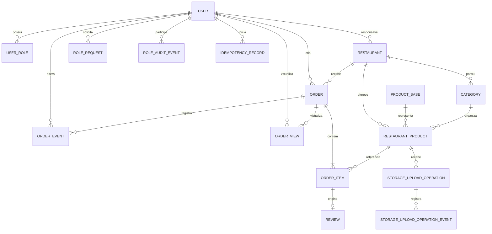

# NɅCO — Modelo de dados, relacionamentos e contratos de API

Este documento consolida o modelo lógico, as relações e os contratos de API já decididos para o MVP. Não é um schema Prisma, migrations executáveis nem uma especificação OpenAPI final. As entidades, regras, campos conceituais, rotas e convenções deste documento são a referência para essas entregas futuras; tipos físicos, índices/constraints concretos, exemplos completos de request/response e o arquivo `docs/api/openapi.yaml` ainda serão materializados durante a etapa de implementação e fechamento da API.

## 1. Entidades e atributos documentados

### 1.1. `User`

Representa a conta única da pessoa.

Atributos de referência já documentados: `id`, `name`, `email` (globalmente único), `password_hash`, `status`, `created_at`, `updated_at`.

Regras:
- Uma pessoa possui uma conta, independentemente dos papéis.
- A senha pertence à conta, não ao papel.
- Cadastro público atribui `CLIENTE` automaticamente.
- `RESPONSAVEL` é concedido após solicitação e aprovação; pode existir conta com esse papel sem restaurante.
- Existe uma única conta ADMIN, criada/manutenida manualmente no banco, sem cadastro público; senha em hash.
- ADMIN é exclusivo e não combina com CLIENTE ou RESPONSAVEL.
- Uma conta pode ter CLIENTE e RESPONSAVEL simultaneamente. No MVP não há seletor de identidade/papel no login: o mobile apresenta fluxos de cliente e o web apresenta gestão; cada operação exige validação do papel e do ownership no backend.

No MVP, `PATCH /api/me` altera somente `name`; `GET /api/me` consulta os dados da conta. O ciclo de sessão aprovado usa access JWT de 15 minutos e refresh token opaco/rotativo com validade máxima de 30 dias; os detalhes estão na seção 5 e no adendo de decisões complementares.

### 1.2. `UserRole`

Atributos: `user_id` FK para `User`; `role` em `CLIENTE`, `RESPONSAVEL` ou `ADMIN`.

Chave primária composta (`user_id`, `role`). Não pode haver papel duplicado para a conta. Restrição de exclusividade de ADMIN (sem combinação de papéis) e unicidade global de uma única conta ADMIN precisam ser impostas por regra/constraint compatível com o banco.

### 1.3. `RoleRequest`

Entidade lógica aprovada para persistir solicitações de papel `RESPONSAVEL`. Campos conceituais: `id`, `user_id`, `status`, `created_at`, `decided_at`, `decided_by` e `decision_reason` opcional. Estados: `PENDING`, `APPROVED` e `REJECTED`. Deve existir no máximo uma solicitação `PENDING` por usuário, garantida por índice único parcial no PostgreSQL. Após rejeição, o usuário aguarda 7 dias a partir de `decided_at` para nova solicitação. A aprovação e a concessão do papel ocorrem na mesma transação.

Rotas decididas: `POST /api/me/role-requests`, `GET /api/me/role-requests`, `GET /api/admin/role-requests?status=PENDING` e `PATCH /api/admin/role-requests/{id}` para aprovar/rejeitar. A forma física final e as migrations ainda serão implementadas.

### 1.4. `RoleAuditEvent`

Entidade lógica aprovada, append-only, com campos conceituais `id`, `actor_user_id`, `target_user_id`, `action`, `reason`, `metadata` JSONB e `created_at`. Audita `REQUEST_CREATED`, aprovação, rejeição, concessão e remoção de papel, além de transferência de responsável. Não editar nem apagar eventos pelo fluxo normal; a implementação física deve reforçar a imutabilidade por permissões de banco e/ou trigger.

A remoção do papel `RESPONSAVEL` não apaga restaurantes: ADMIN deve transferir cada restaurante para outro usuário que já tenha `RESPONSAVEL`; a remoção é bloqueada enquanto existir restaurante não transferido. Rotas decididas: `PATCH /api/admin/restaurants/{id}/responsible` e `DELETE /api/admin/users/{userId}/roles/RESPONSAVEL`. O schema e as migrations ainda serão implementados.

### 1.5. `Restaurant`

Atributos documentados: `id`, `responsible_user_id` FK para `User`, `public_name`, `legal_name` opcional, `cnpj` único, `description` opcional, `phone`, endereço (`cep`, `street`, `number`, `neighborhood`, `city`, `state`, `address_complement` opcional), `cuisine_category`, `timezone` IANA (inicial `America/Sao_Paulo`), `opening_hours` como grade semanal por dia ISO 1–7 com zero ou mais intervalos `opensAt`/`closesAt` (`HH:mm`), `logo` opcional, `cover_image` opcional, `publication_status` (`PUBLISHED`/`UNPUBLISHED`), `created_at`, `updated_at`. Feriados, exceções por data e fechamento temporário manual ficam fora do MVP.

Regras:
- Cada restaurante tem exatamente um responsável.
- Um responsável pode possuir vários restaurantes e pode existir sem nenhum.
- Cadastro não exige aprovação administrativa do restaurante.
- Novo restaurante começa `UNPUBLISHED`.
- Publicação e funcionamento são independentes. `operating_status` é derivado dos horários e não precisa ser persistido.
- Publicado e fechado pode ser exibido publicamente, mas não recebe pedido.
- Não despublicar quando houver pedido em `CRIADO`, `CONFIRMADO_RESTAURANTE`, `EM_PREPARO` ou `SAIU_PARA_ENTREGA`.
- Mesmo despublicado, o responsável mantém acesso ao painel/gestão.
- Remover o papel RESPONSAVEL não apaga restaurantes. Antes da remoção, ADMIN deve transferir todos os restaurantes para outro usuário que já possua o papel; sem transferência, a remoção é bloqueada.

### 1.6. `ProductBase`

Atributos documentados: `id`, `name`, `description`, `created_at`, `updated_at`. Representa conceito de produto compartilhável entre restaurantes. O nome da oferta exibido pelo restaurante fica em `RestaurantProduct.display_name`, não renomeando globalmente o `ProductBase`.

### 1.7. `RestaurantProduct`

Atributos documentados: `id`, `restaurant_id` FK, `product_base_id` FK, `category_id` FK, `display_name`, `normalized_name`, `price` (BRL, `DECIMAL(12,2)`), `stock_quantity`, `storage_key` opcional da imagem corrente, `provider_asset_id`, `provider_public_id`, `provider_version`, `status`, `created_at`, `updated_at`. `display_name` começa com `ProductBase.name`; `normalized_name` é derivado no servidor por Unicode NFKD, remoção de marcas diacríticas, trim, redução de espaços consecutivos e comparação independente de locale.

Regras:
- Cada restaurante controla preço, estoque, imagem e status de sua oferta.
- Estoque zero: visível e indisponível para compra.
- Preço > 0; estoque >= 0.
- Oferta pertence a um restaurante e a categoria desse mesmo restaurante.
- Alterações/exclusões não podem invalidar pedidos históricos.
- Produtos já usados em pedidos são desativados ou têm exclusão física restringida.
- RN-02 proíbe nome duplicado dentro do mesmo restaurante. A unicidade lógica é `(restaurant_id, normalized_name)` e vale também para ofertas desativadas; a constraint/índice físico será criado nas migrations.

### 1.8. `Category`

Atributos documentados: `id`, `restaurant_id` FK, `name`, `description` opcional, `display_order`, `status`. Nome/escopo da categoria pertencem ao restaurante; a integridade física que impede oferta de referenciar categoria de outro restaurante será aplicada no banco e backend.

Categorias pertencem a restaurante, são personalizadas por estabelecimento, e uma oferta só pode usar categoria do mesmo restaurante.

### 1.9. `Order`

Atributos documentados: `id`, `customer_id` FK para `User`, `restaurant_id` FK para `Restaurant`, `status`, `total`, `created_at`, `updated_at`.

Status canônicos: `CRIADO`, `CONFIRMADO_RESTAURANTE`, `EM_PREPARO`, `SAIU_PARA_ENTREGA`, `CONCLUIDO`, `RECUSADO`, `CANCELADO`.

Regras:
- Um pedido pertence a um restaurante.
- Cliente autenticado com `CLIENTE` cria o pedido.
- Restaurante precisa estar publicado e aberto no momento de receber o pedido.
- Pedido inicia `CRIADO`, tem ao menos um item e total igual à soma dos subtotais.
- Backend revalida preço e disponibilidade.
- Estoque baixa apenas na confirmação.
- Pedido recusado permanece no histórico do cliente.

### 1.10. `OrderItem`

Atributos: `id`, `order_id` FK, `restaurant_product_id` FK, `product_name` (snapshot), `unit_price` (snapshot), `quantity`, `subtotal`.

Restrições:
- Oferta deve ser do restaurante do pedido.
- Quantidade de 1 a 20.
- Não repetir produto em linhas diferentes do mesmo pedido: unicidade de (`order_id`, `restaurant_product_id`).
- `subtotal = unit_price × quantity`.
- Snapshots permanecem inalterados após mudanças do catálogo.

### 1.11. `Review`

Atributos: `id`, `order_item_id` FK, `rating`, `comment`, `created_at`, `updated_at`.

Decisões aprovadas:
- `PRODUCT_ONLY`.
- Uma avaliação (`ONE`) por item de pedido; unicidade de `order_item_id`.
- Comentário opcional; nota de 1 a 5.
- Só após `Order.status = CONCLUIDO`.
- Só pelo cliente dono do pedido que contém o item pode criar avaliação.
- Qualquer visitante pode consultar avaliações públicas do produto, sem autenticação; autor exibido como “Cliente verificado”, sem dados pessoais.
- Não duplicar `customer_id`, `order_id` ou `restaurant_id` em Review; obter por relacionamento.

**Contratos do MVP:** criação autenticada em `POST /api/order-items/{orderItemId}/reviews`; leitura pública paginada em `GET /api/products/{productId}/reviews`. O caminho legado `/api/restaurants/:id/reviews` não deve ser implementado como avaliação de restaurante.

### 1.12. `OrderView`

Registra a primeira visualização de um pedido por responsável, por meio da ação explícita `POST /api/orders/{orderId}/views`. Campos conceituais: `order_id`, `responsible_user_id`, `first_viewed_at`; unicidade `(order_id, responsible_user_id)`. Repetir a ação preserva a primeira data/hora. Carregar a lista de pedidos não cria visualização.

### 1.13. `OrderEvent`

Atributos: `id`, `order_id` FK, `previous_status`, `new_status`, `changed_by` FK para `User`, `created_at`.

Cada transição de status gera evento com estado anterior/novo, ator e timestamp.

### 1.14. `IdempotencyRecord`

Entidade lógica aprovada para registrar a intenção de criação de pedido. Deve persistir `user_id`, `idempotency_key`, hash do payload canônico, estado do processamento, status HTTP final, referência ao pedido quando houver, corpo mínimo de resposta/erro e timestamps de criação/expiração. Escopo de unicidade `(user_id, idempotency_key)`; o estado completo permanece por 24 horas e depois é reduzido a tombstone mínimo permanente. Chave expirada nunca pode ser reutilizada. Mesmo par chave/hash retorna o resultado original; mesmo usuário/chave com payload diferente retorna `409 IDEMPOTENCY_KEY_REUSED`.

Requisições simultâneas processam uma única operação; a segunda aguarda até 5 segundos sem manter lock/transação aberto. Se necessário, recebe `202 PROCESSING` e consulta `GET /api/orders/idempotency/{key}`. Chave própria expirada retorna 410; chave inexistente ou pertencente a outro usuário retorna 404. A forma física final e as migrations ainda serão implementadas.

### 1.15. `StorageUploadOperation`

Registra permanentemente os metadados de cada operação de upload, sem reter necessariamente os binários. Campos conceituais: `id`, `restaurant_product_id`, `storage_key`, `provider_asset_id`, `provider_public_id`, `provider_version`, estado atual, contagem/agenda de tentativas, timestamps e dados operacionais necessários a reconciliações. A operação usa `storage_key` única, mapeada pelo adapter para `public_id` exclusivo e imutável no Cloudinary.

Estados de consulta aprovados: `PENDING`, `UPLOADED`, `ASSOCIATED`, `CLEANUP_SCHEDULED`, `FAILED` e `RECONCILING`. A imagem anterior só deixa de ser a referência corrente após upload confirmado e atualização condicional bem-sucedida.

### 1.16. `StorageUploadOperationEvent`

Histórico separado, append-only. Campos conceituais: `id`, `upload_operation_id`, `event_type`, `details` JSONB, `actor_type`, `actor_user_id`, `process_instance_id` e `created_at`. `actor_type` aceita `USER`, `ADMIN` e `SYSTEM`; os identificadores de ator/processo ficam nulos quando não aplicáveis.

Eventos aprovados: `UPLOAD_REQUESTED`, `UPLOAD_STARTED`, `UPLOAD_COMPLETED`, `UPLOAD_ASSOCIATED`, `RECONCILIATION_STARTED`, `RECONCILIATION_RECOVERED`, `ORPHAN_DETECTED`, `CLEANUP_SCHEDULED`, `UPLOAD_FAILED`, `LEASE_CLAIMED` e `LEASE_EXPIRED`. Heartbeats atualizam campos operacionais e não geram eventos. `details` é estruturado por tipo de evento e não pode conter segredos.

### 1.17. `StorageDeletionOperation`

Controla uma operação persistente de exclusão de asset Cloudinary identificada por `storage_key` e `provider_asset_id`/`provider_public_id`. A unicidade é por chave lógica; chamadas repetidas reutilizam a operação. Registra tentativas, resposta sanitizada de `destroy` com `invalidate=true` e reconciliação da existência do asset. Não modelar ID/status de purge nem confirmação de propagação global, pois não há consulta padrão para isso. Estados lógicos recomendados: `PENDING`, `DELETE_REQUESTED`, `PROVIDER_DELETE_ACCEPTED`, `FAILED` e `RECONCILIATION_REQUIRED`; aceite do provedor não equivale a purge global confirmado. A forma física final será implementada nas migrations.

## 2. Relacionamentos conceituais

`RoleRequest`, `RoleAuditEvent`, `OrderView` e `IdempotencyRecord` são entidades lógicas aprovadas e aparecem no ERD conceitual; o schema físico e suas migrations ainda serão implementados. `StorageDeletionOperation` também é entidade lógica aprovada, com estados específicos do adapter Cloudinary ainda sujeitos a implementação e validação.

## 3. Restrições e índices conceituais aprovados

| Restrição | Entidade/campo | Observação |
|---|---|---|
| E-mail global único | `User.email` | Banco e backend. |
| Papel sem duplicidade | `UserRole(user_id, role)` | PK composta. |
| ADMIN exclusivo | Regra entre linhas `UserRole` do mesmo usuário | Não combinar ADMIN com outros papéis; trigger/regra transacional no PostgreSQL e validação no serviço. |
| Uma única conta ADMIN | Global | Índice único parcial sobre o papel `ADMIN`; criação manual protegida. |
| Uma solicitação PENDING por usuário | `RoleRequest(user_id)` | Índice único parcial `WHERE status = 'PENDING'`. |
| Auditoria append-only | `RoleAuditEvent` | Fluxo normal não edita/remove; reforçar por privilégios de banco e/ou trigger. |
| CNPJ único | `Restaurant.cnpj` | Banco e backend. |
| Preço positivo e precisão | `RestaurantProduct.price` | BRL em `DECIMAL(12,2)`; API transmite string decimal; rejeitar mais de duas casas com 422. |
| Estoque não negativo | `RestaurantProduct.stock_quantity` | Banco/backend. |
| Oferta/categoria no mesmo restaurante | `RestaurantProduct.restaurant_id` / `category_id` e `Category.restaurant_id` | Integridade lógica aprovada; constraint física será materializada nas migrations. |
| Quantidade entre 1 e 20 | `OrderItem.quantity` | Banco/backend. |
| Um registro por produto no pedido | `OrderItem(order_id, restaurant_product_id)` | Restrição única aprovada. |
| Pedido com ao menos um item | `Order` / `OrderItem` | Garantia por backend/transação. |
| Subtotal consistente | `OrderItem` | `DECIMAL(12,2)`; subtotal = `unit_price × quantity`; total = soma dos subtotais. Sem float binário. |
| Rating 1–5 | `Review.rating` | Banco/backend. |
| Uma review por item | `Review.order_item_id` | Restrição única aprovada; leitura pública não expõe dados pessoais do autor. |
| Nome único no restaurante | `RestaurantProduct(restaurant_id, normalized_name)` | Inclui ofertas desativadas; normalização derivada no backend. |
| Primeira visualização por responsável | `OrderView(order_id, responsible_user_id)` | Chave única composta; `first_viewed_at` não é sobrescrito. |
| Idempotência por usuário | `(user_id, idempotency_key)` | Constraint única obrigatória; registro mínimo não expira enquanto sistema existir. |
| Chave lógica do upload | `StorageUploadOperation.storage_key` | Única por operação de upload; mapeada pelo adapter para `public_id` imutável no Cloudinary. |
| Operação de exclusão | `StorageDeletionOperation.storage_key` | Uma única operação por chave; pedidos repetidos reutilizam o registro e o `asset_id` é usado para exclusão. |
| Histórico de upload | `StorageUploadOperationEvent` | Append-only; `details` JSONB por tipo de evento. |
| Transições válidas | `Order.status` + `OrderEvent` | Backend; conciliação com estado persistido. |

## 4. Estados e transações

- **Criação:** `IdempotencyRecord`, `Order` e `OrderItem` são gravados na mesma transação. Falha antes do commit reverte tudo. Estoque não é reservado nem baixado nesta transação.
- **Confirmação:** bloquear ofertas em ordem determinística de ID, revalidar todas as quantidades e atualizar estoque + status + `OrderEvent` em uma única transação. Falha de estoque causa rollback integral e mantém pedido `CRIADO`.
- **Recusa:** `CRIADO` → `RECUSADO` altera status e registra evento, sem baixar estoque.
- **Cancelamento após confirmação:** status + `OrderEvent` + restauração integral do estoque na mesma transação; somente uma primeira transição elegível pode restaurar.
- Transições concorrentes usam update condicional/controle de versão para que apenas uma ação válida persista.

**QU-60 está resolvida pelo adendo:** atomicidade é assegurada em duas fronteiras transacionais coerentes com a regra aprovada de estoque: (1) idempotência + criação do pedido/itens; (2) estoque + transição + evento na confirmação/cancelamento. Não há baixa na criação.

## 5. Endpoints preservados e aprovados

### 5.1. Rotas originais preservadas

| Método | Rota | Finalidade original | Acesso descrito | Estado |
|---|---|---|---|---|
| POST | `/api/auth/register` | Criar conta | Público, com rate limiting e proteção contra SQL injection | Preservada; CLIENTE automático. |
| POST | `/api/auth/login` | Iniciar sessão | Público, com rate limiting e proteção contra SQL injection | Preservada. |
| POST | `/api/auth/refresh` | Renovar access token e rotacionar refresh token | Sessão válida | Aprovada; refresh opaco, rotativo, validade máxima de 30 dias. |
| POST | `/api/auth/logout` | Encerrar sessão | Autenticado | Revoga refresh/session no servidor e limpa dados locais. |
| GET | `/api/me` | Consultar perfil | Autenticado | Retorna dados da conta; nunca inclui hash/senha/token. |
| PATCH | `/api/me` | Atualizar perfil | Autenticado | No MVP altera somente `name`; e-mail não editável. |
| GET | `/api/restaurants` | Listar estabelecimentos | Público | Preservada. |
| GET | `/api/restaurants/:id` | Consultar estabelecimento | Público | Preservada. |
| GET | `/api/restaurants/:id/products` | Consultar catálogo | Público | Preservada. |
| POST | `/api/restaurants/:id/products` | Criar produto | Responsável do estabelecimento | Preservada; operação de oferta vinculada ao restaurante. |
| PATCH | `/api/products/:id` | Atualizar produto | Responsável do estabelecimento | Preservada. |
| DELETE | `/api/products/:id` | Excluir ou desativar produto | Responsável do estabelecimento | Preservada; preservar histórico. |
| POST | `/api/order-items/{orderItemId}/reviews` | Criar avaliação de produto | Cliente autenticado, dono do pedido concluído | Uma por OrderItem; nota 1–5; comentário opcional. |
| GET | `/api/products/{productId}/reviews` | Consultar avaliações públicas | Público, sem autenticação | Resposta paginada; autor exibido como “Cliente verificado”, sem dados pessoais. |
| POST | `/api/orders/create` | Criar pedido | Cliente autenticado | Preservada; `Idempotency-Key` passa a ser requisito do contrato. |
| GET | `/api/orders` | Consultar pedidos do cliente | Cliente autenticado | Preservada. |
| GET | `/api/restaurants/{restaurantId}/orders` | Consultar pedidos do restaurante | Responsável autenticado e autorizado naquele restaurante | Lista paginada/resumida; não altera pedido. |
| GET | `/api/me/orders/inbox` | Consultar inbox consolidada | RESPONSAVEL | Pedidos de todos os restaurantes gerenciados; mesmos filtros/ordenação. |
| GET | `/api/orders/{orderId}` | Consultar detalhes e eventos | Cliente dono do pedido ou responsável autorizado | Leitura pura; não marca visualização. |
| POST | `/api/orders/{orderId}/views` | Marcar primeira visualização | Responsável autorizado | Idempotente por pedido/responsável; mantém `first_viewed_at`. |
| PATCH | `/api/orders/{orderId}/status` | Alterar estado do pedido | Responsável/cliente conforme matriz de transição | Único contrato de transição; valida estado, ator e estoque atomicamente. |
| GET | `/api/restaurant/dashboard?restaurantId={restaurantId}` | Consultar indicadores | Responsável autorizado no restaurante | Métricas aprovadas: produtos vendidos e avaliações recebidas; período default 30 dias, máximo 365. |

### 5.2. Endpoints de gerenciamento de restaurantes aprovados

| Método | Endpoint | Finalidade | Autorização | Contrato/resposta registrado |
|---|---|---|---|---|
| POST | `/api/restaurants` | Cadastrar restaurante do usuário autenticado | RESPONSAVEL | 201; responsável identificado pela autenticação, nunca pelo body; começa `UNPUBLISHED`. |
| GET | `/api/me/restaurants` | Listar restaurantes do responsável | RESPONSAVEL | 200; apenas restaurantes próprios, publicados ou despublicados; lista vazia se nenhum. |
| GET | `/api/restaurants/{id}/management` | Consultar dados para gestão | Responsável daquele restaurante | 200; acessível mesmo despublicado. |
| PATCH | `/api/restaurants/{id}` | Atualizar dados cadastrais parcialmente | Responsável autorizado | 200; campos omitidos permanecem inalterados; não muda publicação automaticamente. |
| PATCH | `/api/restaurants/{id}/publication` | Publicar/despublicar | Responsável autorizado | 200; despublicação bloqueada com pedidos ativos. |

### 5.3. Solicitações e administração de papéis

| Método | Endpoint | Finalidade | Autorização | Regra principal |
|---|---|---|---|---|
| POST | `/api/me/role-requests` | Solicitar papel RESPONSAVEL | Conta autenticada | Uma solicitação PENDING por usuário; cooldown de 7 dias após rejeição. |
| GET | `/api/me/role-requests` | Consultar próprias solicitações | Conta autenticada | Não permite consultar solicitações de terceiros. |
| GET | `/api/admin/role-requests?status=PENDING` | Listar solicitações | ADMIN | Consulta administrativa auditável. |
| PATCH | `/api/admin/role-requests/{id}` | Aprovar/rejeitar | ADMIN | Aprovação + concessão do papel na mesma transação; registrar auditoria. |
| PATCH | `/api/admin/restaurants/{id}/responsible` | Transferir responsável | ADMIN | Novo responsável deve possuir `RESPONSAVEL`; registrar auditoria. |
| DELETE | `/api/admin/users/{userId}/roles/RESPONSAVEL` | Remover papel | ADMIN | Bloquear se ainda houver restaurante não transferido. |

### 5.4. Endpoints administrativos de consulta de uploads aprovados (Q70)

| Método | Endpoint | Finalidade | Autorização | Observação |
|---|---|---|---|---|
| GET | `/api/admin/storage/upload-operations` | Listar operações de upload | ADMIN | Filtros por estado e período; nomes/tipos dos parâmetros serão especificados na OpenAPI. |
| GET | `/api/admin/storage/upload-operations/{id}` | Detalhar operação e eventos | ADMIN | Consulta/investigação; não reprocessa upload sem arquivo original. |

Os endpoints de gestão de restaurante, papéis e mídia usam os códigos HTTP consolidados na seção 5.7. O contrato HTTP de upload pelo responsável e o mecanismo operacional de reprocessamento de exclusão ainda não foram aprovados; não inventar essas rotas.

### 5.5. Endpoint de idempotência aprovado

`GET /api/orders/idempotency/{key}`

A escolha de endpoint específico foi aprovada na QU-52. Exige autenticação e verifica titularidade de `user_id + key`; retorna estado e resultado quando disponível, sem recriar pedido ou alterar estoque.

### 5.6. Cabeçalho de criação idempotente

`POST /api/orders/create` deve receber o cabeçalho `Idempotency-Key`, gerado pelo cliente para cada intenção lógica de compra. Uma nova intenção deve gerar nova chave. A chave é associada ao usuário autenticado; o usuário não define `user_id` no body para esse vínculo.

### 5.7. Convenções de erro aprovadas para o MVP

O adendo complementar já consolidou os códigos e o envelope de erro. A implementação e a OpenAPI devem seguir esta tabela, sem manter exemplos numéricos antigos como convenção ativa:

| HTTP | Uso | Regra |
|---:|---|---|
| 400 | Sintaxe/JSON malformado ou cabeçalho obrigatório ausente | A requisição não pode ser interpretada. |
| 401 | Autenticação ausente, inválida ou sessão expirada | Não revela dados protegidos. |
| 403 | Usuário autenticado sem papel geral necessário | Recurso fora do escopo/ownership retorna 404 para não revelar existência. |
| 404 | Recurso inexistente ou fora do escopo do usuário | Também usado para chave idempotente desconhecida ou de outro usuário. |
| 409 | Conflito de negócio, estoque, transição, duplicidade ou chave reutilizada com payload distinto | `error.code` simbólico específico. |
| 410 | Tombstone idempotente expirado do próprio usuário | Não permite reutilizar a chave. |
| 422 | JSON válido com campos/valores semanticamente inválidos | Incluir detalhes de validação sem dados sensíveis. |
| 429 | Rate limit | Incluir `Retry-After` quando aplicável. |
| 500 | Erro interno inesperado | Sem stack trace/detalhes internos ao cliente. |
| 503 | Dependência/serviço temporariamente indisponível | Mensagem compreensível; sem sucesso simulado. |

Envelope: `{ "error": { "code": "INSUFFICIENT_STOCK", "message": "...", "details": [], "requestId": "..." } }`. `error.code` é estável e simbólico; não deve repetir o número HTTP.

## 6. Contratos e DTOs consolidados para a futura OpenAPI

| Ponto | Decisão vigente | Estado do artefato |
|---|---|---|
| Campos e casing | JSON externo em `camelCase`; persistência pode usar `snake_case`; `status` é canônico. | Decidido; refletir no OpenAPI. |
| Oferta/produto | `restaurantProductId` identifica oferta; `price` é preço de catálogo; `unitPrice` é snapshot. | Decidido; refletir nos schemas. |
| Dinheiro | BRL; strings decimais na API; `DECIMAL(12,2)` no banco. | Decidido; implementar sem float binário. |
| Horários | `timezone` IANA e grade semanal com dias ISO 1–7 e intervalos locais `HH:mm`. | Decidido; implementar validação inclusive virada de dia. |
| Avaliações | `POST /api/order-items/{orderItemId}/reviews`; `GET /api/products/{productId}/reviews` público e paginado. | Decidido; rota de reviews de restaurante substituída. |
| Pedidos recebidos | GET lista/detalhes puros; POST views registra leitura; PATCH status altera estado. | Decidido; preservar semântica HTTP. |
| Dashboard | `GET /api/restaurant/dashboard?restaurantId={restaurantId}`; período default 30 dias, máximo 365, timezone do restaurante. | Decidido; autorização por restaurante. |
| Sessão | Access JWT 15 min; refresh opaco rotativo até 30 dias; logout revoga sessão. | Decidido; implementar rotação/reuso. |
| Idempotência | UUID v4 no header `Idempotency-Key`; 24 h corpo completo; tombstone permanente; mesma key/diferente payload = 409; consulta 200/404/410. | Decidido; implementar persistência/contratos. |
| Erros | Envelope simbólico e códigos 400/401/403/404/409/410/422/429/500/503. | Decidido; OpenAPI deve ser a fonte executável de contrato. |
| Upload de imagem | Cloudinary via `StoragePort`; path HTTP para upload de responsável e endpoint de reprocessamento de exclusão não foram aprovados. | Adapter e operações a implementar; não inventar rotas. |
| Categorias | Categoria é própria do restaurante; endpoint dedicado ainda não está formalizado. | Fechar forma de exposição/gestão antes do freeze da API. |

## 7. O que falta materializar durante o desenvolvimento

- `docs/api/openapi.yaml` ainda será criado a partir das rotas, DTOs e convenções já decididos neste documento e no adendo. Sua ausência nesta entrega é intencional e não significa ausência de decisões de API.
- Schema Prisma/PostgreSQL, migrations, índices, constraints e seeds ainda serão implementados; as entidades e regras lógicas aprovadas acima não devem ser reabertas por causa disso.
- Implementar e testar autenticação, pedidos, papéis, avaliações públicas, catálogo, horários, dashboard e StoragePort conforme os contratos já aprovados.
- Fechar apenas os contratos não especificados explicitamente: gestão de categorias, upload de imagem do responsável, reprocessamento administrativo de exclusão Cloudinary e parâmetros dos filtros administrativos de mídia.
- Para mídia, concluir campos físicos e eventos JSONB, limites de recursos, qualidade WebP, frequência/cache da consulta Admin API Usage e comportamento com dados de uso atrasados/indisponíveis, conforme o documento de imagens.
- Definir política de moderação/denúncia e retenção de avaliações públicas antes de abrir publicação irrestrita, sem expor dados pessoais; isso não altera o acesso público já aprovado.

Estas atividades são entregas futuras de documentação executável/código/operação, não decisões de produto em aberto.