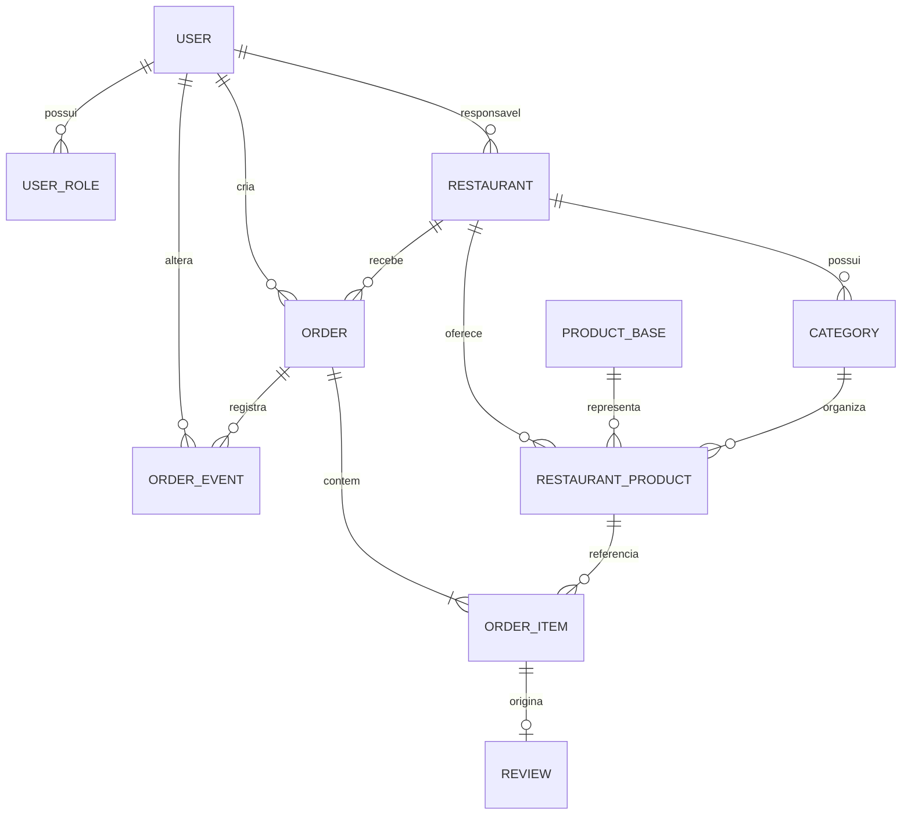

# NɅCO — Modelo de dados, relacionamentos e contratos de API

Este documento consolida o modelo conceitual existente e as decisões aprovadas. Não é um schema Prisma nem uma especificação OpenAPI final. Tipos físicos, nomes definitivos de alguns atributos, índices e alguns DTOs permanecem pendentes.

## 1. Entidades e atributos documentados

### 1.1. `User`

Representa a conta única da pessoa.

Atributos de referência já documentados: `id`, `name`, `email` (globalmente único), `password_hash`, `status`, `created_at`, `updated_at`.

Regras:
- Uma pessoa possui uma conta, independentemente dos papéis.
- A senha pertence à conta, não ao papel.
- Cadastro público atribui `CLIENTE` automaticamente.
- `RESPONSAVEL` é concedido após solicitação e aprovação; pode existir conta com esse papel sem restaurante.
- Existe uma única conta ADMIN, criada/manutenida manualmente no banco, sem cadastro público; senha em hash.
- ADMIN é exclusivo e não combina com CLIENTE ou RESPONSAVEL.

Não estão definidos todos os campos do perfil editável nem o ciclo de vida completo da sessão JWT.

### 1.2. `UserRole`

Atributos: `user_id` FK para `User`; `role` em `CLIENTE`, `RESPONSAVEL` ou `ADMIN`.

Chave primária composta (`user_id`, `role`). Não pode haver papel duplicado para a conta. Restrição de exclusividade de ADMIN (sem combinação de papéis) e unicidade global de uma única conta ADMIN precisam ser impostas por regra/constraint compatível com o banco.

### 1.3. Solicitação de papel RESPONSAVEL — estrutura lógica, schema pendente

Decisões de processo aprovadas: solicitação pelo usuário; aprovação/rejeição administrativa; cooldown de 7 dias após rejeição; remoção do papel por ADMIN; auditoria de concessões, remoções, aprovações e rejeições.

Ainda não foi aprovada uma entidade física, nome de tabela, campos, estados persistidos, endpoint ou regra para impedir várias solicitações pendentes simultâneas. Portanto, esta seção não declara `RoleRequest` como entidade aprovada; identifica uma necessidade lógica de persistência a detalhar.

### 1.4. Auditoria de papéis — estrutura lógica, schema pendente

Ações auditadas: concessão/remoção de papel, aprovação e rejeição. A auditoria da criação de uma solicitação ainda não foi decidida. Nome da entidade/tabela, atributos, retenção e endpoint de consulta não estão definidos.

### 1.5. `Restaurant`

Atributos documentados: `id`, `responsible_user_id` FK para `User`, `public_name`, `legal_name` opcional, `cnpj` único, `description` opcional, `phone`, endereço (`cep`, `street`, `number`, `neighborhood`, `city`, `state`, `address_complement` opcional), `cuisine_category`, `opening_hours` (estrutura pendente), `logo` opcional, `cover_image` opcional, `publication_status` (`PUBLISHED`/`UNPUBLISHED`), `created_at`, `updated_at`.

Regras:
- Cada restaurante tem exatamente um responsável.
- Um responsável pode possuir vários restaurantes e pode existir sem nenhum.
- Cadastro não exige aprovação administrativa do restaurante.
- Novo restaurante começa `UNPUBLISHED`.
- Publicação e funcionamento são independentes. `operating_status` é derivado dos horários e não precisa ser persistido.
- Publicado e fechado pode ser exibido publicamente, mas não recebe pedido.
- Não despublicar quando houver pedido em `CRIADO`, `CONFIRMADO_RESTAURANTE`, `EM_PREPARO` ou `SAIU_PARA_ENTREGA`.
- Mesmo despublicado, o responsável mantém acesso ao painel/gestão.
- Remover o papel RESPONSAVEL não apaga automaticamente restaurantes. O estado de propriedade/acesso após remoção ainda precisa ser decidido.

### 1.6. `ProductBase`

Atributos documentados: `id`, `name`, `description`, `created_at`, `updated_at`. Representa conceito de produto compartilhável entre restaurantes.

### 1.7. `RestaurantProduct`

Atributos documentados: `id`, `restaurant_id` FK, `product_base_id` FK, `category_id` FK, `price`, `stock_quantity`, `image` opcional, `status`, `created_at`, `updated_at`.

Regras:
- Cada restaurante controla preço, estoque, imagem e status de sua oferta.
- Estoque zero: visível e indisponível para compra.
- Preço > 0; estoque >= 0.
- Oferta pertence a um restaurante e a categoria desse mesmo restaurante.
- Alterações/exclusões não podem invalidar pedidos históricos.
- Produtos já usados em pedidos são desativados ou têm exclusão física restringida.
- RN-02 proíbe nome duplicado dentro de restaurante, mas normalização e ponto exato da constraint ainda estão pendentes.

### 1.8. `Category`

Atributos documentados: `id`, `restaurant_id` FK, `name`, `description` opcional, `display_order`, `status`.

Categorias pertencem a restaurante, são personalizadas por estabelecimento, e uma oferta só pode usar categoria do mesmo restaurante.

### 1.9. `Order`

Atributos documentados: `id`, `customer_id` FK para `User`, `restaurant_id` FK para `Restaurant`, `status`, `total`, `created_at`, `updated_at`.

Status canônicos: `CRIADO`, `CONFIRMADO_RESTAURANTE`, `EM_PREPARO`, `SAIU_PARA_ENTREGA`, `CONCLUIDO`, `RECUSADO`, `CANCELADO`.

Regras:
- Um pedido pertence a um restaurante.
- Cliente autenticado com `CLIENTE` cria o pedido.
- Restaurante precisa estar publicado e aberto no momento de receber o pedido.
- Pedido inicia `CRIADO`, tem ao menos um item e total igual à soma dos subtotais.
- Backend revalida preço e disponibilidade.
- Estoque baixa apenas na confirmação.
- Pedido recusado permanece no histórico do cliente.

### 1.10. `OrderItem`

Atributos: `id`, `order_id` FK, `restaurant_product_id` FK, `product_name` (snapshot), `unit_price` (snapshot), `quantity`, `subtotal`.

Restrições:
- Oferta deve ser do restaurante do pedido.
- Quantidade de 1 a 20.
- Não repetir produto em linhas diferentes do mesmo pedido: unicidade de (`order_id`, `restaurant_product_id`).
- `subtotal = unit_price × quantity`.
- Snapshots permanecem inalterados após mudanças do catálogo.

### 1.11. `Review`

Atributos: `id`, `order_item_id` FK, `rating`, `comment`, `created_at`, `updated_at`.

Decisões aprovadas:
- `PRODUCT_ONLY`.
- Uma avaliação (`ONE`) por item de pedido; unicidade de `order_item_id`.
- Comentário opcional; nota de 1 a 5.
- Só após `Order.status = CONCLUIDO`.
- Só pelo cliente dono do pedido que contém o item.
- Não duplicar `customer_id`, `order_id` ou `restaurant_id` em Review; obter por relacionamento.

**Impacto pendente:** RF-02 foi decidido como avaliação de produto, mas endpoint original `/api/restaurants/:id/reviews` sugere avaliação do restaurante. Não renomear nem alterar o contrato até aprovação explícita do caminho/estrutura correto.

### 1.12. `OrderEvent`

Atributos: `id`, `order_id` FK, `previous_status`, `new_status`, `changed_by` FK para `User`, `created_at`.

Cada transição de status gera evento com estado anterior/novo, ator e timestamp.

### 1.13. Registro idempotente — estrutura lógica, schema físico pendente

Decisões aprovadas exigem persistir, no mínimo, a combinação do usuário e da chave, hash do payload canônico, estado do processamento e referência/resultado do pedido. Chaves expiradas preservam registro mínimo/tombstone permanentemente enquanto o sistema existir.

- Escopo de unicidade: `user_id + idempotency_key`.
- Retenção do estado completo: 24 horas.
- Tombstone: permanente durante a vida útil do sistema.
- Uma chave expirada não pode ser reutilizada.
- Payload distinto com a mesma chave gera HTTP 409.
- A operação repetida não duplica pedido/consumo.

O nome físico da tabela, tipos/colunas, estratégia de partição/índices e política de migração não foram aprovados; precisam ser definidos no schema físico sem alterar as regras acima.

## 2. Relacionamentos conceituais

Solicitações de papel, auditoria administrativa e registro idempotente são necessidades lógicas aprovadas, mas sua entidade/tabela física ainda não está definida; por isso não aparecem como entidades confirmadas no ERD.

## 3. Restrições e índices conceituais aprovados

| Restrição | Entidade/campo | Observação |
|---|---|---|
| E-mail global único | `User.email` | Banco e backend. |
| Papel sem duplicidade | `UserRole(user_id, role)` | PK composta. |
| ADMIN exclusivo | Regra entre linhas `UserRole` do mesmo usuário | Não combinar ADMIN com outros papéis. |
| Uma única conta ADMIN | Global | Mantida pelo desenvolvedor; forma física de garantir unicidade deve ser definida. |
| CNPJ único | `Restaurant.cnpj` | Banco e backend. |
| Preço positivo | `RestaurantProduct.price` | Banco/backend; escala monetária pendente. |
| Estoque não negativo | `RestaurantProduct.stock_quantity` | Banco/backend. |
| Oferta/categoria no mesmo restaurante | `RestaurantProduct.restaurant_id` / `category_id` e `Category.restaurant_id` | Integridade lógica aprovada; implementação física da constraint pendente. |
| Quantidade entre 1 e 20 | `OrderItem.quantity` | Banco/backend. |
| Um registro por produto no pedido | `OrderItem(order_id, restaurant_product_id)` | Restrição única aprovada. |
| Pedido com ao menos um item | `Order` / `OrderItem` | Garantia por backend/transação. |
| Subtotal consistente | `OrderItem` | Fórmula definida; representação decimal e arredondamento pendentes. |
| Rating 1–5 | `Review.rating` | Banco/backend. |
| Uma review por item | `Review.order_item_id` | Restrição única aprovada. |
| Idempotência por usuário | `(user_id, idempotency_key)` | Constraint única obrigatória; registro mínimo não expira enquanto sistema existir. |
| Transições válidas | `Order.status` + `OrderEvent` | Backend; conciliação com estado persistido. |

## 4. Estados e transações

- A criação do pedido persiste `Order`, `OrderItem` e o registro idempotente conforme a regra QU-60 a esclarecer. Estoque **não** é baixado na criação.
- `CRIADO` → `CONFIRMADO_RESTAURANTE`: verificar novamente estoque, baixar itens e mudar status em transação atômica; registrar `OrderEvent`.
- `CRIADO` → `RECUSADO`: mudar status e evento; não baixar estoque.
- Cancelamento após confirmação: mudança de status, evento e restauração de estoque sem duplicidade.
- Transições concorrentes exigem controle para que apenas transições válidas persistam.

**Ponto de aprovação necessário:** QU-60 cita atomicidade do registro idempotente, pedido e operações relacionadas ao estoque. Isso precisa ser compatibilizado com a regra anterior de baixa somente na confirmação. Não assumir que a criação do pedido baixa estoque. Ver relatório comparativo.

## 5. Endpoints preservados e aprovados

### 5.1. Rotas originais preservadas

| Método | Rota | Finalidade original | Acesso descrito | Estado |
|---|---|---|---|---|
| POST | `/api/auth/register` | Criar conta | Público, com rate limiting e proteção contra SQL injection | Preservada; CLIENTE automático. |
| POST | `/api/auth/login` | Iniciar sessão | Público, com rate limiting e proteção contra SQL injection | Preservada. |
| POST | `/api/auth/logout` | Encerrar sessão | Autenticado | Preservada; efeito sobre JWT depende da política de sessão. |
| GET | `/api/restaurants` | Listar estabelecimentos | Público | Preservada. |
| GET | `/api/restaurants/:id` | Consultar estabelecimento | Público | Preservada. |
| GET | `/api/restaurants/:id/products` | Consultar catálogo | Público | Preservada. |
| POST | `/api/restaurants/:id/products` | Criar produto | Responsável do estabelecimento | Preservada; operação de oferta vinculada ao restaurante. |
| PATCH | `/api/products/:id` | Atualizar produto | Responsável do estabelecimento | Preservada. |
| DELETE | `/api/products/:id` | Excluir ou desativar produto | Responsável do estabelecimento | Preservada; preservar histórico. |
| POST | `/api/restaurants/:id/reviews` | Criar avaliação | Cliente autenticado | Preservada como referência original, mas sem contrato compatibilizado com PRODUCT_ONLY. |
| POST | `/api/orders/create` | Criar pedido | Cliente autenticado | Preservada; `Idempotency-Key` passa a ser requisito do contrato. |
| GET | `/api/orders/` | Consultar pedidos do cliente | Cliente autenticado | Preservada. |
| GET | `/api/restaurants/:restaurantId/orders` | “Receber e aceitar pedido” | “Cliente proprietário” | Preservada sem mudança; ator, método e finalidade estão em conflito e precisam de aprovação. |
| GET | `/api/restaurant/dashboard` | Consultar resumo do painel | Responsável autorizado | Preservada; métricas/DTO pendentes. |

### 5.2. Endpoints de gerenciamento de restaurantes aprovados

| Método | Endpoint | Finalidade | Autorização | Contrato/resposta registrado |
|---|---|---|---|---|
| POST | `/api/restaurants` | Cadastrar restaurante do usuário autenticado | RESPONSAVEL | 201; responsável identificado pela autenticação, nunca pelo body; começa `UNPUBLISHED`. |
| GET | `/api/me/restaurants` | Listar restaurantes do responsável | RESPONSAVEL | 200; apenas restaurantes próprios, publicados ou despublicados; lista vazia se nenhum. |
| GET | `/api/restaurants/{id}/management` | Consultar dados para gestão | Responsável daquele restaurante | 200; acessível mesmo despublicado. |
| PATCH | `/api/restaurants/{id}` | Atualizar dados cadastrais parcialmente | Responsável autorizado | 200; campos omitidos permanecem inalterados; não muda publicação automaticamente. |
| PATCH | `/api/restaurants/{id}/publication` | Publicar/despublicar | Responsável autorizado | 200; despublicação bloqueada com pedidos ativos. |

Códigos documentados para esses endpoints: 400, 401, 403, 404, 409 e 500. A padronização geral entre esses códigos e exemplos antigos 422 permanece pendente.

### 5.3. Endpoint de idempotência aprovado

`GET /api/orders/idempotency/{key}`

A escolha de endpoint específico foi aprovada na QU-52. Exige autenticação e verifica titularidade de `user_id + key`; retorna estado e resultado quando disponível, sem recriar pedido ou alterar estoque.

### 5.4. Cabeçalho de criação idempotente

`POST /api/orders/create` deve receber o cabeçalho `Idempotency-Key`, gerado pelo cliente para cada intenção lógica de compra. Uma nova intenção deve gerar nova chave. A chave é associada ao usuário autenticado; o usuário não define `user_id` no body para esse vínculo.

### 5.5. Convenções de erro presentes na documentação-base

Os exemplos/contratos originais apresentam mais de uma convenção, que permanece preservada até uma decisão de padronização:

| Contexto de origem | HTTP apresentado | Observação |
|---|---:|---|
| Validação de cadastro de produto (exemplo) | 422 | Exemplo usa `error.code` como texto numérico (`"422"`) e `fields`. |
| Login inválido (exemplo) | 401 | Exemplo usa `error.code` como texto numérico (`"401"`). |
| Sem conexão/disponibilidade de comunicação (exemplo) | 503 | Mensagem ao cliente deve ser compreensível; não simular sucesso. |
| Contrato de gerenciamento de restaurante | 400, 401, 403, 404, 409, 500 | Exemplo de tratamento inclui códigos sem padronização com as respostas gerais. |

Esta consolidação não escolhe 400 ou 422 para validação, nem 403 ou 404 para recurso alheio/inexistente, e não altera o formato de `error.code`. Os conflitos devem ser resolvidos antes de congelar os contratos da API.

## 6. Impactos em DTOs e contratos — sem decisão inventada

| Ponto | Impacto identificado | Tratamento nesta revisão |
|---|---|---|
| `Review` | RF-02 agora é PRODUCT_ONLY, mas rota original usa `/restaurants/:id/reviews`. | Registrar conflito e pedir aprovação para alterar/marcar a rota correta; não criar caminho alternativo. |
| `Order` | `POST /api/orders/create` exige `Idempotency-Key`. | Incorporar cabeçalho como condição de criação; body exato continua baseado em campos já definidos. |
| Consulta idempotência | Endpoint novo foi explicitamente escolhido na QU-52. | Registrar rota e autenticação/ownership; campos exatos da resposta pendentes. |
| `situation` versus `status` | Exemplo de produto usa `situation: active`; modelo usa `status`. | Não mapear ou renomear até decisão. |
| `productId` versus `restaurant_product_id` | API exemplo usa `productId`; modelo relaciona oferta por `restaurant_product_id`. | DTO e mapeamento permanecem pendentes. |
| `price` versus `unit_price` | API exemplo usa `price`; modelo de `OrderItem` usa snapshot `unit_price`. | Não substituir campos unilateralmente. |
| Erros | Exemplos mostram 422, 401, 503; contrato de gerenciamento lista 400/401/403/404/409/500. | Preservar referências e deixar padronização pendente. |
| `opening_hours` | Está na entidade, mas estrutura não entra no contrato de criação atual. | Não adicionar campos sem decisão da estrutura de horários. |
| Status | Texto original usa `CONCLUÍDO`; modelo usa `CONCLUIDO`. | Forma canônica no domínio/API/persistência é `CONCLUIDO`, conforme decisão aprovada. |
| Criação/decisão de papel | Fluxo de request/approval foi aprovado, mas endpoint/schema não. | Não criar endpoint nem DTO sem decisão. |

## 7. Pendências de modelagem e API

- Schema da solicitação de papel RESPONSAVEL, incluindo múltiplas solicitações pendentes e auditoria da criação.
- Modelo de auditoria para concessões, remoções, aprovações e rejeições.
- Política operacional quando RESPONSAVEL perde papel e tem restaurantes.
- Schema físico do registro idempotente e tombstones.
- Solução para atomicidade QU-60 sem deslocar a baixa de estoque para a criação do pedido.
- Formato exato do 202, identificador/referência, corpo do endpoint de consulta e status para chaves ausentes/expiradas.
- Contrato da operação de pedidos recebidos/aceitação pelo restaurante.
- Contrato da avaliação PRODUCT_ONLY.
- DTOs de produtos, perfil, carrinho e painel.
- Estrutura `opening_hours` e atributos associados.
- Índices/constraints físicas para integridade entre categoria e oferta.
- Contrato unificado de erros HTTP.
