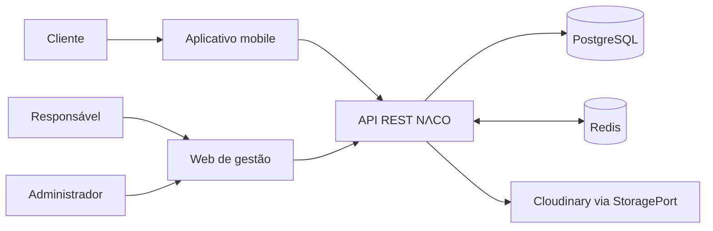
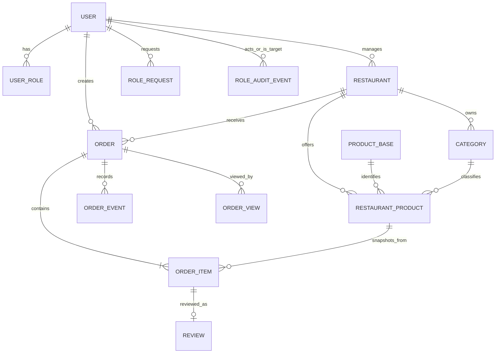

> **Status documental:** versão consolidada para orientar o início da implementação. Este documento descreve decisões aprovadas, padrões técnicos do adendo e pendências que precisam de resolução antes do congelamento da API. Não é evidência de implementação, homologação ou prontidão para produção.

# Controle do documento

| Campo | Valor |
|---|---|
| Sistema | NɅCO (pronúncia: NACO) |
| Documento | Arquitetura de software e especificação técnica mestre |
| Versão | 1.0 |
| Data-base | 02/11/2026 |
| Escopo | MVP mobile + web + API + persistência + operações |
| Arquitetura | Monólito modular |
| Repositório conhecido | `Gabrielhanel/naco` |
| Fontes | Especificação consolidada, modelo de dados/API, registro QU-01–QU-73, auditoria documental e adendo de decisões complementares v1.0 |
| Estado do software | Não declarado como implementado; este documento é planejamento/especificação |

## Convenções de leitura

- **Aprovado:** requisito ou decisão expressamente registrada nas fontes do projeto.
- **Padrão técnico adotado:** escolha de implementação fechada no adendo de 02/11/2026.
- **Recomendação de arquitetura:** orientação técnica para concretizar uma decisão, sem alterar regra de negócio.
- **Pendência de contrato:** ponto que deve ser resolvido antes de publicar/finalizar a OpenAPI ou implementar a operação afetada.
- **Fora do MVP:** capacidade explicitamente excluída do primeiro corte.

A documentação-base e as regras de domínio aprovadas têm precedência. Este documento organiza e aprofunda as decisões, mas não autoriza alterar requisitos preexistentes por conveniência técnica. Quando houver conflito, a implementação da operação afetada deve aguardar a resolução formal.

# 1. Resumo executivo

O NɅCO é uma plataforma demonstrativa de descoberta de restaurantes, consulta de cardápios, simulação de pedidos e gestão de estabelecimentos. O produto tem duas experiências principais: aplicativo mobile para clientes e aplicação web para responsáveis por restaurantes. Ambos consomem uma API REST única, responsável por autenticação, autorização, regras de domínio, integridade transacional e persistência.

O MVP será construído como **monólito modular**, não como conjunto de microsserviços. A separação interna será por módulos de domínio, com camadas explícitas e dependências controladas. PostgreSQL é a fonte de verdade; Redis atende cache de consultas públicas e limitação de requisições, sem substituir consistência do banco. A comunicação de atualização de pedidos será polling HTTP a cada 15 segundos.

O objetivo é entregar uma aplicação funcional e, ao mesmo tempo, um laboratório de engenharia: arquitetura evolutiva, contratos explícitos, persistência consistente, autenticação segura, testes automatizados, concorrência, observabilidade, recuperação, CI/CD e campanha de desempenho verificável.

**O que o MVP entrega:** contas e papéis; cadastro e gestão de restaurantes; horários e publicação; categorias e catálogo; preços e estoque; carrinho local; checkout e ciclo de vida de pedidos simulados; histórico; avaliação de produtos comprados; painel de indicadores; administração controlada; API documentada; testes e operação básica.

**O que o MVP não entrega:** pagamento real, entregadores reais, rastreamento GPS, prazo real de entrega, emissão fiscal, cupons, fidelidade, recomendações automatizadas, MFA, carrinho sincronizado entre dispositivos, WebSocket/SSE, filas, microsserviços ou exceções de calendário/feriados.

# 2. Objetivos, princípios e critérios de sucesso

## 2.1 Objetivos do produto

1. Permitir ao cliente descobrir estabelecimentos publicados, consultar produtos disponíveis e simular uma compra.
2. Permitir ao responsável operar um ou vários restaurantes, mantendo isolamento entre estabelecimentos.
3. Preservar a história comercial demonstrativa: snapshots de nome, preço, cliente e endereço no momento do pedido.
4. Demonstrar integridade em fluxos críticos: estoque, confirmação, cancelamento, idempotência e autorização.
5. Oferecer experiência mobile para cliente e web para gestão, apoiadas pelo mesmo backend.

## 2.2 Objetivos técnicos

- Separação por domínio e baixo acoplamento dentro de um monólito.
- Contratos REST explícitos, versionáveis e descritos em OpenAPI.
- Validação no cliente para UX e no servidor para segurança e integridade.
- Fonte de verdade transacional no PostgreSQL.
- Autorização por usuário, papel, propriedade e escopo do restaurante verificada no servidor.
- Testes reais de integração para constraints, transações e concorrência.
- CI reproduzível e ambiente local por Docker Compose.
- RNF-01 testável com campanha, evidências e critérios quantitativos.

## 2.3 Princípios arquiteturais

| Princípio | Aplicação no NɅCO |
|---|---|
| Simplicidade evolutiva | Monólito modular primeiro; microsserviços somente com evidência de necessidade. |
| Domínio antes da tecnologia | Regras de pedido/estoque não residem em componentes de UI nem em controllers. |
| Fonte de verdade única | PostgreSQL é autoridade para usuários, catálogo, pedidos, estoque e permissões. |
| Fail closed | Falhas de autenticação/autorização e, quando necessário, de rate limiting não devem abrir acesso. |
| Imutabilidade histórica | Alterações no catálogo/perfil não reescrevem snapshots de pedidos concluídos ou em andamento. |
| Consistência transacional | Mudanças de estoque, estado e eventos relacionados são atômicas. |
| Contrato explícito | DTOs públicos não expõem modelos ORM diretamente. |
| Observabilidade segura | Logs e métricas ajudam a diagnosticar sem armazenar segredos ou dados sensíveis desnecessários. |
| Testabilidade | Regras críticas são verificáveis sem interface e integradas ao banco real. |

# 3. Visão do produto e limites do MVP

## 3.1 Atores

| Ator | Responsabilidade |
|---|---|
| Visitante | Descobrir restaurantes e cardápios públicos; iniciar cadastro/login. |
| Cliente (`CLIENTE`) | Gerenciar nome próprio, manter carrinho local, criar pedidos, consultar histórico e avaliar itens de pedidos concluídos. |
| Responsável (`RESPONSAVEL`) | Administrar restaurantes aos quais está associado, catálogo, disponibilidade, pedidos recebidos e indicadores. Pode gerenciar vários restaurantes. |
| Administrador (`ADMIN`) | Administrar solicitações e operações privilegiadas conforme matriz; uma única conta, criada manualmente, exclusiva e auditada. |
| Operador/desenvolvedor | Preparar ambiente, seed administrativo controlado, infraestrutura, backup, observabilidade e liberação. Não é um papel público adicional. |

## 3.2 Capacidades incluídas

- Cadastro público atribui automaticamente `CLIENTE`.
- Solicitação e aprovação administrativa para concessão de `RESPONSAVEL`.
- Conta `ADMIN` única e exclusiva, sem cadastro público.
- Cadastro/edição/publicação de restaurante, com um único responsável por restaurante.
- Horários semanais e timezone do restaurante.
- Categorias e ofertas específicas por restaurante.
- Estoque e preço por oferta.
- Carrinho local mobile com um restaurante por vez.
- Criação idempotente de pedido simulado.
- Confirmação, recusa, preparo, saída para entrega demonstrativa, conclusão e cancelamento conforme matriz.
- Histórico e visualização individual de pedidos recebidos.
- Avaliações `PRODUCT_ONLY`, uma por item comprado, somente após conclusão.
- Dashboard com produtos vendidos e avaliações recebidas; sem faturamento.
- Rate limiting, segurança de sessão, logs, métricas, backup e testes.

## 3.3 Fora de escopo e não presumir

Pagamento, gateway, dinheiro real, liquidação, split, operação real de entregador, roteirização, GPS, previsão de entrega, emissão fiscal, cupom, fidelidade, promoções complexas, recomendação automatizada, MFA, multi-endereços salvos, carrinho persistido no servidor, sincronização de carrinho entre dispositivos, feriados/exceções de horário, push notifications, WebSocket/SSE, mensageria e microservices.

# 4. Requisitos funcionais e regras de negócio

Os IDs RF-01 a RF-09 e RN-01 a RN-09 são preservados. A tabela resume a intenção; os critérios detalhados e cenários de teste devem continuar rastreados nos documentos de requisitos.

## 4.1 Requisitos funcionais

| ID | Capacidade | Comportamento essencial |
|---|---|---|
| RF-01 | Conta e autenticação | Cadastro/login; e-mail global único; CLIENTE automático; sessão com refresh/revogação. |
| RF-02 | Avaliação | Avaliar somente produto adquirido; vínculo com OrderItem próprio; pedido CONCLUIDO; nota 1–5; comentário opcional; uma por item. |
| RF-03 | Pedido/entrega simulados | Pedido de um restaurante; inicia CRIADO; transições autorizadas; sem pagamento/entrega real. |
| RF-04 | Dashboard | Responsável consulta indicadores apenas do próprio restaurante. |
| RF-05 | Gestão do catálogo | Criar, editar, desativar/excluir oferta respeitando histórico e autorização. |
| RF-06 | Papéis | CLIENTE automático; RESPONSAVEL após solicitação/aprovação; ADMIN exclusivo e manual. |
| RF-07 | Restaurante | Criar/editar/publicar/despublicar; vários restaurantes por responsável; um responsável por restaurante. |
| RF-08 | Preço e estoque | Preço positivo; estoque não negativo; baixa na confirmação; restauração única no cancelamento elegível. |
| RF-09 | Alteração de produto | Alterar nome, preço, imagem, descrição e categoria sem alterar snapshots históricos. |

## 4.2 Regras de negócio

- **RN-01:** pedido/carrinho contém produtos de um único restaurante.
- **RN-02:** não pode haver produto com nome duplicado dentro do mesmo restaurante. A forma de comparação aprovada pelo adendo usa `normalized_name` derivado no servidor.
- **RN-03:** responsável só gerencia restaurantes/recursos que lhe pertencem ou para os quais possui autorização ativa.
- **RN-04:** conta altera somente seus dados pessoais, salvo ação administrativa autorizada.
- **RN-05:** avaliação `PRODUCT_ONLY`, do próprio cliente, item de pedido concluído, uma por item, nota 1–5.
- **RN-06:** produto sem estoque não pode ser incluído no carrinho; continua visível como indisponível. Estoque só baixa na confirmação.
- **RN-07:** oferta removida não pode entrar em novos pedidos; referências históricas permanecem válidas.
- **RN-08:** adicionar ao carrinho exige autenticação e restaurante aberto; criar pedido exige restaurante aberto e publicado.
- **RN-09:** remover/alterar item atualiza subtotal e total localmente.

## 4.3 Matriz de cancelamento aprovada

| Estado atual | Cliente | Responsável |
|---|---:|---:|
| `CRIADO` | Pode cancelar | Não; pode recusar |
| `CONFIRMADO_RESTAURANTE` | Pode cancelar | Pode cancelar |
| `EM_PREPARO` | Pode cancelar | Não |
| `SAIU_PARA_ENTREGA` | Não | Não |
| `CONCLUIDO` | Não | Não |
| `RECUSADO` | Não | Não |
| `CANCELADO` | Não | Não |

Se cancelamento ocorrer após confirmação, estado, evento e reposição do estoque são persistidos atomicamente e apenas uma vez.

# 5. Fluxos de negócio ponta a ponta

## 5.1 Cadastro, login e sessão

1. Cliente envia nome, e-mail e senha ao cadastro público.
2. API valida sintaxe, normaliza e-mail conforme política única, verifica unicidade e força da senha.
3. Senha é derivada com Argon2id; nunca é persistida em texto puro.
4. Usuário e papel `CLIENTE` são criados no mesmo fluxo transacional.
5. Login verifica hash e limita tentativas por conta/IP.
6. API cria sessão, access token curto e refresh token opaco.
7. Refresh é rotativo; reutilização de token anterior invalida a família de sessão.
8. Logout revoga sessão/refresh no servidor; clientes limpam estado local.
9. Todas as operações protegidas verificam sessão ativa e autorização atual no servidor.

**Regra de implementação:** JWT não deve ser fonte definitiva de papéis ou ownership. Deve carregar apenas identificadores e claims técnicas mínimas; permissão real é consultada no backend.

## 5.2 Solicitação de RESPONSAVEL

1. Usuário autenticado com CLIENTE solicita papel.
2. Sistema verifica cooldown de 7 dias após rejeição e não permite duplicidade de solicitação pendente.
3. Solicitação é persistida com estado e timestamps.
4. ADMIN consulta solicitações pendentes.
5. Aprovação e concessão do papel acontecem na mesma transação; rejeição grava motivo opcional e data.
6. Todas as decisões/grants/removals geram evento de auditoria.
7. Remover RESPONSAVEL exige transferir todos os restaurantes para outro responsável existente antes da remoção; não excluir restaurante automaticamente.

## 5.3 Restaurante e horário

1. RESPONSAVEL cadastra restaurante; API define `responsible_user_id` a partir da sessão.
2. Novo restaurante começa `UNPUBLISHED`.
3. Dados incluem timezone IANA e grade semanal de horários.
4. Publicação é operação separada do funcionamento. Restaurante publicado e fechado pode ser listado, mas não aceita pedido.
5. Despublicação é bloqueada com pedidos ativos em CRIADO, CONFIRMADO_RESTAURANTE, EM_PREPARO ou SAIU_PARA_ENTREGA.
6. Horário ausente/inválido implica fechado; horários são avaliados no timezone do restaurante.

## 5.4 Catálogo e estoque

1. O responsável cria uma oferta (`RestaurantProduct`) vinculada a `ProductBase` e categoria do mesmo restaurante.
2. `display_name` começa com `ProductBase.name`; `normalized_name` é produzido no servidor.
3. A unicidade de nome é aplicada por restaurante inclusive para oferta desativada.
4. Preço é BRL, positivo e armazenado como DECIMAL(12,2); estoque é inteiro e não negativo.
5. Estoque zero não remove o item do catálogo, mas bloqueia compra.
6. Alterações no catálogo não mudam snapshot de `OrderItem` já gravado.
7. Oferta referenciada por pedido deve ser desativada ou ter exclusão física restringida.

## 5.5 Carrinho, checkout e pedido

1. Mobile mantém um carrinho local por usuário e por restaurante.
2. Cliente só adiciona produto disponível e de restaurante aberto.
3. Checkout envia restaurante, endereço e itens com quantidades e `expectedUnitPrice`.
4. Cliente gera uma UUID v4 `Idempotency-Key` por intenção lógica.
5. Backend verifica sessão, titularidade do carrinho, publicação/horário, disponibilidade e preços atuais.
6. Divergência de preço produz 409 `PRICE_CHANGED`; o cliente pede revisão e nova intenção deve usar chave nova.
7. Registro idempotente, Order e OrderItems são criados na mesma transação. Nenhum estoque é baixado ou reservado nesta fase.
8. Endereço, nome e e-mail do cliente são congelados no pedido.
9. Timeout no cliente leva a consultar a chave antes de qualquer nova tentativa.

## 5.6 Confirmação, recusa, preparo e conclusão

- Responsável recebe pedidos por restaurante ou inbox consolidada.
- Lista é resumida e ordenada por ativos primeiro, mais recentes primeiro, ID descendente como desempate.
- Detalhes mostram itens, snapshots, cliente, endereço e eventos cronológicos.
- `PATCH /api/orders/{orderId}/status` é o único contrato de transição.
- Confirmação bloqueia ofertas em ordem determinística, revalida estoque e, em uma transação, baixa todos os itens, muda status e cria evento.
- Falha de estoque reverte integralmente e pedido continua CRIADO; erro 409 `INSUFFICIENT_STOCK`.
- Recusa em CRIADO não baixa estoque.
- Avanço manual segue sequência validada; update condicional previne concorrência.
- Cancelamento após confirmação muda status, cria evento e restaura estoque na mesma transação.

## 5.7 Visualização e inbox de pedidos

- `GET /api/restaurants/{restaurantId}/orders`: resumo para responsável do restaurante.
- `GET /api/me/orders/inbox`: pedidos de todos os restaurantes geridos, com contadores por restaurante e global.
- `GET /api/orders/{orderId}`: detalhe do pedido.
- Polling de 15 segundos, pausado quando tela não está visível; atualizar ao voltar.
- Cada responsável possui estado próprio de leitura (`OrderView`), não compartilhado com outros responsáveis.
- Pedidos encerrados saem do contador de não lidos, mas histórico de visualização permanece.

**Conflito de semântica HTTP a resolver:** o adendo descreve `GET /api/orders/{orderId}` como consulta de detalhes e simultaneamente marca a leitura do pedido, gravando `OrderView`. Pela regra geral de que GET consulta sem mutação, essas duas responsabilidades conflitam. Recomendação para API freeze: GET permanece puro e a marcação é feita por endpoint explícito de escrita, por exemplo `POST /api/orders/{orderId}/views`, idempotente. Não implementar o efeito colateral em GET sem corrigir formalmente o contrato.

## 5.8 Avaliação de produto

- Endpoint adotado no adendo: `POST /api/order-items/{orderItemId}/reviews`.
- Cliente dono do pedido, após `CONCLUIDO`, cria uma avaliação por OrderItem.
- Nota inteira 1–5; comentário opcional.
- Não implementar review de restaurante, edição ou exclusão no MVP.
- O caminho legado `/api/restaurants/{id}/reviews` deve ser marcado como substituído no contrato consolidado.

## 5.9 Administração

- Uma conta ADMIN, exclusiva, sem cadastro público; seed/script protegido.
- Aprovar/rejeitar pedidos de papel, transferir responsável, remover RESPONSAVEL após transferências e auditar ações.
- Ações sensíveis que dependam de autorização do proprietário do projeto não devem gerar um segundo fluxo de aprovação dentro do produto; o procedimento externo precisa ser definido operacionalmente.
- Permissões e ownership são verificados em todas as requisições, mesmo quando o frontend esconde botões.

# 6. Arquitetura de solução

## 6.1 Estilo arquitetural

**Monólito modular orientado a domínio**, com uma API Node/Express e módulos separados por contexto. Um único processo de aplicação pode ser escalado horizontalmente sem decompor os domínios em serviços independentes. A separação interna cria fronteiras para uma eventual extração futura, mas não implica implantação distribuída no MVP.

## 6.2 Diagrama de contexto



O mobile e o web não acessam banco nem Cloudinary diretamente. Toda regra de negócio passa pela API; credenciais e segredos ficam no backend/ambiente seguro.

## 6.3 Diagrama de contêineres e responsabilidades

| Contêiner | Tecnologia | Responsabilidade |
|---|---|---|
| Mobile cliente | React Native + TypeScript | Descoberta, catálogo, carrinho local, checkout, histórico, acompanhamento e reviews. |
| Web gestão | React + TypeScript | Restaurantes, horários, categorias, produtos, pedidos, inbox e dashboard. |
| API | Node.js 26 LTS, Express, TypeScript strict | Autenticação, autorização, validação, domínio, contratos e integração. |
| Banco relacional | PostgreSQL | Fonte de verdade, constraints, transações, snapshots e auditoria. |
| Cache/rate-limit | Redis | Cache-aside público, contadores e limites; não fonte de verdade. |
| Armazenamento de imagens | Cloudinary através de abstração | Upload/entrega de imagens sem dependência de domínio ao fornecedor. |
| CI | GitHub Actions | Lint, typecheck, testes, build e verificação de migrations. |

## 6.4 Camadas internas

1. **Routes:** composição de métodos, paths, middlewares e controllers; sem regras de domínio.
2. **Controllers:** tradução HTTP ⇄ casos de uso; validam envelope/DTO e códigos HTTP; não orquestram SQL diretamente.
3. **Application/Services:** casos de uso, autorização contextual, transações e coordenação de domínio.
4. **Domain:** entidades/valores, invariantes, máquina de estados, cálculo monetário, normalização, políticas de autorização.
5. **Repositories:** abstração de persistência; implementação Prisma; consultas específicas e transações.
6. **Schemas/DTOs:** Zod para entrada e saída; contratos OpenAPI; mapeamento explícito camelCase ⇄ modelo relacional.
7. **Infrastructure:** PostgreSQL/Prisma, Redis, Cloudinary, relógio, UUID, hashing, JWT, logging e tracing.

**Direção de dependência:** interface → aplicação → domínio; infraestrutura implementa portas definidas pelas camadas internas. O domínio não importa Express, Prisma, Redis ou SDK do Cloudinary.

## 6.5 Módulos de domínio

| Módulo | Responsabilidades | Dependências permitidas principais |
|---|---|---|
| `auth` | Cadastro, login, refresh, logout, sessões, hashing, tokens. | users, sessions, security infra |
| `users` | Perfil e estado de usuário. | roles |
| `roles` | UserRole, solicitações, decisões, auditoria. | users, restaurants (transferência) |
| `restaurants` | Cadastro, propriedade, publicação, horário, timezone. | users, orders (bloqueio de despublicação) |
| `categories` | Categorias por restaurante e ordenação. | restaurants |
| `products` | ProductBase, RestaurantProduct, preço, stock, mídia, normalização. | restaurants, categories, storage |
| `orders` | Carrinho não persistido, criação, idempotência, snapshots, estado, eventos, stock, views. | users, restaurants, products |
| `reviews` | Review PRODUCT_ONLY e validação de ownership/conclusão. | orders/products |
| `dashboard` | Agregações de vendas concluídas e reviews. | restaurants, orders, reviews |
| `admin` | Casos de uso privilegiados e trilha de auditoria. | roles, restaurants, users |
| `shared` | Erros, paginação, money, clock, IDs, logging, config. | sem dependência dos módulos de domínio |

A dependência entre módulos deve ocorrer por interfaces/casos de uso exportados, não por importação de repositórios internos de outro módulo.

## 6.6 Estrutura de repositório recomendada

```text
naco/
├── apps/
│   ├── api/                  # Express + TypeScript
│   ├── mobile/               # React Native
│   └── web/                  # React web
├── packages/
│   ├── contracts/            # Schemas compartilháveis, tipos públicos, OpenAPI helpers
│   └── config/               # Configurações TypeScript/lint compartilhadas
├── docs/
│   ├── architecture/
│   ├── adr/
│   ├── api/
│   ├── testing/
│   └── operations/
├── infra/
│   ├── docker/
│   └── scripts/
├── .github/workflows/
├── docker-compose.yml
├── .env.example
└── README.md
```

Dentro de cada módulo da API, manter `domain`, `application`, `infrastructure`, `http` e `tests` quando o tamanho justificar. Não criar camadas vazias só por padronização: começar simples, mas manter fronteiras claras.

# 7. Stack tecnológica e justificativas

| Camada | Decisão do adendo | Uso e observações |
|---|---|---|
| Runtime backend | Node.js 26 LTS | Fixar versão exata suportada no ambiente e CI; não usar Alpha/Current em produção. |
| Backend HTTP | Express.js | API REST; middlewares explícitos e composição modular. |
| Linguagem | TypeScript `strict` | Tipagem estrita e contratos internos. |
| Banco | PostgreSQL | ACID, constraints, índices, transações e JSONB para snapshot de endereço quando apropriado. |
| ORM/migrations | Prisma | Acesso tipado e migrações versionadas; SQL explícito para índices parciais/triggers quando Prisma não expressar constraint necessária. |
| Cache/rate limit | Redis | Cache-aside e limitadores; política para indisponibilidade deve ser definida. |
| Mobile | React Native + TypeScript + React Navigation + Axios | Aplicativo cliente; refresh seguro via Keychain/Keystore. |
| Web | React + TypeScript + Axios | Painel do responsável e administração. |
| Validação | Zod | Validar input no limite HTTP; validar invariantes no domínio. |
| Contratos | OpenAPI | Fonte publicada dos paths, schemas, autenticação, erros e exemplos. |
| Imagens | Cloudinary atrás de StoragePort | Domínio não acopla ao SDK; validar MIME, dimensão e tamanho. |
| Testes | Vitest, Supertest, React Testing Library, Appium, k6 | Unitário, API, UI, mobile E2E e carga. |
| Dev local | Docker Compose | PostgreSQL e Redis; seeds somente para desenvolvimento/testes. |
| CI | GitHub Actions | lint, typecheck, unit, integration, migrations, build, security checks. |

## 7.1 Redis: responsabilidade e limites

- Cache-aside apenas para consultas públicas de restaurantes e catálogo.
- TTL inicial de 60 segundos.
- Invalidar após alterações relevantes em restaurante, produto ou categoria.
- Não cachear estoque, permissões, pedidos ou sessões como fonte de verdade.
- Rate limiting por janelas deslizantes/token bucket.
- Definir comportamento explícito na queda de Redis: não degradar silenciosamente a proteção de endpoints sensíveis. A política fail-closed/degraded com fallback limitado precisa ser aprovada e testada.

## 7.2 Armazenamento de imagens

Criar interface `StoragePort` (`upload`, `delete`, `getPublicUrl` ou equivalentes), com implementação Cloudinary. Validar extensão/MIME real, tamanho máximo, dimensões e autorização de upload. Não aceitar URL arbitrária como prova de arquivo seguro. Remoção de imagem deve respeitar referências em uso e ser resiliente a falhas externas.

# 8. Modelo de domínio e persistência

## 8.1 Entidades centrais

| Entidade | Finalidade | Campos/atributos documentados ou derivados |
|---|---|---|
| `User` | Conta única | id, name, email único, password_hash, status, timestamps. |
| `UserRole` | Papéis por conta | user_id, role; PK composta; ADMIN exclusivo/único. |
| `RoleRequest` | Solicitação RESPONSAVEL | id, user_id, status, created_at, decided_at, decided_by, decision_reason opcional. |
| `RoleAuditEvent` | Auditoria administrativa | id, actor_user_id, target_user_id, action, reason, metadata JSONB, created_at. |
| `Restaurant` | Estabelecimento | responsável, nomes, CNPJ único, contato/endereço, cozinha, timezone, opening_hours, logo/cover, publication_status. |
| `ProductBase` | Identidade compartilhável de produto | id, name, description, timestamps. |
| `Category` | Categoria própria do restaurante | id, restaurant_id, name, description, display_order, status. |
| `RestaurantProduct` | Oferta comercial específica | id, restaurant_id, product_base_id, category_id, display_name, normalized_name, price, stock_quantity, image, status, timestamps. |
| `Order` | Pedido simulado | id, customer_id, restaurant_id, status, total, delivery address/name/email snapshots, timestamps. |
| `OrderItem` | Linha histórica | id, order_id, restaurant_product_id, product_name snapshot, unit_price, quantity, subtotal. |
| `OrderEvent` | Histórico de transição | id, order_id, previous_status, new_status, changed_by, created_at. |
| `OrderView` | Primeiro acesso do responsável | order_id, responsible_user_id, first_viewed_at; unique composto. |
| `Review` | Avaliação de produto | id, order_item_id único, rating, comment, timestamps. |
| `IdempotencyRecord` | Estado da intenção de checkout | user_id, key, payload_hash, processing/result state, HTTP result, order reference, expiry/tombstone timestamps. |

`RoleRequest`, `RoleAuditEvent` e `IdempotencyRecord` têm necessidade funcional e campos lógicos definidos no adendo; o schema físico final, constraints, índices e migrações ainda precisam ser consolidados. `OrderView` também precisa de schema físico.

## 8.2 Relacionamentos



## 8.3 Restrições e índices obrigatórios/conceituais

- `User.email` globalmente único.
- `UserRole(user_id, role)` chave composta.
- Uma única conta ADMIN global; ADMIN não combina com CLIENTE/RESPONSAVEL.
- `Restaurant.cnpj` único.
- `RestaurantProduct.price > 0`; `stock_quantity >= 0`.
- Constraint composta garantindo que category e offer pertencem ao mesmo restaurante.
- `RestaurantProduct(restaurant_id, normalized_name)` único, inclusive desativados.
- `OrderItem.quantity` entre 1 e 20.
- `UNIQUE(order_id, restaurant_product_id)`.
- Pedido deve ter ao menos um item; assegurar no caso de uso/transação.
- Subtotal = unit price × quantity; total = soma dos subtotais.
- `Review.order_item_id` único; rating 1–5.
- `IdempotencyRecord(user_id, key)` único e tombstone permanente.
- `OrderView(order_id, responsible_user_id)` único.
- RoleRequest: uma solicitação pendente por usuário via índice parcial (conforme adendo).
- Constraints de estoque e status devem proteger invariantes mesmo sob concorrência.

## 8.4 Dinheiro e precisão

- Moeda única: BRL.
- Persistência: `DECIMAL(12,2)`.
- API: strings decimais, por exemplo `"19.90"`.
- Domínio: Decimal ou inteiro em centavos; nunca `float` de ponto flutuante binário.
- Rejeitar mais de duas casas decimais com HTTP 422.
- `subtotal = unitPrice × quantity`; `total = soma(subtotal)`.
- Não há taxa de entrega nem pagamento no MVP.

## 8.5 Horários e timezone

- `Restaurant.timezone` usa identificador IANA, inicialmente `America/Sao_Paulo` até ajuste conforme localização.
- Grade semanal ISO: 1=segunda a 7=domingo.
- Cada dia aceita zero ou mais intervalos; ausência de intervalo significa fechado.
- Horas no formato HH:mm.
- Intervalo com `closesAt < opensAt` atravessa meia-noite; é interpretado como continuação do dia de abertura.
- `closesAt == opensAt` é inválido.
- Intervalos sobrepostos são proibidos.
- Grade ausente ou inválida significa fechado (fail-safe).
- Avaliação usa hora local do restaurante e deve considerar intervalos iniciados no dia anterior.
- Feriados, exceções e fechamento especial ficam fora do MVP.

**Validação adicional recomendada:** verificar colisões entre dias adjacentes (ex.: segunda 22:00–02:00 e terça 01:00–05:00), não apenas sobreposição dentro da mesma lista diária.

## 8.6 Normalização de nome

Algoritmo servidor: Unicode NFKD → remover marcas diacríticas → trim → colapsar espaços consecutivos → lowercase independente de locale. Persistir `normalized_name` ou derivá-lo consistentemente. Unicidade composta por restaurante. Não tentar equivalência de homógrafos entre alfabetos diferentes. Atualização dos dois campos deve ser atômica.

# 9. Arquitetura de pedidos, estoque e idempotência

## 9.1 Estados canônicos

`CRIADO` → `CONFIRMADO_RESTAURANTE` → `EM_PREPARO` → `SAIU_PARA_ENTREGA` → `CONCLUIDO`.

Saídas alternativas: `CRIADO` → `RECUSADO`; cancelamentos conforme matriz. Persistência/API usam `CONCLUIDO` sem acento; a UI pode exibir “Concluído”.

## 9.2 Máquina de estados e autorização

Toda transição deve verificar simultaneamente:
1. usuário autenticado e sessão ativa;
2. papel exigido;
3. ownership/escopo sobre o restaurante ou pedido;
4. estado atual real no banco;
5. destino permitido pela máquina de estados;
6. pré-condições adicionais (estoque, elegibilidade de cancelamento).

Usar update condicional ou lock transacional para garantir que duas requisições concorrentes não confirmem/cancelem/avancem o mesmo pedido. Mudança de status e `OrderEvent` pertencem à mesma transação. Em conflito, retornar `409 ORDER_STATE_CONFLICT`, sem persistência parcial.

## 9.3 Estoque

**Criação:** validar estoque suficiente como leitura de viabilidade, mas não reservar nem debitar. Como não há reserva, outra compra pode consumir estoque antes da confirmação; a confirmação deve revalidar.

**Confirmação:** bloquear linhas de ofertas em ordem determinística por ID, validar todas as quantidades, aplicar débitos, mudar status e inserir evento em transação única. Se um item falhar, rollback total e pedido permanece CRIADO.

**Cancelamento:** se a baixa já ocorreu, transicionar, criar evento e restituir exatamente uma vez na mesma transação. Estados que não tiveram baixa não podem gerar reposição.

## 9.4 Idempotência de criação

- Header obrigatório `Idempotency-Key` UUID v4.
- Unicidade por `(user_id, key)`.
- Hash canônico inclui `restaurantId`, endereço normalizado e itens ordenados por `restaurantProductId` com quantidade e preço esperado.
- Mesma chave + mesmo hash retorna resultado original.
- Mesma chave + payload diferente: 409 `IDEMPOTENCY_KEY_REUSED`.
- Preço esperado divergente: 409 `PRICE_CHANGED`; sem pedido criado.
- Estado completo por 24h; depois tombstone mínimo permanente; chave não reutilizável.
- Concorrente aguarda até 5s sem manter transação/lock longo; depois 202 `PROCESSING` com URL de consulta; primeira solicitação continua.
- `GET /api/orders/idempotency/{key}` verifica usuário dono; desconhecida/outro usuário = 404; tombstone próprio expirado = 410; processing/concluída = 200.
- Falha antes de commit reverte registro, pedido e itens integralmente.

## 9.5 Compatibilização QU-60

A atomicidade aprovada deve ser lida como duas fronteiras:
- **Criação:** registro idempotente + Order + OrderItems, sem alteração de estoque.
- **Confirmação/cancelamento:** estoque + status + OrderEvent, com baixa ou reposição atômica.

Não antecipar débito de estoque para criação. Testar falhas antes/depois do commit e repetição de chave para provar ausência de duplicidade.

# 10. Contratos de API

## 10.1 Padrões gerais

- Base path: `/api`.
- REST/HTTP; JSON `camelCase`; banco pode ser `snake_case`.
- Datas UTC ISO 8601 com `Z`; horários de restaurante são hora local + timezone.
- Campo canônico de estado: `status`.
- Oferta externa: `restaurantProductId`; catálogo: `price`; snapshot de pedido: `unitPrice`.
- Paginação: `page=1`, `limit=20`, máximo 100; resposta com `items`, `page`, `limit`, `totalItems`, `totalPages`.
- O cliente nunca envia `customerId`/`responsibleUserId` como autoridade; o backend obtém identidade da sessão.
- DTOs são schemas dedicados; não serializar entidades Prisma diretamente.

## 10.2 Inventário de rotas orientador

| Método | Rota | Acesso | Finalidade |
|---|---|---|---|
| POST | `/api/auth/register` | Público | Cadastro CLIENTE. |
| POST | `/api/auth/login` | Público | Iniciar sessão. |
| POST | `/api/auth/refresh` | Cookie/refresh válido | Renovar e rotacionar refresh. |
| POST | `/api/auth/logout` | Sessão | Revogar sessão. |
| GET/PATCH | `/api/me` | Autenticado | Consultar/alterar nome próprio. |
| GET | `/api/restaurants` | Público | Listar restaurantes públicos. |
| GET | `/api/restaurants/{id}` | Público | Detalhe público. |
| GET | `/api/restaurants/{id}/products` | Público | Catálogo. |
| POST | `/api/restaurants` | RESPONSAVEL | Criar restaurante. |
| GET | `/api/me/restaurants` | RESPONSAVEL | Restaurantes gerenciados. |
| GET | `/api/restaurants/{id}/management` | Responsável do restaurante | Dados para gestão. |
| PATCH | `/api/restaurants/{id}` | Responsável do restaurante | Atualizar dados/horários. |
| PATCH | `/api/restaurants/{id}/publication` | Responsável do restaurante | Publicar/despublicar. |
| POST | `/api/restaurants/{id}/products` | Responsável do restaurante | Criar oferta. |
| PATCH | `/api/products/{id}` | Responsável do restaurante | Atualizar oferta. |
| DELETE | `/api/products/{id}` | Responsável do restaurante | Desativar/restringir exclusão. |
| POST | `/api/orders/create` | CLIENTE | Criar pedido; Idempotency-Key obrigatório. |
| GET | `/api/orders` | CLIENTE | Histórico próprio. |
| GET | `/api/restaurants/{restaurantId}/orders` | Responsável do restaurante | Lista de pedidos. |
| GET | `/api/me/orders/inbox` | RESPONSAVEL | Inbox consolidada. |
| GET | `/api/orders/{orderId}` | Titular/ator autorizado | Detalhes e eventos. |
| PATCH | `/api/orders/{orderId}/status` | Ator autorizado | Único contrato de transição. |
| GET | `/api/orders/idempotency/{key}` | Titular da chave | Consultar estado idempotente. |
| POST | `/api/order-items/{orderItemId}/reviews` | Cliente dono do pedido | Avaliar produto após CONCLUIDO. |
| GET | `/api/restaurant/dashboard` | Responsável autorizado | Indicadores. |
| POST/GET | `/api/me/role-requests` | Autenticado | Criar/listar solicitações próprias. |
| GET | `/api/admin/role-requests?status=PENDING` | ADMIN | Listar solicitações. |
| PATCH | `/api/admin/role-requests/{id}` | ADMIN | Aprovar/rejeitar. |
| PATCH | `/api/admin/restaurants/{id}/responsible` | ADMIN | Transferir responsável. |
| DELETE | `/api/admin/users/{userId}/roles/RESPONSAVEL` | ADMIN | Remover papel após transferências. |

**Rota a compatibilizar:** `GET /api/orders/{orderId}/views` ou `POST /api/orders/{orderId}/views` não deve ser adicionada definitivamente sem acertar a semântica de leitura. Recomendação é `POST` para registrar visualização e `GET` puro para detalhe.

## 10.3 Exemplo de criação de pedido

```http
POST /api/orders/create
Authorization: Bearer <access-token>
Idempotency-Key: 550e8400-e29b-41d4-a716-446655440000
Content-Type: application/json
```

```json
{
  "restaurantId": "rest_123",
  "deliveryAddress": {
    "recipientName": "Cliente de teste",
    "postalCode": "99999-000",
    "street": "Rua Exemplo",
    "number": "100",
    "complement": null,
    "neighborhood": "Centro",
    "city": "Tapejara",
    "state": "RS"
  },
  "items": [
    {
      "restaurantProductId": "offer_456",
      "quantity": 2,
      "expectedUnitPrice": "19.90"
    }
  ]
}
```

Identidade do cliente, nome do produto, preço final, subtotal e total são derivados pelo backend. O endereço é validado e persistido como snapshot imutável.

## 10.4 Envelope de erro

```json
{
  "error": {
    "code": "INSUFFICIENT_STOCK",
    "message": "Não há estoque suficiente para confirmar este pedido.",
    "details": [],
    "requestId": "req_..."
  }
}
```

| HTTP | Uso previsto |
|---:|---|
| 200 | Consulta/alteração concluída. |
| 201 | Recurso criado. |
| 202 | Intenção idempotente em processamento. |
| 400 | JSON malformado, header obrigatório ausente ou sintaxe inválida. |
| 401 | Não autenticado/sessão inválida ou expirada sem renovação possível. |
| 403 | Autenticado sem papel global exigido. |
| 404 | Recurso inexistente ou fora do escopo, sem revelar existência. |
| 409 | Conflito de domínio/concorrência/idempotência/preço/estoque. |
| 410 | Tombstone expirado pertencente ao usuário. |
| 422 | Documento válido sintaticamente, mas semanticamente inválido. |
| 429 | Rate limit. |
| 500 | Erro inesperado; sem internals. |
| 503 | Dependência temporariamente indisponível. |

Resolver antes da API freeze os códigos legados divergentes e padronizar `error.code` simbólico estável.

# 11. Segurança e privacidade

## 11.1 Senhas e tokens

- Senha: 12–128 caracteres; Unicode e espaços aceitos; sem regras artificiais de composição.
- Hash: Argon2id com baseline `m=19456 KiB`, `t=2`, `p=1`; calibrar sem reduzir abaixo do baseline sem revisão. Salt pela biblioteca.
- Access JWT HS256, 15 minutos, segredo aleatório de pelo menos 256 bits em secret manager/ambiente protegido.
- Refresh opaco, aleatório, rotativo, até 30 dias; banco armazena hash, sessão, usuário, expiração e revogação.
- Reutilização de refresh antigo revoga a família de sessão.
- API verifica sessão ativa; logout revoga; alteração de status/papel reflete imediatamente na autorização.

## 11.2 Armazenamento no cliente

- Mobile: access token em memória; refresh em Keychain/Keystore com biblioteca segura.
- Web: refresh em cookie HttpOnly, Secure, SameSite=Lax; access token em memória.
- Proibido armazenar tokens em localStorage/sessionStorage.
- Web mutável precisa de proteção CSRF e CSP; prevenir XSS; usar HTTPS.
- Logout limpa carrinho e dados temporários locais.

## 11.3 Autorização

- Middleware autentica sessão, mas serviços verificam autorização contextual.
- Verificar papel, propriedade do restaurante, ownership do pedido, estado do usuário e estado da sessão em cada ação.
- Nunca confiar em role, userId, restaurantId ou owner enviados pelo frontend.
- Para recurso alheio, preferir 404 quando a regra de privacidade exige não revelar existência.
- ADMIN único, exclusivo e auditado.

## 11.4 Rate limiting e defesa

- Login: 5 falhas por conta/15 min; 30 tentativas por IP/15 min; atraso progressivo e mensagem genérica.
- Cadastro: 5 tentativas/IP/15 min.
- Geral: 120 req/min por usuário autenticado; limites separados para ações sensíveis.
- Redis sliding window/token bucket; 429 e Retry-After.
- CORS limitado a origens conhecidas, TLS, Helmet, CSP, validação Zod, queries parametrizadas, upload limitado, secret scanning e dependency checks no CI.

## 11.5 Dados que não podem ir aos logs

Senha, access token, refresh token, Idempotency-Key completa, endereço completo, payload sensível, dados pessoais não necessários e segredos. Usar requestId/correlationId e identificadores não sensíveis/pseudonimizados quando necessário.

## 11.6 Auditoria e retenção

- `RoleAuditEvent` append-only: actor, target, action, reason, metadata e created_at.
- Aplicação deve impedir alteração/remoção; reforçar com privilégios de banco e/ou trigger onde apropriado.
- Logs de aplicação: 90 dias como baseline.
- Auditoria: 24 meses como baseline, sujeita a revisão de necessidade/privacidade.
- Dados pessoais exigem política de retenção/eliminação antes de produção. A presença desses controles não declara conformidade jurídica automática.
- MFA fora do MVP.

# 12. Frontend mobile e web

## 12.1 Mobile — cliente

**Módulos/telas esperados:** autenticação; home/explorar restaurantes; filtros/busca; detalhe do restaurante; catálogo por categoria; detalhe do produto; carrinho; checkout/endereço; confirmação de envio; histórico; detalhe/acompanhamento do pedido; avaliações de item concluído; perfil.

**Estado local:** sessão; carrinho associado ao usuário; restaurante atual do carrinho; itens/quantidades; totais calculados com valores decimais seguros; estado de checkout e chave idempotente; cache visual não autoritativo.

**Regra do carrinho:** um restaurante por vez; ao mudar de restaurante, não misturar produtos. A política de UX ao tentar adicionar de outro restaurante deve preservar RN-01 e explicar a ação necessária, sem criar pedido multirrestaurante.

**Checkout resiliente:** desabilitar submissão duplicada; manter a mesma chave em retries da mesma intenção; em timeout, consultar a chave; se preço mudou, pedir revisão e nova chave; não mostrar sucesso até confirmação/consulta positiva.

## 12.2 Web — responsável/admin

**Áreas:** seleção de restaurante/contexto; resumo; cadastro/edição do estabelecimento; horários/timezone; publicação; categorias; catálogo; disponibilidade/estoque; pedidos por restaurante; inbox consolidada; detalhe do pedido; ações de estado; contadores não lidos; dashboard; administração de solicitações/transferências/auditoria.

**Pedidos:** polling a cada 15 segundos enquanto visível; pausar em background/aba oculta; atualização imediata no retorno. Preservar filtros, pesquisa e página ao voltar dos detalhes. Após ação concorrente/falha, consultar estado atual antes de habilitar nova tentativa.

**Acessibilidade:** usar WCAG 2.2 AA como referência para web; foco visível, labels, contraste, navegação por teclado, erros associados aos campos, estados comunicados a leitores de tela. No mobile: rótulos acessíveis, ordem coerente, contraste e texto ampliável.

# 13. Segurança operacional e integração

## 13.1 Política de retries (RNF-02 operacionalizado)

- GET idempotente: até 3 tentativas totais em falha transitória de rede/timeout/429/502/503/504; backoff exponencial com jitter e respeito a Retry-After.
- 401: uma tentativa de refresh e uma repetição da chamada original.
- Não retry automático em 400/403/404/409/422.
- Criação de pedido: até 3 tentativas com a mesma chave; em timeout consultar chave primeiro.
- Transições de pedido: nunca retry cego; consultar estado e reapresentar ações válidas.
- Em qualquer falha, mostrar mensagem útil e nunca simular sucesso.

## 13.2 Disponibilidade, backup e recuperação

- Sem SLA contratual no MVP.
- Meta interna inicial pós-deploy: 99,5% de disponibilidade mensal, excluindo manutenção planejada.
- Backup diário criptografado do PostgreSQL, retenção 7 dias.
- Snapshot antes de migrations relevantes.
- RPO inicial até 24 horas; RTO inicial até 8 horas.
- Teste de restauração mensal, com evidência registrada.

## 13.3 Observabilidade

- Logs estruturados com requestId/correlationId.
- Métricas de latência, taxa de requisição, erro, CPU, RAM, conexões DB, Redis/cache, fila interna se existir e falhas externas.
- Tracing OpenTelemetry para requisição e chamadas ao banco.
- Alertas iniciais: erro técnico >1% por 5 min; P95 acima do limite por 5 min; banco/Redis indisponível; backup falhou.
- Logs técnicos 90 dias; trilha administrativa 24 meses, sujeita à revisão de privacidade.
- Health/readiness não expõe segredo, stack trace ou configuração sensível.

# 14. Estratégia de testes e qualidade

## 14.1 Pirâmide de testes

| Nível | Ferramenta | Escopo |
|---|---|---|
| Unitário | Vitest | Regras, estado, dinheiro, normalização, autorização, horários, validações. |
| Integração backend | Vitest + PostgreSQL real/Testcontainer | Migrations, constraints, transações, idempotência, estoque, sessões. |
| API | Supertest | Auth, ownership, status, DTO, paginação, erros, headers. |
| UI web/mobile | React Testing Library | Componentes, estados de erro/loading, acessibilidade básica, formulários. |
| E2E mobile | Appium | Jornada real do cliente em dispositivo/emulador. |
| Carga/concor. | Grafana k6 | RNF-01, estoque concorrente, latência, RPS e taxa de erro. |
| Exploratórios | Postman | Inspeção manual e smoke, sem substituir testes automatizados. |

## 14.2 Fluxos E2E obrigatórios

1. Cadastro, login, refresh, logout.
2. RESPONSAVEL solicita papel; ADMIN aprova; usuário cadastra restaurante.
3. Responsável cria categoria e oferta; catálogo público apresenta oferta.
4. Cliente encontra restaurante, adiciona produtos e faz checkout.
5. Mesma chave repetida retorna o pedido original; chave com payload diferente recebe 409.
6. Responsável recebe, confirma, prepara e avança pedido.
7. Estoque baixa somente na confirmação; cancelamento elegível restaura uma vez.
8. Cliente consulta histórico e avalia item após CONCLUIDO.
9. Inbox consolidada separa restaurantes e contadores por responsável.
10. Dashboard calcula produtos vendidos/reviews no período.

## 14.3 Testes críticos de segurança e concorrência

- Acesso cruzado entre clientes e entre restaurantes.
- Spoof de role/userId/restaurantId no cliente.
- Token revogado, sessão encerrada e refresh reutilizado.
- Rate limit por conta/IP/usuário.
- SQL injection, XSS/CSRF web e upload malicioso.
- Vazamento de secrets/PII nos logs.
- Mesma chave idempotente simultânea; mesma chave com payload diferente; timeout antes/depois do commit.
- Duas confirmações concorrentes; confirmação × cancelamento; cancelamento duplicado; duas compras disputando o mesmo estoque.
- Corrida entre remoção de RESPONSAVEL e requisição já em andamento.

## 14.4 Critérios de qualidade e gate de release

- CI executa lint, typecheck, unitários, integração, build e validação de migrations.
- Meta de cobertura ≥80% em serviços/regras de domínio; cobertura global isolada não prova qualidade.
- Zero bug crítico/alto conhecido nos fluxos de autenticação, autorização, pedido, estoque e idempotência.
- Smoke test em staging aprovado.
- Testes de migração/rollback e restauração com evidência.
- RNF-01 só aprovado após executar campanhas e critérios completos; documentação não substitui medição.

# 15. RNF-01 — Desempenho e integridade sob carga

## 15.1 Operações oficiais

1. Listar restaurantes.
2. Consultar detalhes de restaurante.
3. Listar produtos.
4. Consultar detalhes de produto.
5. Login/autenticação.
6. Criar pedido.
7. Consultar pedidos do cliente.
8. Consultar pedidos recebidos pelo restaurante.
9. Consultar painel de gerenciamento.

A operação 8 depende de contrato coerente de ator/método/rota. Fechar antes da campanha.

## 15.2 Limites oficiais

| Classe | P95 | P99 |
|---|---:|---:|
| Operações comuns | ≤2 s | ≤4 s |
| Criação de pedido | ≤3 s | ≤6 s |

Taxa de erro técnico máxima: 1%. Erros de negócio esperados como 409 de estoque não contam como erro técnico, conforme definição do requisito; outras classes 409 devem ser classificadas/documentadas para evitar métricas ambíguas.

## 15.3 Carga sustentada

- Ramp-up progressivo até 1.000 usuários virtuais simultâneos: 10 minutos.
- Sustentar 1.000 VUs por 60 minutos adicionais.
- Trecho oficial por execução: mínimo 70 minutos, fora preparação/aquecimento/encerramento.
- Sessões persistentes e pool de contas com papéis apropriados; não autenticar a cada requisição.
- Dataset sintético e isolado.

## 15.4 Matriz quantitativa de homologação

| Campanha | Desenho | Execuções |
|---|---|---:|
| Carga | 3 volumes × 2 condições de cache × 5 execuções | 30 |
| Overhead | 30 pares × 2 configurações de instrumentação | 60 |
| Concorrência de estoque | 4 níveis × 10 repetições | 40 |
| **Total** |  | **130** |

Cache frio: limpar previamente e registrar misses/aquecimento. Cache aquecido: pré-carregar amostra e confirmar hit rate. Antes da medição, estabilizar por 5 min com CPU/RAM/conexões DB sem tendência e dentro de ±5% da linha base; sem requisições pendentes nem filas de infraestrutura. Alternar instrumentação completa/mínima e não subtrair overhead dos resultados oficiais. Percentis de concorrência calculados sobre latências individuais agregadas nas 10 repetições de cada nível, com amostra reportada e limitação do P99 reconhecida.

## 15.5 Evidências obrigatórias

Guardar versão de código, commit, configuração, hardware/infra, dataset, scripts k6, logs, métricas, latências individuais, percentis, RPS, erros, recursos, condição de cache, modo de instrumentação e relatório de cada execução. Campanha aprovada só após todos critérios e cenários QU correspondentes executados e avaliados.

# 16. CI/CD, ambientes e release

## 16.1 Ambientes

- **Local:** Docker Compose, dados sintéticos, `.env` local não versionado.
- **CI:** serviços efêmeros PostgreSQL/Redis; migrations e testes repetíveis.
- **Staging:** integração semelhante à produção com dados sintéticos; smoke, segurança e ensaio de release.
- **Produção/demonstração pública:** secrets protegidos, TLS, backup, monitoramento, acesso administrativo controlado.

## 16.2 Pipeline sugerido

1. Checkout e configuração da versão Node fixada.
2. Instalação reproduzível com lockfile.
3. Lint e typecheck.
4. Testes unitários.
5. Inicializar PostgreSQL/Redis de teste.
6. Executar migrations e testes de integração.
7. Build backend/mobile/web.
8. Verificação de dependências e secrets.
9. Artefatos e relatório de cobertura.
10. Deploy staging e smoke tests via etapa protegida.
11. Aprovação manual antes de produção, se houver ambiente público.

## 16.3 Migrations

- Toda alteração de schema tem migration versionada.
- Migration deve ser testada em banco vazio e em cópia representativa.
- Criar snapshot antes de mudança relevante.
- Preferir migração compatível (expand/contract) para evitar incompatibilidade entre versão antiga e nova durante rollout.
- Não usar seed administrativo público nem credenciais padrão versionadas.

# 17. Gestão de riscos técnicos

| Risco | Impacto | Mitigação/teste |
|---|---|---|
| Conflito de leitura OrderView e GET puro | Efeito colateral em método de consulta | Separar POST de visualização; teste de idempotência; corrigir OpenAPI. |
| Ambiguidade conta/seleção de papel | Login, UX e modelo de autorização inconsistentes | Resolver SINGLE account vs seleção de conta/identidade após login antes da API freeze. |
| Dashboard em múltiplos restaurantes | Consulta sem contexto de escopo | Definir seleção/contexto de restaurante no endpoint preservado. |
| Concorrência de estoque | Sob venda ou débito duplicado | Lock ordenado, update condicional, transação e teste concorrente no PostgreSQL. |
| Retry de checkout | Pedido duplicado | Idempotency-Key persistente e consulta após timeout. |
| Redis indisponível | Rate limit/cache inconsistente | Definir fail-closed/degraded por endpoint e testar falha. |
| Mudança de catálogo | Histórico corrompido | Snapshot e teste de imutabilidade. |
| Horário entre dias | Restaurante aberto/fechado errado | Validar adjacência e timezone IANA. |
| Perda de responsável | Restaurante órfão/inacessível | Transferência obrigatória antes de remoção. |
| Segredo/PII em logs | Exposição de dados | Sanitização estruturada, testes de logs e secret scanning. |
| RNF-01 sem ambiente representativo | Conclusão inválida de desempenho | Documentar ambiente/dataset, repetir execuções e não extrapolar resultados. |

# 18. Pendências para congelamento da API e decisões operacionais

Os itens abaixo não devem ser silenciosamente inferidos. São gates de fechamento contratual.

| ID | Pendência | Recomendação técnica / próximo passo | Severidade |
|---|---|---|---|
| P-01 | `GET /api/orders/{id}` grava `OrderView` apesar de GET dever ser leitura | Separar leitura e marcação com POST idempotente; alterar contrato formalmente. | Bloqueia API freeze de pedidos |
| P-02 | Divergência entre conta única com papéis compostos e fluxo histórico de escolher conta/tipo após login | Confirmar o modelo único aprovado que o frontend deve representar; não criar segunda conta sem decisão. | Bloqueia auth/API freeze |
| P-03 | Preservação de `GET /api/restaurant/dashboard` com múltiplos restaurantes | Definir seleção explícita por restaurantId ou contexto inequívoco; preservar autorização server-side. | Bloqueia DTO dashboard |
| P-04 | Matriz de cancelamento está aprovada, mas deve constar integralmente na OpenAPI/docs de casos | Criar tabela de transição e testes por ator/estado. | Bloqueia status API |
| P-05 | Overlap de horários que cruza meia-noite e dia seguinte | Validador de intervalos por linha temporal semanal; teste adjacente. | Bloqueia horário |
| P-06 | Política quando Redis cair | Definir fail-closed/degraded/fallback para rate limit/cache sem bypass silencioso. | Bloqueia produção |
| P-07 | Append-only de auditoria | Reforçar permissão de banco/trigger além da convenção de aplicação. | Bloqueia segurança admin |
| P-08 | Códigos HTTP e envelope legado divergentes | Unificar 400/422, 403/404 e error.code simbólico no OpenAPI. | Bloqueia API freeze |
| P-09 | Persistência física de RoleRequest, RoleAuditEvent, IdempotencyRecord, OrderView | Consolidar tipos, constraints, índices, retenção e migrations. | Bloqueia migrations respectivas |
| P-10 | Endpoint da marcação de visualização | Definir método/rota após P-01. | Bloqueia inbox |
| P-11 | Admin: autorização prévia externa para ações sensíveis | Documentar procedimento operacional e evidência de autorização. | Bloqueia ações privilegiadas respectivas |
| P-12 | Categoria: rota pública/gestão não está explicitada na tabela final de rotas | Definir se categorias são geridas via rotas próprias ou incluídas nas operações de produto; não inventar endpoint. | Bloqueia contratos catálogo |

## 18.1 Decisões que não bloqueiam o início técnico

- Executar 130 runs RNF-01 (gate de homologação, não pré-requisito de criação do repositório).
- Rever SLO/RPO/RTO e retenções antes de produção.
- Refinar detalhes visuais sem alterar contrato de domínio.
- Implementar feriados/exceções, carrinho server-side, WebSocket/SSE, push, pagamento e entrega reais (fora do MVP).

# 19. Estratégia de implementação por fatias verticais

Cada funcionalidade deve atravessar o sistema antes de passar à próxima:

1. Especificar contrato e casos de aceitação.
2. Atualizar OpenAPI e schemas de request/response.
3. Criar migration/constraints necessárias.
4. Implementar domínio e políticas.
5. Implementar repository/transação.
6. Implementar service/use case.
7. Implementar controller/route/middleware.
8. Testar unidade, integração e API.
9. Integrar frontend (componentes, estados e UX de falha).
10. Executar regressão e revisar segurança/observabilidade.

Não construir telas baseadas em DTOs provisórios. Em fluxo crítico, não considerar a tarefa concluída apenas porque a tela funciona com mocks.

# 20. Definição de pronto (DoD) e gates

Uma atividade só pode ser considerada concluída quando:
- comportamento aprovado está implementado sem quebrar RF/RN/RNF;
- contrato OpenAPI e tipos correspondem ao comportamento real;
- autorização e validação são verificadas no servidor;
- migrations/constraints estão versionadas e testadas;
- testes apropriados passam em ambiente reproduzível;
- erros seguem envelope e códigos aprovados;
- logs não contêm segredos/PII proibida;
- interface trata loading, vazio, erro, retry e conflito sem falso sucesso;
- documentação de operação/decisão foi atualizada;
- revisão de regressão não encontrou falha crítica/alta nos fluxos envolvidos.

## 20.1 Marcos de liberação

- **M0 — Fundação:** repo, ambiente, CI, contratos e convenções funcionais.
- **M1 — Backend seguro:** banco, migrations, autenticação, sessão, papel e autorização.
- **M2 — Catálogo operacional:** restaurantes, horários, categorias, produtos, nomes, imagens e stock.
- **M3 — Pedido consistente:** carrinho local conectado, checkout idempotente, transições, eventos e stock atômico.
- **M4 — Produto completo:** reviews, dashboard, inbox, admin/role requests.
- **M5 — Experiências integradas:** mobile cliente e web gestão conectados à API real.
- **M6 — Homologação:** regressão, segurança, restauração, RNF-01, relatório e staging aprovado.

# 21. Glossário

| Termo | Significado |
|---|---|
| `ProductBase` | Identidade lógica compartilhável de um produto. |
| `RestaurantProduct` | Oferta específica de um restaurante, com preço, estoque e status próprios. |
| Snapshot | Cópia imutável dos dados relevantes no instante do pedido. |
| `OrderItem` | Linha de item de um pedido e origem da avaliação de produto. |
| Idempotência | Repetir a mesma intenção não cria efeito duplicado. |
| Tombstone | Registro mínimo persistente que prova que uma chave já foi usada/expirou. |
| Cache frio/aquecido | Cache limpo ou previamente carregado antes da campanha. |
| P95/P99 | Percentis de latência que representam 95%/99% das observações abaixo do valor. |
| VU | Usuário virtual simulado em teste de carga. |
| RPO | Ponto máximo de perda de dados aceitável em recuperação. |
| RTO | Tempo-alvo máximo para restabelecer serviço. |
| DoD | Definition of Done, critérios de conclusão de uma atividade. |
| API freeze | Marco em que contratos públicos ficam estáveis para implementação integrada. |

# 22. Fontes e governança documental

Este documento consolida e aprofunda, sem substituir, as fontes oficiais do projeto:

1. `01_ESPECIFICACAO_CONSOLIDADA.md` — RF-01 a RF-09, RN-01 a RN-09, RNF-01/RNF-02, critérios, testes e rastreabilidade.
2. `02_MODELO_DADOS_E_API.md` — entidades, relacionamentos, constraints, rotas preservadas e pendências de DTO.
3. `03_REGISTRO_DECISOES_RNF01.md` — QU-01 a QU-73 e metodologia de desempenho.
4. `04_RELATORIO_COMPARATIVO_E_AUDITORIA.md` — auditoria de preservação, conflitos e limites da revisão.
5. `NACO_DECISOES_COMPLEMENTARES_MVP.md` — decisões técnicas de 14 etapas, rotas, modelo, stack, segurança, operação e testes (02/11/2026).

**Governança:** mudança em requisito RF/RN/RNF exige atualização do documento de requisitos e registro de decisão. Mudança de contrato atualiza OpenAPI, DTOs, testes e documentação. Mudança de stack/infra registra ADR com contexto, opções, decisão e consequências.

---

**Declaração final de estado:** o MVP está documentado em nível suficiente para iniciar a implementação por fatias verticais, após resolver os gates contratuais identificados. Este documento não afirma que código, migrations, integrações, testes, campanhas RNF-01, segurança operacional ou produção já existam ou tenham sido validados.


# Apêndices de rastreabilidade integral

Os apêndices a seguir preservam o detalhamento operacional originalmente aprovado nos documentos-base. Em caso de conflito de formatação, os identificadores e os critérios devem ser comparados com os arquivos oficiais versionados no repositório.

## Apêndice A — Critérios de aceitação, cenários e rastreabilidade preservados

### Critérios 1. RF-01 — Cadastro e autenticação

- Dado um e-mail ainda não cadastrado e dados válidos, quando a conta for criada, então deve existir exatamente uma entidade `User` e um papel `CLIENTE` associado.
- Dado e-mail já cadastrado, quando houver nova tentativa de cadastro, então não deve ser criada outra conta.
- Dadas credenciais válidas, o login autentica e retorna a sessão conforme contrato vigente.
- Dadas credenciais inválidas, a autenticação é recusada (exemplo original HTTP 401).
- Não é possível obter papel `ADMIN` por cadastro público.
- Fluxo de solicitação de `RESPONSAVEL` respeita aprovação e cooldown de 7 dias após rejeição.

### Critérios 2. RF-02 — Avaliação de produto

- Cliente só avalia `OrderItem` pertencente a pedido seu.
- Pedido deve estar em `CONCLUIDO`.
- Nota deve estar entre 1 e 5; comentário pode estar ausente.
- Uma segunda avaliação para o mesmo `order_item_id` deve ser rejeitada.
- Avaliação não armazena cópia redundante de customer/order/restaurant; vínculo é obtido por relações.

### Critérios 3. RF-03 — Pedido demonstrativo

- Cliente deve estar autenticado e ter `CLIENTE`.
- Restaurante deve estar publicado e aberto.
- Pedido contém itens de um único restaurante, com quantidade de 1 a 20 por produto e sem duas linhas para o mesmo `restaurant_product_id`.
- Backend revalida preço/disponibilidade e calcula total.
- Pedido inicia `CRIADO` e mantém snapshot de nome/preço.
- Transições inválidas são recusadas; cada alteração de status cria `OrderEvent`.
- Cancelamento respeita matriz de ator/estado; estoque é restaurado apenas se havia sido baixado na confirmação.
- Idempotência impede duplicação conforme seção 5.1.

### Critérios 4. RF-04 — Painel

- Apenas responsável autorizado consulta dados do restaurante.
- Tentativa de consultar restaurante alheio é negada.
- Os valores devem corresponder aos dados-fonte; as fórmulas/indicadores específicos ainda dependem de decisão.

### Critérios 5. RF-05/RF-09 — Catálogo

- Responsável só cria/edita/remove produto/oferta dentro de restaurante autorizado.
- Preço > 0; estoque >= 0.
- Produto sem estoque permanece visível e indisponível.
- Produto referenciado por pedido não pode ter histórico invalidado.
- Alterar nome/preço não modifica snapshots antigos.
- Oferta só usa categoria do mesmo restaurante.
- Duplicidade de nome deve ser testada conforme normalização ainda pendente.

### Critérios 6. RF-06/RF-07 — Papéis e restaurantes

- Conta é única e e-mail globalmente único.
- Conta pode ser CLIENTE e RESPONSAVEL; ADMIN é exclusivo.
- ADMIN é único, criado manualmente, sem cadastro público e com senha hash.
- Responsável pode gerenciar vários restaurantes; cada restaurante tem um único responsável.
- Novo restaurante começa `UNPUBLISHED`.
- `GET /api/me/restaurants` lista somente restaurantes do usuário autenticado.
- Despublicação é bloqueada quando há pedidos ativos; painel permanece acessível quando despublicado.

### Critérios 7. RNF-01

- Cada uma das 30 execuções oficiais atende P95/P99 e erro por operação; cada combinação tem 5 execuções individuais aprovadas.
- Execução com qualquer operação acima do limiar ou taxa de erro acima de 1% reprova a combinação.
- Campanha de concorrência não apresenta estoque negativo, duplicidade de consumo/pedido ou reconciliação divergente.
- Campanha de overhead preserva pares equivalentes e evidências; overhead não reprova por percentual próprio.
- Os cenários de falha e recuperação comprovam rollback pré-commit e recuperação pós-commit via chave.

### Critérios 8. RNF-02

- Diante de falha de comunicação, a interface exibe mensagem compreensível.
- A interface não mostra sucesso quando a operação não foi confirmada.
- Retry detalhado permanece pendente e não pode ser automatizado para criação de pedido sem considerar idempotência.

## 8. Cenários de teste relacionados

### Cenários 1. Conta, papéis e autorização

1. Cadastro válido cria User e papel CLIENTE.
2. E-mail duplicado não cria uma segunda conta.
3. CLIENTE e RESPONSAVEL podem coexistir na mesma conta.
4. Tentativa de associar ADMIN junto a CLIENTE/RESPONSAVEL é bloqueada.
5. ADMIN não pode ser criado via rota pública e deve existir uma única conta ADMIN.
6. Pedido de papel RESPONSAVEL segue aprovação administrativa.
7. Rejeição inicia cooldown de 7 dias.
8. Remoção de RESPONSAVEL exige ação administrativa e gera auditoria.
9. Testar concessão, remoção, aprovação e rejeição com registro auditável.
10. Acesso a dados pessoais de outra conta é negado.

### Cenários 2. Restaurante, catálogo e painel

1. Responsável sem papel tenta cadastrar/gerir restaurante: negar.
2. Responsável cadastra dois restaurantes: ambos ficam associados ao mesmo usuário.
3. Restaurante novo inicia UNPUBLISHED.
4. Usuário não autorizado tenta listar/editar/gerir restaurante alheio: negar.
5. Despublicação com pedidos em estado ativo: HTTP 409 conforme contrato de gestão documentado.
6. Despublicação sem pedido ativo: atualiza publication_status sem excluir histórico.
7. Gerenciar restaurante despublicado continua permitido.
8. Restaurante publicado porém fechado permanece consultável, sem aceitar novo pedido.
9. Criar oferta com preço <= 0 ou estoque < 0: rejeitar.
10. Produto com estoque zero permanece visível, mas indisponível.
11. Categoria de outro restaurante não pode ser usada na oferta.
12. Atualizar oferta não altera snapshots de pedidos antigos.
13. Produto já usado em pedido não perde referências históricas.
14. Responsável consulta somente indicadores do seu escopo.

### Cenários 3. Pedido e avaliação

1. Visitante tenta criar pedido: negar.
2. Usuário sem CLIENTE tenta criar pedido: negar.
3. Pedido com produtos de restaurantes diferentes: rejeitar.
4. Pedido com quantidade fora de 1..20: rejeitar.
5. Duplicar `restaurant_product_id` em linhas separadas do mesmo pedido: rejeitar.
6. Criar pedido válido gera estado CRIADO e OrderItems com snapshots.
7. Falha ao criar pedido não deixa cabeçalho sem itens nem registro parcial.
8. Confirmação baixa estoque atomicamente.
9. Recusa não baixa estoque.
10. Cancelar em cada combinação papel/estado valida matriz.
11. Cancelar após baixa restaura estoque uma única vez.
12. Mudança inválida de status não persiste.
13. Cada mudança válida produz OrderEvent com antes/depois, ator e horário.
14. Cliente avalia item próprio após CONCLUIDO.
15. Avaliar item de outro cliente ou antes de CONCLUIDO: rejeitar.
16. Avaliação fora de 1..5: rejeitar.
17. Segunda avaliação para mesmo item: rejeitar.

### Cenários 4. Idempotência e falhas

1. Mesma key + mesmo payload em sequência: não duplica pedido e retorna o resultado original.
2. Mesma key + payload diferente: HTTP 409, sem mutação.
3. Mesma key em requisições simultâneas: apenas uma execução.
4. Segunda chamada aguarda até 5 segundos; se primeira terminar, devolve resultado; caso contrário 202 com referência.
5. Consultar `GET /api/orders/idempotency/{key}` com usuário titular: retorna status/resultado conforme contrato a detalhar.
6. Usuário diferente tenta consultar chave alheia: não vaza existência/conteúdo.
7. Chave expirada após 24h é recusada por causa do tombstone permanente.
8. Nova intenção gera nova key.
9. Payload equivalente com itens em ordem diferente gera o mesmo hash canônico.
10. Payload com campo relevante alterado gera hash diferente e 409.
11. Falha antes do commit gera rollback integral.
12. Resposta HTTP perdida após commit é recuperada pela idempotência.
13. Reiniciar processo com operação pendente e verificar estado persistido/recuperável.

### Cenários 5. RNF-01: carga, concorrência e instrumentação

Executar os 30 testes oficiais, 60 execuções adicionais de overhead e 40 execuções de disputa de estoque conforme seção 5.1. Guardar logs/evidências individuais e reconciliação. Não substituir os limites aprovados por médias agregadas.

### Cenários 6. RNF-02

1. API indisponível: mostrar mensagem compreensível, sem falsa confirmação.
2. Timeout: informar estado incerto sem disparar automaticamente uma nova intenção de compra com nova chave.
3. Erro de servidor: não apresentar sucesso.
4. Retry manual: respeitar futuras regras de repetição e idempotência quando forem especificadas.

## 9. Dependências entre requisitos

| Origem | Depende de | Impacto/dependência |
|---|---|---|
| RF-01 | `User`, `UserRole` | Conta única e autenticação são pré-condição para fluxos protegidos. |
| RF-02 | RF-01, RF-03; `Order`, `OrderItem`, `Review` | Avaliação exige cliente autenticado, pedido próprio concluído e item comprado. |
| RF-03 | RF-01, RF-07, RF-08; catálogo, horários, publicação, `Order`, `OrderItem`, `OrderEvent` | Pedido depende de cliente, restaurante válido, ofertas e disponibilidade. |
| RF-04 | RF-07, RF-08; `Restaurant`, `Order`, `OrderItem`, `Review` | Painel depende de dados de restaurante, pedidos e avaliações; definição de métricas pendente. |
| RF-05 | RF-06, RF-07; `ProductBase`, `RestaurantProduct`, `Category` | Gestão de produtos depende de papel RESPONSAVEL e ownership do restaurante. |
| RF-06 | RF-01; `UserRole` e fluxo de solicitação/auditoria | Atribuição de RESPONSAVEL depende de aprovação administrativa; múltiplas solicitações pendentes não está decidido. |
| RF-07 | RF-06; `User`, `UserRole`, `Restaurant`, `Order` | Gestão de restaurante depende de papel e associação do responsável. |
| RF-08 | RF-03; `RestaurantProduct`, `Order`, `OrderItem`, `OrderEvent` | Estoque/preço participam da validação do pedido e das transições de confirmação/cancelamento. |
| RF-09 | RF-05, RF-08; `ProductBase`, `RestaurantProduct`, `Category`, `OrderItem` | Alterações de catálogo não podem reescrever snapshots. |
| RNF-01 | RF-01, RF-03, RF-04, RF-05, RF-07, RF-08; staging, banco, gerador, dados | Testa nove operações, concorrência, idempotência e integridade sob carga. |
| RNF-02 | Todos os RF via API/cliente; Axios e contratos de erro | Falhas não podem ser mostradas como sucesso; retry e contratos precisam ser detalhados. |

## 10. Matriz de rastreabilidade resumida

| Requisito | Regras principais | Entidades | Endpoints documentados/relacionados | Testes principais |
|---|---|---|---|---|
| RF-01 | RN-04 e regras de conta/papéis | `User`, `UserRole` | `POST /api/auth/register`; `POST /api/auth/login`; `POST /api/auth/logout` | Cadastro, e-mail único, login, logout, papéis e ciclo de sessão. |
| RF-02 | RN-05 | `Review`, `OrderItem`, `Order`, `User` | `POST /api/restaurants/:id/reviews` é rota original, mas seu contrato conflita com produto-only; não redefinir sem aprovação | Elegibilidade, pedido concluído, ownership, nota, unicidade e contrato de rota. |
| RF-03 | RN-01, RN-06, RN-07, RN-08, RN-09; cancelamento/idempotência | `Order`, `OrderItem`, `OrderEvent`, `Restaurant`, `RestaurantProduct` | `POST /api/orders/create`; `GET /api/orders/`; rota de pedidos recebidos permanece inconsistente | Criação, snapshots, transições, cancelamento, estoque, idempotência e falhas. |
| RF-04 | Permissões de responsável/admin | `Restaurant`, `Order`, `OrderItem`, `Review`, `RestaurantProduct` | `GET /api/restaurant/dashboard` | Escopo autorizado e reconciliação de indicadores; fórmulas pendentes. |
| RF-05 | RN-02, RN-03, RN-06, RN-07 | `ProductBase`, `RestaurantProduct`, `Category`, `OrderItem` | `POST /api/restaurants/:id/products`; `PATCH /api/products/:id`; `DELETE /api/products/:id` | CRUD, ownership, duplicidade, estoque zero, histórico. |
| RF-06 | Conta SINGLE, CLIENTE automático, RESPONSAVEL request/approval, ADMIN exclusivo | `User`, `UserRole`; estrutura de solicitação/auditoria pendente | Rotas públicas existentes não definem endpoints de solicitação/aprovação/remoção | Cadastro de papel, aprovação, rejeição, cooldown, exclusividade e auditoria. |
| RF-07 | Responsável único por restaurante, vários restaurantes por responsável; publicação | `User`, `UserRole`, `Restaurant`, `Order` | Endpoints de gerenciamento listados na seção API | Criação, listagem, gestão, publicação, despublicação, pedidos ativos. |
| RF-08 | RN-06, RN-08; estoque na confirmação/estorno no cancelamento | `RestaurantProduct`, `Order`, `OrderItem`, `OrderEvent` | Rotas de produto; `POST /api/orders/create`; rota de transição de pedido não está formalizada | Estoque não negativo, disputa, baixa/restauração atômicas. |
| RF-09 | RN-02, RN-03, RN-07 | `ProductBase`, `RestaurantProduct`, `Category`, `OrderItem` | `PATCH /api/products/:id`; rotas de produto | Atualização, categoria no mesmo restaurante, snapshots. |
| RNF-01 | QU-01 a QU-73 | Todas as entidades envolvidas nos cenários | Nove operações da QU-01; endpoint idempotência aprovado | 30 carga + 60 overhead + 40 concorrência, recuperação e reconciliação. |
| RNF-02 | Tratamento de falhas | API, frontend, sessão | Endpoints de API via Axios | Mensagem compreensível, sem falso sucesso; retry detalhado pendente. |

## 11. Pendências que continuam abertas

A lista completa e a justificativa aparecem no relatório de auditoria. Resumo:

1. **Rota de pedidos recebidos:** `GET /api/restaurants/:restaurantId/orders` indica “Cliente proprietário”, embora a finalidade seja recebimento/aceitação pelo restaurante. Ator, finalidade e método necessitam confirmação.
2. **Avaliação versus endpoint:** o escopo aprovado é produto-only, mas a rota original `/api/restaurants/:id/reviews` sugere avaliação de restaurante. A rota não será renomeada ou recontratada sem aprovação.
3. **Horários:** estrutura de `opening_hours`, fuso, virada de dia, exceções e horários especiais.
4. **Nomes de produto:** normalização e entidade/constraint que garantirá RN-02.
5. **Valores monetários:** precisão, moeda, escala e arredondamento.
6. **JWT/sessão:** expiração, refresh, revogação, logout e armazenamento persistente.
7. **Segurança:** política de senha, parâmetros de hash, limites de tentativas/rate limiting e privacidade/retenção.
8. **ADMIN:** procedimento de autorização prévia na matriz e limites operacionais detalhados.
9. **Solicitações RESPONSAVEL:** múltiplas solicitações pendentes, auditoria da criação e modelo/persistência do pedido.
10. **Perda do papel RESPONSAVEL:** destino operacional dos restaurantes; dados não serão apagados automaticamente.
11. **DTO/modelo:** `situation` versus `status`; `productId` versus `restaurant_product_id`; `price` versus `unit_price`.
12. **Erros da API:** padronização de 400/422, 403/404 e forma/código de `error.code`.
13. **Carrinho:** persistência, cálculo, atualização e endpoint/contrato para RN-09.
14. **Perfil:** campos que o usuário pode alterar e endpoint correspondente a RN-04.
15. **Painel:** indicadores, fórmula, período, filtros, paginação e contrato.
16. **Idempotência:** status/body de chave ausente, inexistente/expirada e acesso a chave de outro usuário; formato detalhado do 202 e resposta de consulta; classificação do 409 de payload diferente no relatório de erros.
17. **Atomicidade QU-60:** esclarecer a fronteira entre registro idempotente/criação do pedido e estoque, já que a regra aprovada reduz estoque somente na confirmação.
18. **Modelo físico:** estratégia de índices e constraints físicas para integridade entre restaurante, categoria e oferta; schema de registros idempotentes, solicitações e auditoria.
19. **RNF-02:** classes de falha, retry/backoff, limites e política de repetição segura.
20. **Operação:** disponibilidade/SLA, backups, retenção, recuperação fora dos testes RNF-01, observabilidade operacional e RPO/RTO.
21. **Qualidade:** critérios de entrada/saída, cobertura, política de regressão e gates de publicação.
22. **Acessibilidade:** decidir se haverá requisito e critérios.
23. **Tecnologias:** a documentação original trata a tabela de stack como opções/exemplos; decisões definitivas por componente precisam ser formalizadas quando aplicável.
24. **Governança e prioridade:** versão/responsável/status formal e prioridade individual dos requisitos, se desejados.
25. **Disponibilidade do serviço:** nenhum objetivo mensurável ou janela de manutenção foi aprovada.

Nenhuma pendência acima deve ser resolvida por inferência nesta revisão.


## Apêndice B — Registro integral das decisões QU-01 a QU-73

### QU-01 a QU-19 — Critérios centrais de desempenho

| ID | Decisão aprovada |
|---|---|
| QU-01 | Operações medidas: listar restaurantes; detalhes de restaurante; listar produtos; detalhes de produto; login/autenticação; criar pedido; pedidos do cliente; pedidos recebidos pelo restaurante; painel de gerenciamento. Não adicionar outra operação sem revisão. A rota de pedidos recebidos mantém conflito de ator/finalidade. |
| QU-02 | P95: até 2 s para operações comuns; até 3 s para criação de pedido. |
| QU-03 | Taxa máxima de erros técnicos de 1%; contar HTTP 5xx, timeouts e falhas inesperadas; excluir recusas legítimas como 409 de estoque insuficiente. 401 inesperado em fluxo autenticado deve ser investigado. |
| QU-04 | Carga sustentada por 60 minutos. |
| QU-05 | P99: até 4 s para operações comuns; até 6 s para criação de pedido. |
| QU-06 | Ramp-up de 10 minutos até 1.000 usuários simultâneos; depois 60 minutos sustentados. Duração mínima oficial de 70 minutos, fora preparação/aquecimento/encerramento. |
| QU-07 | Distribuição de carga qualitativa realista, com mais consultas/listagens e menos pedidos. |
| QU-08 | Distribuição de requisições: listar restaurantes 20%; detalhes restaurante 10%; listar produtos 20%; detalhes produto 10%; login 5%; criar pedido 5%; pedidos cliente 10%; pedidos recebidos restaurante 10%; painel 10%. Total 100%. Modelar sessão/VUs sem novo login a cada chamada. |
| QU-09 | Ambiente de staging/homologação isolado e representativo de produção. |
| QU-10 | Documentar recursos efetivos por execução: CPU, RAM, instâncias, banco/versão/recursos/conexões, OS, runtime/dependências, rede, gerador, data, versão da aplicação e configuração; verificar representatividade. |
| QU-11 | Usar dados progressivos em volumes pequeno, médio e grande. |
| QU-12 | Volumes: usuários 500/5.000/20.000; restaurantes 20/100/500; produtos/ofertas 500/5.000/25.000; pedidos 2.000/20.000/100.000; avaliações 500/5.000/25.000. São dados cadastrados, não simultaneidade. |
| QU-13 | Estados de pedidos no dataset: CRIADO 10%; CONFIRMADO_RESTAURANTE 10%; EM_PREPARO 10%; SAIU_PARA_ENTREGA 10%; CONCLUIDO 45%; RECUSADO 5%; CANCELADO 10%. Gerar por transições válidas e temporalmente coerentes. |
| QU-14 | Paginação: 20 padrão, 100 máximo; testar primeira e páginas profundas; acima do máximo rejeitar ou limitar consistentemente; ordenação estável com desempate único; paginação não substitui índices. |
| QU-15 | Se houver cache, separar cache frio/aquecido, limpar previamente o frio, medir aquecimento e hit/miss. Não exige cache nem tecnologia específica. |
| QU-16 | Intervalo aleatório de 1–5 s entre ações do mesmo VU; não determina RPS. Registrar RPS efetivo. |
| QU-17 | Cinco execuções por combinação volume/cache: 3 × 2 × 5 = 30 execuções oficiais; preservar resultados individuais e analisar média, mediana, dispersão e percentis. |
| QU-18 | Mesmos critérios de latência e erros em todos os cenários, inclusive cache frio e todos os volumes. |
| QU-19 | Todas as cinco execuções de cada combinação devem cumprir individualmente. Percentis por operação dentro de cada execução; não mascarar operação lenta por média agregada. Uma execução reprovada reprova a combinação. |

### QU-20 a QU-28 — RPS e concorrência de estoque

| ID | Decisão aprovada |
|---|---|
| QU-20 | Medir/documentar RPS efetivo, total e por operação, incluindo variação, concluídas, falhas, timeouts e relação com latência/VUs. Não há RPS mínimo. |
| QU-21 | Criar cenários específicos de disputa simultânea por estoque, além da carga geral. |
| QU-22 | Níveis de 10, 25, 50 e 100 tentativas simultâneas pela mesma oferta. |
| QU-23 | Estoque inicial igual a 50% da demanda, arredondado para baixo, uma unidade por tentativa: 5, 12, 25 e 50 unidades, respectivamente. |
| QU-24 | Dez repetições por nível; total de 40 execuções. Restaurar estoque antes de cada execução. |
| QU-25 | Usar barreira para liberação simultânea; registrar liberação e início efetivo. Sincronização do gerador não garante simultaneidade no banco. |
| QU-26 | Latência de concorrência: P95 até 3 s e P99 até 6 s desde a liberação da barreira até resposta HTTP. |
| QU-27 | Tentativas sem estoque recebem HTTP 409 e não consomem unidades. 409 de recusa legítima não é erro técnico. |
| QU-28 | Após cada execução, reconciliar pedidos, respostas e estoque; sem duplicação, estoque negativo, consumo indevido ou alteração parcial. |

### QU-29 a QU-39 — Idempotência, atomicidade e falhas

| ID | Decisão aprovada |
|---|---|
| QU-29 | Reenvio da mesma solicitação não pode duplicar pedido nem consumo; testar reenvios sequenciais e simultâneos. |
| QU-30 | Cliente gera `Idempotency-Key` para cada intenção lógica; nova intenção usa nova chave; chave associada ao usuário e ao resultado; payload diferente com mesma chave deve ser rejeitado (409 recomendado e depois aprovado na QU-56); persistência/atomicidade com pedido e estoque deve ser garantida, observada a ressalva QU-60. |
| QU-31 | Dados completos idempotentes retidos por 24 horas. Após expiração, requisição antiga não pode gerar compra inesperada. |
| QU-32 | Para mesma chave simultânea, segunda chamada aguarda a primeira. Se exceder limite, comunicar processamento sem segunda operação. Não manter transação/bloqueio do banco aberto enquanto aguarda. |
| QU-33 | Espera de até 5 s; se primeira concluir, devolver o mesmo resultado; senão responder como processamento. A espera não cancela primeira operação; resultado continua recuperável. |
| QU-34 | Injetar falhas em todos os pontos críticos antes/durante/depois da gravação do pedido e atualização de estoque. |
| QU-35 | Rollback integral se falha antes do commit, sem alteração parcial; se commit ocorreu e resposta HTTP se perdeu, recuperação pela idempotência. |
| QU-36 | Injeção controlada de falhas de banco, interrupção do processo e perda de resposta HTTP. Distinguir falha pré-commit de resposta perdida pós-commit. |
| QU-37 | Após reinicialização, verificar consistência; preservar transações confirmadas, descartar incompletas e recuperar operações por chave. |
| QU-38 | Evidência por execução: cenário/ponto de falha, horário, chave, respostas HTTP, logs correlacionados, estado de pedido/estoque antes/depois e reconciliação, sem dados sensíveis. |
| QU-39 | Zero inconsistências: divergência, pedido duplicado, estoque negativo ou consumo indevido reprova a execução. Erros técnicos não reprovam automaticamente se integridade e demais critérios passam; taxa de erro segue QU-03. |

### QU-40 a QU-50 — Preparação, observabilidade e overhead

| ID | Decisão aprovada |
|---|---|
| QU-40 | Restaurar estado inicial controlado antes de cada execução; validar dados/isolamento e preservar volume, distribuição de status e cache definidos. |
| QU-41 | Monitorar CPU, memória, rede, conexões/consultas DB, pool, disco e métricas da aplicação. |
| QU-42 | Métricas de recurso são diagnósticas, sem limites arbitrários; reprovação segue critérios funcionais/desempenho já definidos. |
| QU-43 | Validar gerador para 1.000 VUs sem gargalo; geração distribuída permitida se necessário; documentar topologia e validar perfil/sincronização/carga. |
| QU-44 | Medir overhead da instrumentação, manter configuração consistente e documentar impacto; não subtrair overhead automaticamente dos resultados oficiais. |
| QU-45 | Comparar instrumentação completa e mínima em condições equivalentes: mesma infraestrutura, app, dados, carga, cache, duração e repetições. Mínima preserva rastreabilidade básica. |
| QU-46 | Cinco pares por combinação: 3 volumes × 2 cache × 5 pares = 30 pares/60 execuções adicionais. |
| QU-47 | Alternar ordem entre pares: completa/mínima, depois mínima/completa, repetindo o padrão. |
| QU-48 | Antes de cada execução, aguardar estabilização: sem requisições pendentes, filas residuais e com recuperação dos recursos. Separar de restauração de dados. |
| QU-49 | Calcular percentual de overhead por par; manter resultados individuais, média, mediana e dispersão. Analisar cada métrica separadamente. |
| QU-50 | Overhead como indicador diagnóstico, sem limite fixo ou reprovação automática; investigar e documentar impactos relevantes. |

### QU-51 a QU-56 — Fluxo de consulta e escopo da chave

| ID | Decisão aprovada |
|---|---|
| QU-51 | Se a segunda requisição com mesma chave não obtiver resultado dentro de 5 s, responder HTTP 202 Accepted, indicar processamento e fornecer referência de consulta. Primeira operação continua. |
| QU-52 | Criar endpoint específico `GET /api/orders/idempotency/{key}` para consultar estado e resultado; exige autenticação e valida titularidade. |
| QU-53 | Após expiração, manter registro mínimo da chave e rejeitar novas requisições com ela; nova intenção exige nova chave. |
| QU-54 | Registro mínimo/tombstone permanece armazenado permanentemente enquanto o sistema existir. |
| QU-55 | Unicidade por usuário: combinação `user_id + idempotency_key`. |
| QU-56 | Mesma chave com payload diferente retorna HTTP 409 Conflict e não executa nova operação. |

### QU-57 a QU-62 — Payload e persistência idempotente

| ID | Decisão aprovada |
|---|---|
| QU-57 | Normalizar payload, ordenar itens deterministicamente e calcular hash dos campos relevantes. |
| QU-58 | Considerar restaurante, produtos, quantidades e demais campos que efetivamente alterem o pedido; ignorar formatação irrelevante. Lista exata de campos permanece para contrato/schema. |
| QU-59 | Persistir chave, usuário, hash do payload, estado do processamento e referência/resultado do pedido. |
| QU-60 | Garantir atomicidade do registro idempotente, criação do pedido e operações relacionadas ao estoque. **Ressalva:** a fronteira transacional com estoque precisa de aprovação, pois a regra funcional anterior determina baixa apenas na confirmação, não na criação. |
| QU-61 | Diferenciar internamente chave inexistente, expirada, pertencente a outro usuário e operação em processamento, sem expor informações indevidas. |
| QU-62 | Para mesma chave concorrente, garantir processamento único; demais requisições recuperam o mesmo resultado ou estado. |

### QU-63 a QU-67 — Concorrência entre ações de pedido

| ID | Decisão aprovada |
|---|---|
| QU-63 | Testar confirmações simultâneas de pedidos disputando a mesma oferta, respeitando baixa no momento da confirmação. |
| QU-64 | Testar concorrência entre confirmação e cancelamento, evitando baixa/restauração duplicada. |
| QU-65 | Testar cancelamentos simultâneos do mesmo pedido; estoque não pode ser restaurado duas vezes. |
| QU-66 | Testar transições simultâneas de status; preservar máquina de estados e permissões. |
| QU-67 | Após operações concorrentes, reconciliar pedidos, eventos, estoque e histórico. |

### QU-68 a QU-70 — Recuperação

| ID | Decisão aprovada |
|---|---|
| QU-68 | Injetar falhas antes, durante e após confirmação, baixa de estoque e gravação de eventos. |
| QU-69 | Validar recuperação e consistência após reinicialização do processo. |
| QU-70 | Recuperar pela chave a operação cujo commit ocorreu, mas cuja resposta HTTP foi perdida. |

### QU-71 a QU-73 — Relatório e encerramento

| ID | Decisão aprovada |
|---|---|
| QU-71 | Relatório consolidado com resultados, percentis, erros, RPS, recursos e overhead. |
| QU-72 | Preservar rastreabilidade por execução: configuração, versão, dados, logs e evidências. |
| QU-73 | Considerar RNF-01 validado somente após executar e avaliar todos os cenários e critérios aprovados. |

### Resumo quantitativo

| Campanha | Quantidade |
|---|---:|
| Carga oficial | 30 |
| Comparação de overhead | 60 adicionais |
| Disputa concorrente de estoque | 40 |
| **Total planejado** | **130** |

As quantidades são planejamento de testes, não evidência de execução.
