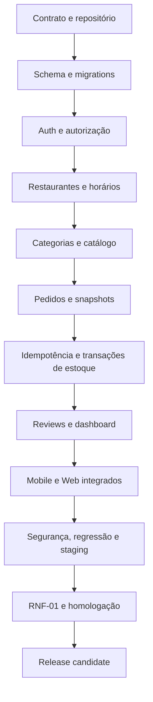

> **Natureza do cronograma:** plano-base estimativo, não compromisso de prazo. Considera desenvolvimento predominantemente individual, com aproximadamente 8–10 horas semanais disponíveis. A duração real depende do conhecimento prévio, retrabalho, infraestrutura e ritmo de aprendizado.

# 1. Premissas e visão geral

| Item | Premissa |
|---|---|
| Horizonte | 36 semanas (aprox. 9 meses) |
| Esforço estimado | 288–360 horas; referência central de 324 horas |
| Capacidade | 8–10 h/semana |
| Equipe | 1 desenvolvedor principal; revisão externa eventual não contabilizada |
| Estratégia | Monólito modular; fatias verticais contrato → migration → service → controller → testes → UI |
| MVP | App mobile cliente + web gestão + API + PostgreSQL/Redis + testes + staging |
| Homologação | Campanhas RNF-01, segurança, concorrência, recuperação e smoke |
| Critério de escopo | Não incluir pagamentos/entregas reais, microservices, WebSocket/SSE ou features fora do MVP |

**Atenção:** o cronograma não presume implementação já realizada. Antes do início, conferir estado real do repositório, branches, migrations e código para evitar recriar trabalho existente. As estimativas gerais de semanas/horas são a linha de base anterior às decisões Q63–Q103; a revisão do esforço de mídia e do total do MVP deve considerar o adapter Cloudinary e a biblioteca de processamento do backend.

# 2. Marcos principais

| Marco | Janela | Resultado esperado | Gate de saída |
|---|---|---|---|
| M0 — Preparação | Semanas 1–2 | Escopo e contratos críticos fechados; repo e ambiente reproduzíveis. | CI mínimo passa; Docker local sobe; pendências bloqueadoras registradas. |
| M1 — Persistência e identidade | Semanas 3–5 | Modelo físico inicial, migrations, autenticação e sessões. | Auth/roles testados; constraints e sessão revogável funcionam. |
| M2 — Operação de restaurante | Semanas 6–8 | Gestão de restaurante, horários, publicação e papéis. | Responsável só acessa próprio restaurante; horário validado. |
| M3 — Catálogo | Semanas 9–11 | Categorias, ProductBase, ofertas, imagem, preço e estoque. | RN-02/RN-06/RN-07/RN-09 cobertos. |
| M4 — Pedidos | Semanas 12–16 | Checkout idempotente, snapshots, inbox, transições e estoque atômico. | Nenhum pedido/estoque duplicado; matriz de estados testada. |
| M5 — Recursos complementares | Semanas 17–18 | Reviews, dashboard, perfil e administração. | Ownership, fórmulas e auditoria cobertos. |
| M6 — Mobile | Semanas 19–24 | Jornada de cliente integrada à API real. | E2E de descoberta até review funciona. |
| M7 — Web | Semanas 25–29 | Painel de gestão/pedidos/admin conectado. | Fluxo de operação de restaurante end-to-end funciona. |
| M8 — Qualidade operacional | Semanas 30–32 | Segurança, regressão, observabilidade, backup e staging. | Sem bug crítico/alto conhecido; restore e smoke evidenciados. |
| M9 — Homologação | Semanas 33–36 | Campanha RNF-01, correções, relatório e release candidate. | 130 execuções planejadas + recovery/idempotência avaliadas; aprovação documentada. |

# 3. Cronograma resumido por semana

| Semana | Frente principal | Resultado/entregável |
|---:|---|---|
| 1 | Preparação e alinhamento | Baseline do repositório, contratos aprovados, itens remanescentes C-01…C-06 e ADRs. |
| 2 | Contratos e fundação | OpenAPI inicial, convenções, Docker Compose, CI mínimo. |
| 3 | Modelo físico | ERD revisado, schema Prisma, constraints e migrations iniciais. |
| 4 | Infra de persistência | Seeds de teste, repositories, health/readiness, testes de migration. |
| 5 | Autenticação | Cadastro, login, Argon2id, access/refresh, logout e rate limit. |
| 6 | Perfil e papéis | `/api/me`, UserRole, sessões ativas, solicitação RESPONSAVEL. |
| 7 | Administração de papéis | Aprovação/rejeição, cooldown, RoleAuditEvent e ADMIN seguro. |
| 8 | Restaurantes/horários | CRUD, publicação, ownership, timezone, validação de horários. |
| 9 | Categorias e produto-base | CRUD/contratos de categoria e ProductBase, relações corretas. |
| 10 | Ofertas | RestaurantProduct, preço, estoque, normalização e unicidade. |
| 11 | Mídia e catálogo público | adapter `StoragePort`/Cloudinary, pipeline validado de upload, catálogo/cache, exclusão e invalidação best effort. |
| 12 | Pedido base | Schema Order/OrderItem/OrderEvent, snapshots e cálculo monetário. |
| 13 | Checkout | Validação de carrinho, preço, horário, publicação e estoque sem baixa. |
| 14 | Idempotência | IdempotencyRecord, hash canônico, replay, tombstone e consulta. |
| 15 | Estados/estoque | Confirmação, recusa, transições, cancelamento e transações atômicas. |
| 16 | Inbox/OrderView | Listas, filtros, polling, contadores e decisão de leitura de visualização. |
| 17 | Reviews/dashboard | Review PRODUCT_ONLY, métricas e timezone do período. |
| 18 | Administração e hardening backend | Transferência de restaurante, remoção de papel, regressão API. |
| 19 | Mobile: base | Navegação, tema/base, sessão segura, clientes HTTP e estados comuns. |
| 20 | Mobile: descoberta | Explorar restaurantes, busca/filtros, detalhe e catálogo. |
| 21 | Mobile: carrinho/checkout | Carrinho local, preço decimais, endereço e idempotência. |
| 22 | Mobile: pedidos | Histórico, detalhe, polling/refresh, cancelamento e falhas. |
| 23 | Mobile: reviews/perfil | Avaliação de item concluído, perfil e logout/limpeza. |
| 24 | Mobile: integração/E2E | Jornada completa, Appium, acessibilidade e correções. |
| 25 | Web: base e restaurante | Router/layout, sessão, selecionar restaurante, perfil do estabelecimento. |
| 26 | Web: catálogo | Categorias, oferta, preço, estoque, imagens e validação. |
| 27 | Web: pedidos | Inbox, lista, filtros, detalhe e ações de transição. |
| 28 | Web: dashboard/admin | Indicadores, solicitações, transferências e auditoria. |
| 29 | Web: integração/E2E | Polling, estados vazios/erro, acessibilidade, regressão. |
| 30 | Segurança | Testes de autorização cruzada, tokens, refresh reuse, CSRF/XSS, rate limit. |
| 31 | Operação | Logs/métricas/tracing, alertas, backup, restore e health checks. |
| 32 | Staging/regressão | Migrations, smoke, fluxos críticos, release checklist. |
| 33 | RNF-01: preparação | Dataset, scripts k6, ambiente estável, cache frio/aquecido. |
| 34 | RNF-01: carga/overhead | Execuções oficiais de carga e comparação de instrumentação. |
| 35 | RNF-01: concorrência/recovery | Disputa de estoque, idempotência, falha/recuperação. |
| 36 | Correções e homologação | Reexecuções necessárias, relatório, evidências e release candidate. |

# 4. Atividades detalhadas e critérios de conclusão

## Fase A — Preparação e fundação (semanas 1–2 | 16–20 h)

| ID | Atividade menor | Dependência | Entregável / critério de aceite |
|---|---|---|---|
| A01 | Inspecionar árvore, branches, scripts, versões e estado atual do repo | Nenhuma | Inventário real sem sobrescrever trabalho existente. |
| A02 | Comparar implementação existente com os quatro documentos-base e adendo | A01 | Matriz implementado/parcial/ausente/conflitante. |
| A03 | Consolidar os contratos residuais C-01 a C-06 antes do freeze da API | A02 | Categorias, upload, reprocessamento de exclusão, dashboard, visualização e filtros administrativos com path/DTO/erros definidos. |
| A04 | Definir políticas operacionais residuais para os módulos afetados | A02 | Redis indisponível, moderação/denúncia de reviews, autorização administrativa e monitoramento Cloudinary documentados. |
| A05 | Criar/organizar diretórios apps/api, apps/mobile, apps/web, packages e docs | A01 | Estrutura mínima consistente com monólito modular. |
| A06 | Fixar Node 26 LTS em arquivo de versão e CI | A05 | Local e CI usam runtime compatível idêntico. |
| A07 | Configurar TypeScript strict, lint, format e scripts npm | A05 | lint/typecheck/build executáveis. |
| A08 | Criar Docker Compose PostgreSQL + Redis + health checks | A05 | Ambiente sobe e persiste dados localmente. |
| A09 | Criar `.env.example` sem segredos e validação de configuração | A05 | App falha claramente com variável obrigatória ausente. |
| A10 | Criar pipeline CI inicial e proteção de branch | A07–A09 | CI roda lint/typecheck/build em push/PR. |
| A11 | Publicar OpenAPI inicial com convenções de erro/auth/paginação | A03 | Documento contrato versionado; sem DTO provisório oculto. |

## Fase B — Persistência, identidade e papéis (semanas 3–7 | 40–50 h)

| ID | Atividade menor | Dependência | Entregável / critério de aceite |
|---|---|---|---|
| B01 | Consolidar ERD físico e cardinalidades | A02 | Modelo revisado sem conflito de ownership. |
| B02 | Criar schema User e UserRole | B01 | Email único e papel composto migrados. |
| B03 | Criar migrations e constraints de ADMIN único/exclusivo | B02 | Testes de unicidade e exclusividade passam. |
| B04 | Materializar schema RoleRequest e RoleAuditEvent | B01 | Campos lógicos aprovados materializados com constraints, índices e auditoria append-only. |
| B05 | Definir append-only no banco para auditoria | B04 | Aplicação/role DB não consegue editar/excluir eventos. |
| B06 | Implementar hash Argon2id e política de senha | B02 | Casos Unicode, espaços e limites cobertos. |
| B07 | Implementar cadastro com CLIENTE automático | B02, B06 | E-mail duplicado e cadastro válido testados. |
| B08 | Implementar login e rate limit por conta/IP | B06, Redis | Resposta genérica e 429/Retry-After testados. |
| B09 | Implementar sessão, JWT 15 min e refresh opaco rotativo | B07–B08 | Token antigo reutilizado revoga família. |
| B10 | Implementar logout e checagem de sessão ativa | B09 | Sessão revogada não acessa endpoint protegido. |
| B11 | Implementar `/api/me` GET/PATCH name | B10 | Cliente só altera o próprio nome. |
| B12 | Implementar solicitação de RESPONSAVEL e cooldown | B04, B10 | Uma pendente por usuário; cooldown 7 dias. |
| B13 | Implementar aprovação/rejeição em transação | B12 | Aprovação + concessão são atômicas. |
| B14 | Implementar seed/script ADMIN protegido | B03 | Nenhum endpoint público cria ADMIN; secret não versionado. |
| B15 | Implementar matriz middleware + autorização contextual | B10–B14 | Testes negativos por papel/ownership passam. |

## Fase C — Restaurante, horários e catálogo (semanas 8–11 | estimativa-base a recalibrar)

> A faixa original de 32–40 h foi estimada antes das decisões Q63–Q103. O fluxo de imagem passou a incluir operações persistentes, processamento defensivo, Cloudinary e reconciliação; recalibrar horas e dependências considerando o adapter e a biblioteca de imagem. Não absorver esse esforço silenciosamente no buffer.

| ID | Atividade menor | Dependência | Entregável / critério de aceite |
|---|---|---|---|
| C01 | Implementar cadastro de restaurante com responsável da sessão | B15 | Body não aceita responsibleUserId como autoridade. |
| C02 | Implementar GET `/api/me/restaurants` e management | C01 | Só restaurantes próprios aparecem. |
| C03 | Implementar edição parcial de restaurante | C02 | Campos omitidos permanecem inalterados. |
| C04 | Implementar publicação/despublicação | C03, futura consulta Orders | Novo restaurante UNPUBLISHED; pedidos ativos bloqueiam despublicação. |
| C05 | Implementar timezone IANA e grade semanal | C03 | Horário local coerente por restaurante. |
| C06 | Implementar validador de intervalos cruzando meia-noite/dias | C05 | Testes de adjacência/overlap passam. |
| C07 | Implementar Category e seus contratos | C01 | Categoria sempre vinculada a restaurante. |
| C08 | Implementar ProductBase | C07 | Identidade lógica separada da oferta. |
| C09 | Implementar RestaurantProduct e FK categoria/restaurante | C07–C08 | Constraint composta impede categoria cruzada. |
| C10 | Implementar money BRL decimal e validação 2 casas | C09 | Sem float; 422 para precisão inválida. |
| C11 | Implementar display_name/normalized_name | C09 | NFKD, diacríticos, whitespace e lowercase testados. |
| C12 | Criar índice único nome normalizado por restaurante | C11 | Duplicado bloqueado mesmo com oferta desativada. |
| C13 | Implementar estoque e status da oferta | C09 | Estoque >=0; zero visível indisponível. |
| C14 | Implementar `StoragePort` + adapter Cloudinary | C09 | Backend controla upload/leitura URL/exclusão; API Secret não chega ao cliente. |
| C15 | Implementar cache-aside catálogo/restaurante + invalidation | C01–C14 | TTL 60s; sem cache de estoque/autorização/pedidos. |
| C16 | Implementar pipeline defensivo de imagens | C14 | JPEG/PNG/WebP estáticos; 5 MB/40 MP; EXIF removido; sRGB; transparência preservada; WebP até 1600×1600 sem upscale. |
| C17 | Implementar `StorageUploadOperation` e eventos append-only | C14, C16 | Estados, eventos JSONB, retries 1/3/10 s e reconciliação persistidos. |
| C18 | Implementar substituição condicional e limpeza de temporários/órfãos | C16–C17 | Compare-and-swap; imagem antiga preservada em falha; temporários removidos. |
| C19 | Implementar `StorageDeletionOperation` | C14, C17 | `destroy` com `invalidate=true`, retries transitórios e reconciliação por asset ID; invalidação best effort. |
| C20 | Implementar consulta ADMIN e métricas do pipeline | C17–C19 | GETs administrativos aprovados, filtros, sanitização e métricas de sucesso, falha, duração, retries, volume e recursos. |

## Fase D — Pedidos, idempotência e estoque (semanas 12–16 | 40–50 h)

| ID | Atividade menor | Dependência | Entregável / critério de aceite |
|---|---|---|---|
| D01 | Criar schema Order, OrderItem, OrderEvent | C09–C13 | Constraints de quantity, subtotal e unicidade. |
| D02 | Criar snapshots de endereço, customer name/email e produto | D01, B11 | Alterar perfil/catálogo não muda pedido antigo. |
| D03 | Criar schema IdempotencyRecord e tombstone | D01 | Unique user/key, payload hash, expiry, status. |
| D04 | Implementar normalização/hash canônico do payload | D03 | Ordem de itens/whitespace irrelevantes não mudam intenção. |
| D05 | Implementar checkout com validações de publicação/horário/preço/stock | D01–D04 | Sem criação em preço divergente/indisponibilidade. |
| D06 | Persistir IdempotencyRecord + Order + Items na mesma transação | D03–D05 | Rollback integral antes do commit; sem débito de stock. |
| D07 | Implementar replay mesma chave/hash | D06 | Resposta original retorna sem duplicar pedido. |
| D08 | Implementar conflito chave/hash diferente | D06 | 409 IDEMPOTENCY_KEY_REUSED. |
| D09 | Implementar tratamento de concorrência e 202 PROCESSING | D06–D08 | Segunda request não mantém lock/transação >5s. |
| D10 | Implementar endpoint de consulta da chave | D03–D09 | Ownership; 404/410/200 conforme regra. |
| D11 | Implementar máquina de estados e matriz de transições | D01 | Todas as combinações ator/estado testadas. |
| D12 | Implementar confirmação com locks determinísticos | D11, C13 | Débito + status + evento em uma transação. |
| D13 | Implementar recusa em CRIADO | D11 | Evento criado; stock não muda. |
| D14 | Implementar cancelamento e reposição única | D12 | Status/evento/stock atômicos. |
| D15 | Implementar update condicional contra transição concorrente | D11–D14 | Duas ações simultâneas não causam estado parcial. |
| D16 | Implementar listagem do cliente e detalhes | D01, D11 | Ownership e snapshots preservados. |
| D17 | Implementar orders por restaurante e inbox consolidada | D16 | Filtros, busca, paginação e ordenação aprovados. |
| D18 | Implementar OrderView em rota explícita de escrita | D17 | GET puro; POST `/api/orders/{orderId}/views` idempotente e preserva primeira visualização. |
| D19 | Implementar contratos de polling e atualização | D17–D18 | Polling 15s; pause hidden; refresh ao retornar. |

## Fase E — Review, dashboard e administração completa (semanas 17–18 | 16–20 h)

| ID | Atividade menor | Dependência | Entregável / critério de aceite |
|---|---|---|---|
| E01 | Implementar POST review por OrderItem | D16 | Dono + pedido CONCLUIDO + uma review/item. |
| E02 | Implementar leitura pública paginada de reviews por produto | E01 | Visitante sem login consulta reviews; autor sem dados pessoais. |
| E03 | Testar rating 1–5, comentário, duplicidade e acesso público | E01–E02 | Casos positivos/negativos e segurança cobertos. |
| E04 | Implementar métricas dashboard | D01, E01 | Produtos vendidos em CONCLUIDO; reviews pela data de criação; seleção explícita do restaurante quando houver mais de um. |
| E05 | Implementar filtros temporais por timezone | E04 | Default 30d; máximo 365d; `restaurantId` obrigatório e ownership validado. |
| E06 | Implementar transferência de responsável | B13, C01 | Transferência auditada; alvo deve ser RESPONSAVEL existente. |
| E07 | Implementar remoção RESPONSAVEL | E06 | Bloqueia remoção se houver restaurante não transferido. |
| E08 | Testar matriz admin e trilha append-only | B05, E06–E07 | Ações permitidas/negadas e evidências. |

## Fase F — Aplicativo mobile cliente (semanas 19–24 | 48–60 h)

| ID | Atividade menor | Dependência | Entregável / critério de aceite |
|---|---|---|---|
| F01 | Inicializar React Native/TypeScript e navegação | B10, A05 | Build reproduzível e rotas principais. |
| F02 | Implementar cliente HTTP, refresh e interceptors seguros | B09 | Uma renovação por 401; sem loop de refresh; guards para fluxos que exigem CLIENTE. |
| F03 | Implementar cadastro/login/logout | F01–F02 | Sessão persiste com refresh seguro. |
| F04 | Implementar exploração e busca de restaurantes | C01–C15 | Loading, vazio, erro, paginação e refresh. |
| F05 | Implementar detalhe e catálogo | C07–C20 | Produtos visíveis com disponibilidade correta e URLs CDN montadas pela API. |
| F06 | Implementar detalhe do produto | F05 | Preço atual, imagem e disponibilidade. |
| F07 | Implementar carrinho local por usuário/restaurante | F05–F06 | RN-01; quantidade e totais recalculados. |
| F08 | Implementar cálculo monetário seguro | F07 | Valores decimais sem float impreciso. |
| F09 | Implementar checkout/endereço | D05–D10 | Uma intenção, chave UUID v4 e retry seguro. |
| F10 | Implementar confirmação e recuperação pós-timeout | F09 | Consultar key antes de nova intenção. |
| F11 | Implementar histórico/detalhe de pedido | D16 | Estados e eventos legíveis. |
| F12 | Implementar acompanhamento/refresh/cancelamento | D11–D19 | Ações válidas conforme matriz; sem retry cego. |
| F13 | Implementar reviews | E01 | Só item próprio concluído; uma por item. |
| F14 | Implementar perfil e logout com limpeza local | B11 | Carrinho/dados temporários removidos no logout. |
| F15 | Appium + acessibilidade + regressão mobile | F01–F14 | Jornada E2E estável em emulador/dispositivo. |

## Fase G — Web de gestão (semanas 25–29 | 40–50 h)

| ID | Atividade menor | Dependência | Entregável / critério de aceite |
|---|---|---|---|
| G01 | Inicializar React/TypeScript, router e layout | B10, A05 | Base web, rotas protegidas e guards para módulos RESPONSAVEL/ADMIN. |
| G02 | Implementar sessão/cookie/CSRF | B09 | Refresh HttpOnly Secure SameSite=Lax; access em memória. |
| G03 | Implementar seleção de restaurante gerenciado | C02, B15 | Contexto explícito e persistência segura de seleção; backend revalida ownership em cada operação. |
| G04 | Implementar edição de restaurante/publicação/horários | C01–C06 | Form valida UX e backend valida invariantes. |
| G05 | Implementar categorias/ofertas | C07–C20 | CRUD sem quebra de snapshot; upload e substituição de imagem conforme pipeline aprovado. |
| G06 | Implementar estoque/preço e estados indisponíveis | C10–C13 | Zero visível, não comprável. |
| G07 | Implementar pedidos por restaurante e inbox | D17–D19 | Contagens por restaurante/global, filtros e busca. |
| G08 | Implementar detalhe, eventos e OrderView | D18 | GET puro; POST de visualização idempotente; primeira visualização preservada por responsável. |
| G09 | Implementar ações de status | D11–D15 | Desabilitar clique duplicado; reconciliar conflitos. |
| G10 | Implementar dashboard | E03–E05 | Período default e filtros no timezone. |
| G11 | Implementar administração de role requests | B12–B15 | Aprovar/rejeitar com auditoria. |
| G12 | Implementar transferência/remoção de responsável | E06–E08 | Fluxo completo e auditado. |
| G13 | Testar WCAG 2.2 AA como referência | G01–G12 | Teclado, foco, contraste, leitores e mensagens. |
| G14 | Testes UI/E2E e regressão web | G01–G13 | Fluxo completo sem mocks para APIs críticas. |

## Fase H — Segurança, operação e staging (semanas 30–32 | 24–30 h)

| ID | Atividade menor | Dependência | Entregável / critério de aceite |
|---|---|---|---|
| H01 | Revisão de autenticação/sessão/refresh | B06–B10 | Testes de expiração, revogação e reuse. |
| H02 | Revisão de autorização/IDOR | Todos módulos | Tentativas cruzadas cliente/restaurante bloqueadas. |
| H03 | Testes XSS/CSRF/injection/upload | F/G e API | Casos negativos automatizados ou evidenciados. |
| H04 | Revisar rate limits e política Redis indisponível | A04, B08 | Sem bypass silencioso de proteção; comportamento fail-safe/degraded testado. |
| H05 | Revisar logs e sanitização de dados | Todos módulos | Teste comprova ausência de secret/PII vedada. |
| H06 | Adicionar logs, métricas, trace e request IDs | API | Painel/alertas básicos úteis. |
| H07 | Configurar health/readiness | API/infra | Não revela segredo nem internals. |
| H08 | Configurar backup diário e retenção 7 dias | PostgreSQL | Evidência de backup criptografado. |
| H09 | Executar restore e medir RPO/RTO | H08 | Teste mensal documentado; RPO≤24h, RTO≤8h como alvo. |
| H10 | Preparar staging e secrets | Infra | Configuração segura sem secrets no Git. |
| H11 | Smoke e regressão de staging | H01–H10 | Fluxos críticos aprovados. |

## Fase I — RNF-01 e release candidate (semanas 33–36 | 32–40 h)

| ID | Atividade menor | Dependência | Entregável / critério de aceite |
|---|---|---|---|
| I01 | Definir baseline de infra e dataset sintético | H10 | Ambiente isolado e reproduzível. |
| I02 | Validar nove operações oficiais no k6 | API completa | Scripts e perfis de VU versionados. |
| I03 | Implementar cenário de cache frio | I01–I02 | Cache limpo, misses registrados. |
| I04 | Implementar cenário de cache aquecido | I01–I02 | Dados pré-carregados e hit rate validado. |
| I05 | Executar 30 testes oficiais de carga | I03–I04 | 3 volumes × 2 caches × 5 runs com evidências. |
| I06 | Executar 60 runs de overhead | H06, I05 | 30 pares × instrumentação completa/mínima. |
| I07 | Executar 40 runs de concorrência estoque | D12–D15 | 4 níveis × 10 repetições; sem inconsistência. |
| I08 | Executar QU-29…QU-70: idempotência e recuperação | D03–D15 | Falhas antes/depois commit sem duplicação/estoque incorreto. |
| I09 | Analisar P95/P99, erros, RPS e recursos | I05–I08 | Relatório reproduzível; limites sem ajuste oportunista. |
| I10 | Corrigir gargalos e bugs encontrados | I09 | Correções registradas e regressão aprovada. |
| I11 | Reexecutar casos impactados | I10 | Evidências novas ligadas ao commit. |
| I12 | Consolidar relatório RNF-01 e release checklist | I01–I11 | Pass/fail por critério e limitações declaradas. |
| I13 | Aprovar release candidate/staging | I12 | Nenhum bug crítico/alto conhecido em fluxos críticos. |

# 5. Dependências e caminho crítico

O caminho crítico passa por OpenAPI/contratos aprovados → persistência → identidade/autorização → restaurante/catálogo → pedido/estoque/idempotência → clientes integrados → homologação. Não iniciar telas dependentes de contratos que ainda mudam. Mobile e web podem compartilhar componentes/contratos e ter alguma sobreposição de desenvolvimento, mas a estimativa não pressupõe dois desenvolvedores.

# 6. Matriz de rastreabilidade de entregáveis

| Requisito/área | Fases principais | Evidência mínima |
|---|---|---|
| RF-01 / auth | B, F, G | Unit + API + E2E + testes refresh/revogação. |
| RF-02 / Review | E, F | Ownership, CONCLUIDO, rating e unique orderItem. |
| RF-03 / Order | D, F, G | Máquina de estados e E2E ponta a ponta. |
| RF-04 / Dashboard | E, G | Agregações e timezone testados. |
| RF-05/RF-09 / catálogo | C, G | CRUD, normalização, snapshots, autorização e fluxo de imagem Q63–Q103. |
| RF-06 / roles | B, E, G | Aprovação, cooldown, exclusividade ADMIN e audit trail. |
| RF-07 / restaurante | C, G | Ownership, publicação, horários e transferência. |
| RF-08 / preço/estoque | C, D, G | Precisão monetária, concorrência e reposição única. |
| RN-01…RN-09 | C, D, F, G | Testes de regras de carrinho/catálogo/pedido. |
| RNF-01 | I | 130 execuções e relatório por cenário. |
| RNF-02 | D, F, G, H | Retry seguro, mensagens e ausência de falso sucesso. |

# 7. Riscos de cronograma e buffers

| Risco | Sinal de alerta | Resposta planejada |
|---|---|---|
| Contrato/API ainda instável | DTO/rota muda durante frontend | Materializar OpenAPI a partir dos contratos aprovados; congelar por módulo antes de UI. |
| Transação/concorrência complexa | Testes só passam com mocks | Reservar tempo para PostgreSQL real e testes concorrentes. |
| Duas interfaces | Backend fica pronto e UI se prolonga | Entregar telas por jornada, sem polir tudo antes do fluxo vertical. |
| Ambiente de carga insuficiente | Picos e recursos variam entre runs | Baseline, estabilização, dataset fixo e execução repetível. |
| Integração externa de mídia | Cloudinary escolhido; invalidação é best effort e pode falhar | Implementar adapter `StoragePort`, `destroy` com `invalidate=true`, monitoramento de créditos e smoke test em staging. |
| Pipeline de imagens | Arquivos malformados, alto consumo ou concorrência de substituições | Validação em camadas, limite 40 MP, controle de recursos, compare-and-swap, reconciliação e limpeza de órfãos. |
| Aprendizado de stack | Atividade leva muito além da estimativa | Priorizar MVP; registrar aprendizado e recalibrar próxima fase. |
| Escopo cresce | Features fora do MVP entram sem decisão | Recusar scope creep; registrar item para fase posterior. |

**Buffer recomendado:** reservar 10–15% da capacidade de cada fase para correções e aprendizado. O horizonte de 36 semanas já distribui semanas de integração/regressão; qualquer novo requisito funcional deve alterar escopo, horas ou data, não ser absorvido silenciosamente.

# 8. Rotina semanal sugerida

1. **Planejamento (30–45 min):** selecionar atividades com dependências satisfeitas e critérios de aceite claros.
2. **Implementação (blocos curtos):** fechar uma atividade de ponta a ponta antes de abrir várias frentes.
3. **Teste contínuo:** executar testes relacionados após cada alteração; não deixar QA crítico para o final.
4. **Revisão semanal (30 min):** atualizar estado, risco, decisões, bugs e estimativa restante.
5. **Demonstração:** validar jornada com o comportamento real, não apenas leitura do código.

## Definition of Done para cada atividade

- Código integrado à branch principal por PR/revisão.
- Testes proporcionais ao risco executados.
- Contrato/OpenAPI e documentação atualizados.
- Sem segredo em código/config/versionamento.
- Tratamento de loading, vazio, sucesso, erro e conflito na interface quando aplicável.
- Logs/telemetria sem conteúdo sensível.
- Critérios de aceite demonstráveis.

# 9. Checklist de liberação do MVP

- [ ] Requisitos RF/RN/RNF sem alteração não aprovada.
- [ ] Contratos residuais e políticas operacionais documentados nos documentos de arquitetura concluídos ou explicitamente excluídos antes da liberação dos módulos afetados.
- [ ] OpenAPI coincide com controllers/DTOs reais.
- [ ] Migrations testadas em banco limpo e staging.
- [ ] Autenticação, refresh, revogação e autorização cruzada testados.
- [ ] Cadastro/gestão de restaurante e horários testados.
- [ ] Catálogo, normalização, estoque e snapshots testados.
- [ ] Checkout idempotente e máquina de estados testados em PostgreSQL real.
- [ ] Carrinho local respeita RN-01 e limpa no logout.
- [ ] Reviews e dashboard obedecem regras e timezone.
- [ ] Mobile e web usam API real, sem mocks em fluxos críticos.
- [ ] Acessibilidade básica e WCAG 2.2 AA como referência no web revisadas.
- [ ] Rate limiting/Redis failure policy aprovada e testada.
- [ ] Logs, métricas, tracing e health checks instalados.
- [ ] Backup/restore testado; RPO/RTO registrados.
- [ ] Zero bug crítico/alto conhecido nos fluxos críticos.
- [ ] RNF-01 executado; relatório e evidências preservados.
- [ ] Release candidate e notas de versão preparadas.

---

**Resultado esperado ao fim do plano:** MVP demonstrável e tecnicamente verificável, com evidências de qualidade e desempenho. O cronograma é referência ajustável; não substitui acompanhamento real de esforço nem autoriza cortar critérios de segurança ou integridade para cumprir uma data.
