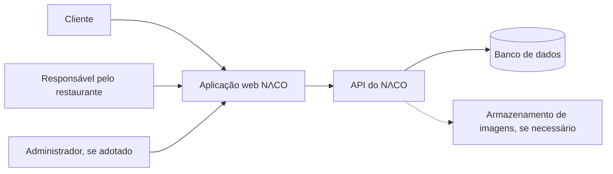
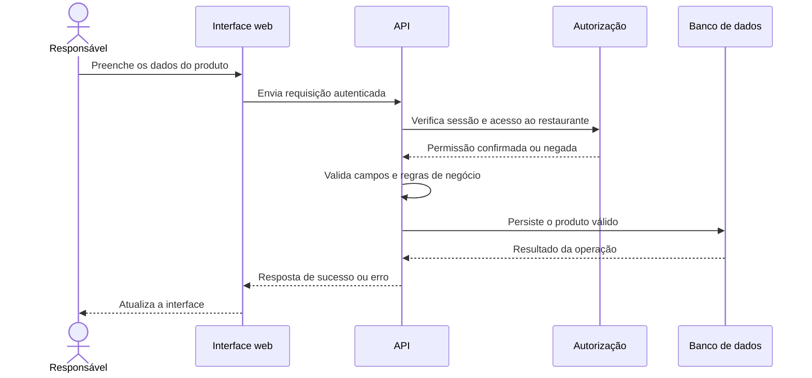
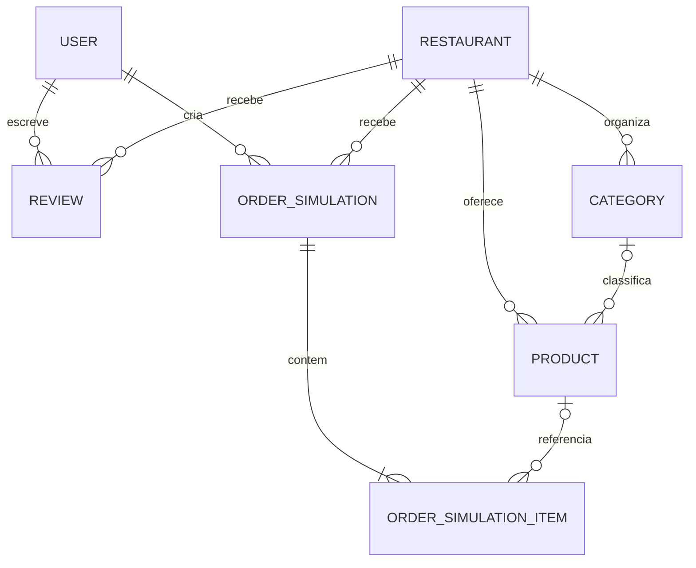

# NɅCO — Documento de Arquitetura de Software

> **Este arquivo é um exemplo de preenchimento, não uma especificação pronta para copiar.** Os trechos marcados como **hipótese**, **proposta** ou **a decidir** servem para mostrar o nível de detalhe esperado. Substitua-os pelas decisões que fizer sentido tomar para o seu projeto.

| Campo | Exemplo de preenchimento |
|---|---|
| Projeto | NɅCO |
| Pronúncia | “Naco” |
| Documento | Arquitetura e planejamento técnico |
| Versão do documento | 0.1 — rascunho inicial |
| Responsável | Desenvolvedor do projeto |
| Situação | Planejamento |
| Última revisão | A preencher |
| Repositório | A definir |
| Licença de código aberto | A definir antes da publicação |

## 1. Como ler este documento

- **Informado:** detalhe já mencionado na ideia inicial do produto.
- **Proposta de exemplo:** uma solução possível usada para demonstrar como documentar uma decisão; não deve ser tratada como decisão final.
- **A decidir:** informação necessária que ainda não foi confirmada.
- **Fora do escopo inicial:** algo que a primeira versão não pretende oferecer.

A arquitetura deve evoluir com o projeto. Não é obrigatório resolver todos os detalhes antes de começar; o importante é reconhecer as incertezas e decidir o que precisa ser esclarecido antes de implementar cada parte.

---

# 2. Visão do produto

## 2.1. Resumo

O NɅCO é uma aplicação de pedidos de comida concebida como projeto de código aberto e como oportunidade de aprendizado prático em desenvolvimento de software. A experiência pretendida é permitir que clientes encontrem estabelecimentos, consultem produtos e percorram um fluxo de pedido simples. Os restaurantes terão ferramentas para administrar o próprio catálogo e acompanhar informações relacionadas à atividade na plataforma.

**Informado:** praticidade, operação para clientes e restaurantes, avaliações, simulação de pedidos/entregas e visualização de dados pelos estabelecimentos.

**A decidir:** se a primeira versão será apenas web responsiva ou se haverá aplicativo mobile; em quais cidades ou regiões o sistema será demonstrado; e se os pedidos serão sempre simulados ou se alguma operação real será incluída futuramente.

## 2.2. Problema e oportunidade

**Hipótese a validar:** pessoas que desejam pedir comida precisam de um caminho simples para conhecer opções e testar o processo de compra; pequenos estabelecimentos precisam de uma maneira acessível de organizar produtos e consultar indicadores básicos.

Essa hipótese deve ser validada com conversas com potenciais usuários, observação de soluções existentes ou testes de protótipos. Não deve ser considerada comprovada apenas por ser a motivação do projeto.

## 2.3. Público-alvo e atores

| Ator | Necessidade principal | Relação com o sistema |
|---|---|---|
| Cliente | Encontrar estabelecimentos, explorar produtos e simular pedidos | Usa a interface pública e a própria conta |
| Responsável pelo restaurante | Administrar o estabelecimento, o catálogo e consultar indicadores | Acessa somente os dados do estabelecimento ao qual tem permissão |
| Administrador da plataforma | Apoiar a operação e tratar problemas de conteúdo ou contas | **Proposta:** perfil interno, caso a administração central seja necessária |
| Serviço de hospedagem/banco | Disponibilizar a aplicação e persistir dados | Infraestrutura técnica, não usuário humano |

**A decidir:** haverá mais de uma conta responsável por restaurante? Um usuário poderá ser cliente e responsável por estabelecimento com a mesma conta? Como será verificada a legitimidade de um cadastro de restaurante?

## 2.4. Objetivos e critérios de sucesso

Os critérios abaixo são exemplos de como transformar uma intenção em algo verificável. Os números são metas ilustrativas, não resultados já alcançados.

| Objetivo | Como avaliar | Meta ilustrativa |
|---|---|---|
| Facilitar a descoberta | Teste de usabilidade para localizar um restaurante e abrir um produto | Participantes concluem o fluxo sem orientação |
| Concluir o fluxo de simulação | Teste de ponta a ponta do carrinho até a confirmação simulada | Fluxo principal funciona nos cenários previstos |
| Permitir autonomia do restaurante | Testar cadastro, edição e remoção de produtos | Operações permitidas funcionam e operações não autorizadas são bloqueadas |
| Apresentar indicadores compreensíveis | Comparar dados exibidos com registros de teste conhecidos | Totais e filtros correspondem aos dados de referência |
| Manter o projeto fácil de executar | Uma pessoa seguindo o README consegue iniciar o sistema | Instalação e execução documentadas e reproduzíveis |

**A decidir:** quais metas quantitativas serão utilizadas e como os testes de usabilidade serão realizados.

---

# 3. Escopo do produto

## 3.1. Funcionalidades planejadas para o MVP

O MVP é a menor versão que permite demonstrar o valor central do produto. A lista a seguir organiza as funcionalidades já citadas e acrescenta critérios de exemplo para que elas possam ser verificadas.

| ID | Funcionalidade | Prioridade ilustrativa | Resultado esperado |
|---|---|---|---|
| RF-01 | Cadastro e login de clientes | Essencial | A pessoa cria uma conta e acessa sua área autenticada |
| RF-02 | Cadastro e login de responsáveis por restaurantes | Essencial | O responsável acessa a área de gestão autorizada |
| RF-03 | Cadastro e manutenção de dados do restaurante | Essencial | Dados do estabelecimento podem ser consultados e atualizados por quem tem permissão |
| RF-04 | Cadastro, edição e exclusão de produtos | Essencial | O responsável gerencia o catálogo do próprio restaurante |
| RF-05 | Navegação pelo catálogo | Essencial | O cliente consulta restaurantes, categorias e produtos disponíveis |
| RF-06 | Avaliação de estabelecimento | Importante | Cliente autenticado registra uma avaliação de acordo com as regras definidas |
| RF-07 | Simulação de pedido | Essencial | O cliente seleciona produtos e recebe uma confirmação claramente identificada como simulação |
| RF-08 | Simulação de etapas de entrega | Essencial | O pedido percorre estados demonstrativos predefinidos |
| RF-09 | Painel de indicadores do restaurante | Essencial | O responsável consulta indicadores calculados a partir dos dados disponíveis |
| RF-10 | Atualização de dados pessoais | Essencial | O cliente altera os campos permitidos da própria conta |

**Ponto de atenção:** como o pedido é descrito como simulado, o documento precisa diferenciar *indicadores de demonstração* de vendas e entregas reais. Não se deve apresentar uma simulação como transação comercial efetiva.

## 3.2. Fora do escopo inicial

- Processamento de pagamentos reais por cartão, Pix ou carteira digital.
- Autenticação em dois fatores.
- Integração operacional com entregadores, rastreamento por GPS ou despacho real.
- Promessa de entrega em prazo real.
- Emissão de documentos fiscais.
- Programa de fidelidade, cupons avançados ou recomendações automatizadas.

Os itens acima são exclusões de exemplo baseadas no escopo inicial. Se alguma necessidade mudar, registre a alteração e avalie seus efeitos sobre segurança, custos e arquitetura.

## 3.3. Possíveis evoluções — sem compromisso de implementação

- Integração com um provedor de pagamento.
- Aplicativo mobile dedicado.
- Notificações por e-mail ou push.
- Ferramentas de moderação e denúncia.
- Relatórios adicionais para restaurantes.
- Integração com serviços de entrega.

Essas possibilidades não fazem parte do MVP enquanto não forem priorizadas explicitamente.

## 3.4. Restrições e premissas

| Tipo | Descrição | Situação |
|---|---|---|
| Produto | Pedidos e entregas serão demonstrativos no MVP | Informado, mas as regras detalhadas ainda precisam ser definidas |
| Escopo | Pagamento real não será integrado na primeira versão | Informado |
| Segurança | Operações protegidas precisam ser autorizadas no servidor | Requisito a adotar no desenho técnico |
| Plataforma | Interface web responsiva é uma alternativa inicial | Proposta de exemplo |
| Orçamento | O projeto deve evitar serviços pagos sem justificativa | A decidir com um orçamento real |
| Equipe | Planejamento orientado a um projeto conduzido por um desenvolvedor | Hipótese; atualizar se houver colaboradores |
| Licença | O código será publicado como código aberto | Informado; licença específica a escolher |

---

# 4. Requisitos e regras de negócio

## 4.1. Requisitos funcionais detalhados

### RF-04 — Gerenciar produtos

**Ator principal:** responsável autorizado pelo restaurante.

**Pré-condições:** sessão válida; conta com permissão de gestão; restaurante associado à conta.

**Fluxo principal de exemplo:**

1. O responsável abre o painel do estabelecimento.
2. A aplicação apresenta os produtos que ele pode administrar.
3. O responsável preenche nome, descrição, preço, categoria e, se aplicável, imagem.
4. O frontend valida os campos para melhorar a experiência.
5. O backend valida novamente os dados e a permissão.
6. O backend persiste a alteração e retorna o resultado.
7. A interface confirma a operação e atualiza a lista.

**Cenários alternativos a testar:** preço inválido; campo obrigatório ausente; sessão expirada; tentativa de editar produto de outro restaurante; falha no banco; imagem em formato ou tamanho não permitido.

**Critérios de aceitação ilustrativos:** um produto válido pode ser salvo; um preço inválido é rejeitado; um usuário sem autorização não consegue alterar o catálogo de outro estabelecimento nem chamando a API diretamente.

### RF-07 — Simular pedido

**Ator principal:** cliente autenticado.

**Pré-condições:** o catálogo está disponível; os produtos escolhidos pertencem a estabelecimentos aceitos pelas regras do sistema; as quantidades são válidas.

**Fluxo principal de exemplo:**

1. O cliente seleciona produtos e quantidades.
2. A aplicação mostra um resumo com os valores calculados.
3. O backend consulta os preços vigentes e valida os itens novamente.
4. O sistema cria um registro identificado como simulação.
5. O sistema retorna um código e o estado inicial do pedido.
6. A interface deixa claro que nenhum pagamento ou entrega real foi solicitado.

**A decidir:** será permitido misturar produtos de diferentes restaurantes no mesmo pedido? A simulação exigirá endereço? Por quanto tempo os pedidos serão mantidos? Quem poderá alterar o estado demonstrativo?

## 4.2. Regras de negócio — exemplos que precisam de confirmação

| ID | Regra proposta | Motivo / pergunta em aberto |
|---|---|---|
| RN-01 | Cada conta só pode atualizar os próprios dados pessoais, salvo campos administrativos explicitamente autorizados | Evitar alteração de dados de terceiros |
| RN-02 | Um responsável só pode gerenciar produtos associados a um restaurante para o qual tenha permissão | Impedir acesso cruzado entre estabelecimentos |
| RN-03 | O preço utilizado no resumo final deve ser recalculado ou validado pelo backend | Não confiar no valor enviado pelo navegador |
| RN-04 | Uma avaliação precisa estar associada a um cliente identificado | A definir se será exigido pedido simulado concluído antes de avaliar |
| RN-05 | A regra sobre avaliações repetidas deve ser explícita | A definir: uma avaliação por cliente/restaurante, por pedido ou outra regra |
| RN-06 | Um produto excluído não deve aparecer como opção nova em pedidos | A definir se será apagado definitivamente ou apenas desativado |
| RN-07 | O pedido simulado deve possuir estados permitidos e transições conhecidas | Evitar mudanças arbitrárias de estado |
| RN-08 | Os indicadores do painel devem ser calculados a partir de uma definição documentada | A definir quais eventos contam como “vendido” em um sistema de simulação |
| RN-09 | A operação de pedido deve rejeitar quantidades nulas, negativas ou fora dos limites definidos | Preservar consistência |
| RN-10 | A média das avaliações deve explicitar como trata ausência de notas e arredondamento | Evitar métricas ambíguas |

Não trate essas regras como confirmadas. Revise cada uma, mantenha as aplicáveis e descreva as exceções necessárias.

## 4.3. Estados do pedido

**Máquina de estados ilustrativa:**

`CRIADO → CONFIRMADO_SIMULADO → EM_PREPARO_SIMULADO → SAIU_PARA_ENTREGA_SIMULADA → CONCLUÍDO_SIMULADO`

Uma transição para `CANCELADO_SIMULADO` pode ser permitida em determinadas etapas, de acordo com regras ainda a definir. Os nomes e as transições devem ser decididos antes da implementação e validados no backend, não apenas na tela.

## 4.4. Requisitos não funcionais

Os objetivos seguintes são exemplos iniciais para um MVP acadêmico/de portfólio. Eles devem ser ajustados a partir de testes, infraestrutura e expectativa de uso.

| ID | Qualidade | Meta ou critério proposto | Como verificar |
|---|---|---|---|
| RNF-01 | Segurança | Requisições protegidas verificam autenticação e autorização no backend | Testes de API com conta autorizada e não autorizada |
| RNF-02 | Desempenho | As telas mais utilizadas devem responder em tempo aceitável sob uma carga de teste definida | Teste de desempenho com ambiente e dados documentados |
| RNF-03 | Usabilidade | Fluxos principais não dependem de instruções externas para serem concluídos | Teste com usuários e registro de dificuldades |
| RNF-04 | Responsividade | Interface utilizável em celular e desktop nos navegadores selecionados | Testes em larguras e navegadores definidos |
| RNF-05 | Manutenibilidade | Regras críticas ficam em módulos testáveis e não somente em componentes de interface | Revisão de código e cobertura dos casos importantes |
| RNF-06 | Confiabilidade | Falhas de comunicação exibem mensagem compreensível e não simulam sucesso | Testes de indisponibilidade e erros de rede |
| RNF-07 | Privacidade | Só são coletados os dados pessoais realmente necessários ao fluxo implementado | Revisão dos formulários, banco e logs |
| RNF-08 | Recuperação | Há procedimento documentado de backup/restauração compatível com o ambiente escolhido | Ensaio de restauração antes da publicação estável |
| RNF-09 | Acessibilidade | Formulários, navegação e estados principais podem ser operados por teclado e têm rótulos claros | Revisão manual e ferramentas de verificação |
| RNF-10 | Custo | Serviços pagos e limites de uso são conhecidos antes da publicação | Revisão periódica de planos e gastos |

**A decidir:** valores numéricos para latência, usuários concorrentes, disponibilidade, retenção e recuperação. Evite escolher números sem definir como serão medidos.

---

# 5. Papéis e permissões

Esta matriz é um ponto de partida. A autorização final precisa considerar a propriedade do recurso, não apenas o nome do perfil.

| Ação | Visitante | Cliente autenticado | Responsável do restaurante | Administrador da plataforma |
|---|---:|---:|---:|---:|
| Consultar restaurantes e produtos públicos | Sim | Sim | Sim | Sim |
| Criar conta / iniciar sessão | Sim | Sim | Sim | Conforme fluxo administrativo |
| Atualizar dados pessoais próprios | Não | Sim | Sim | Conforme política definida |
| Criar avaliação | Não | Sim | Não por padrão | Somente em caso excepcional auditado, se permitido |
| Criar pedido simulado | Não | Sim | A decidir | A decidir |
| Criar ou editar produtos | Não | Não | Apenas no restaurante autorizado | Conforme política administrativa |
| Excluir/desativar produtos | Não | Não | Apenas no restaurante autorizado | Conforme política administrativa |
| Consultar indicadores do restaurante | Não | Não | Apenas no restaurante autorizado | Conforme necessidade operacional |
| Moderar contas ou conteúdo | Não | Não | Não | Proposta: sim, com permissões limitadas |

**A decidir:** se o perfil administrativo fará parte do MVP. Se não fizer, remova-o do primeiro lançamento e documente como a gestão operacional será conduzida.

---

# 6. Arquitetura proposta

## 6.1. Estilo arquitetural

**Proposta de exemplo:** aplicação web com backend organizado como **monólito modular**, expondo uma API REST e usando um banco relacional.

**Por que essa alternativa pode servir ao MVP:** permite manter a implantação relativamente simples, separar responsabilidades por domínio e testar as regras sem operar diversos serviços independentes.

**Alternativas não escolhidas neste exemplo:** microsserviços, por adicionarem implantação e comunicação distribuída sem uma necessidade demonstrada; arquitetura orientada a eventos, por não haver até agora um requisito que a exija; aplicação mobile nativa, enquanto a plataforma inicial ainda não estiver decidida.

Essas alternativas não são ruins em si. Uma decisão final deve considerar requisitos reais, escala, experiência da equipe e custo de operação.

## 6.2. Visão de contexto

O diagrama abaixo é uma forma ilustrativa de representar quem utiliza o sistema e com quais componentes ele conversa.



**A decidir:** provedor de hospedagem, local de armazenamento das imagens, domínio, serviço de e-mail e ferramentas externas. Serviços ainda não escolhidos não devem aparecer como dependências confirmadas no diagrama final.

## 6.3. Módulos e responsabilidades

| Módulo | Responsabilidade | Exemplos de dados administrados |
|---|---|---|
| Identidade e acesso | Cadastro, login, sessão e autorização | Conta, credenciais protegidas, papel/permissões |
| Restaurantes | Perfil e dados do estabelecimento | Nome público, descrição, endereço ou área atendida, situação |
| Catálogo | Organização de categorias e produtos | Produto, preço, descrição, imagem, disponibilidade |
| Avaliações | Registro e consulta de avaliações | Nota, comentário, autor, restaurante, data |
| Pedidos simulados | Criação e avanço dos pedidos demonstrativos | Itens, quantidades, valores usados, estado, datas |
| Painel do restaurante | Consultas e indicadores | Agregações derivadas dos produtos, pedidos e avaliações |
| Administração | Gestão operacional da plataforma | A definir; incluir apenas se houver necessidade |

## 6.4. Organização interna sugerida

Exemplo conceitual de separação de responsabilidades dentro do backend:

- **Rotas/controladores:** recebem HTTP, validam o formato da requisição e devolvem respostas.
- **Casos de uso/serviços de aplicação:** coordenam tarefas como cadastrar produto ou criar pedido simulado.
- **Domínio/regras:** concentra regras de preço, estados, permissões de negócio e critérios de avaliação.
- **Repositórios/acesso a dados:** isolam consultas e persistência.
- **Infraestrutura:** conecta banco, armazenamento de imagens e integrações externas.

A estrutura exata de pastas depende da linguagem e dos frameworks escolhidos. Não crie camadas vazias somente para seguir um padrão arquitetural; cada fronteira deve resolver uma necessidade real.

## 6.5. Fluxo de dados de exemplo — criar produto



O backend deve decidir se a operação está autorizada. Ocultar botões na interface melhora a experiência, mas não substitui a autorização no servidor.

---

# 7. Tecnologias e ferramentas

As escolhas abaixo servem como exemplo de preenchimento, não como uma recomendação definitiva. Compare as opções e registre a razão da decisão antes de instalar serviços ou bibliotecas por hábito.

| Área | Exemplo de opção | Situação | Critério para decidir |
|---|---|---|---|
| Interface | React com TypeScript | Proposta | Familiaridade, responsividade, testabilidade e manutenção |
| Backend | Node.js com uma estrutura web minimalista | Proposta | Organização da API, suporte, segurança e produtividade |
| API | REST sobre HTTP | Proposta | Simplicidade dos fluxos e facilidade para documentar/testar |
| Banco de dados | PostgreSQL | Proposta | Relacionamentos, integridade e consultas para relatórios |
| Acesso a dados | ORM ou consultas parametrizadas | A decidir | Clareza, migrações, controle das consultas e familiaridade |
| Autenticação | Sessão segura ou tokens, conforme a implantação | A decidir | Tipo de cliente, armazenamento seguro, expiração e revogação |
| Imagens | Armazenamento de objetos ou serviço equivalente | A decidir | Custo, limites, controle de acesso e facilidade de operação |
| Testes de API | Ferramenta de requisições + testes automatizados | Proposta | Repetibilidade dos cenários e integração com CI |
| Testes de interface | Ferramenta de testes de componentes/e2e | A decidir | Necessidade de validar fluxos reais de navegação |
| Versionamento | Git e repositório remoto | Proposta | Histórico, revisão e colaboração |
| CI | Pipeline simples para lint e testes | Proposta | Reduzir regressões sem criar manutenção excessiva |
| Hospedagem | Plataforma a escolher após estimar custos | A decidir | Preço, limites, região, suporte, backups e facilidade de migração |

## 7.1. Registro das decisões tecnológicas

Para cada escolha importante, preencher:

- **Decisão:** qual tecnologia ou abordagem foi escolhida?
- **Contexto:** qual necessidade originou a decisão?
- **Alternativas avaliadas:** quais opções foram comparadas?
- **Motivo:** por que a escolhida atende melhor aos requisitos?
- **Custos e riscos:** o que fica mais difícil, caro ou dependente?
- **Revisão:** em que situação a decisão deve ser reavaliada?

---

# 8. Frontend e experiência de uso

## 8.1. Plataforma e navegação

**Proposta de exemplo:** começar com uma interface web responsiva, acessível por navegador em desktop e celular. Aplicativo nativo fica fora do MVP até que exista uma justificativa clara.

### Mapa inicial de telas

| Área | Tela | Acesso | Conteúdo principal |
|---|---|---|---|
| Pública | Explorar restaurantes | Visitante/cliente | Lista de estabelecimentos e filtros iniciais |
| Pública | Detalhes do restaurante | Visitante/cliente | Perfil, categorias, produtos e avaliações |
| Pública | Detalhe do produto | Visitante/cliente | Descrição, preço e informações relevantes |
| Conta | Cadastro e login | Visitante | Formulários e mensagens de validação |
| Cliente | Perfil | Cliente | Dados pessoais e edição permitida |
| Cliente | Carrinho/resumo | Cliente | Itens, quantidades, totais e aviso de simulação |
| Cliente | Pedido simulado | Cliente | Confirmação e estado demonstrativo |
| Restaurante | Visão geral | Responsável autorizado | Indicadores e atalhos de gestão |
| Restaurante | Produtos | Responsável autorizado | Listagem, cadastro, edição e exclusão/desativação |
| Restaurante | Avaliações | Responsável autorizado | Notas e comentários recebidos, conforme política definida |
| Administração | Moderação | Administrador, se adotado | A definir; pode não existir no MVP |

## 8.2. Estados da interface

Para cada tela que depende de uma API, documentar o comportamento dos estados relevantes:

- **Carregando:** indicar que a informação está sendo buscada, sem sugerir que a operação terminou.
- **Vazio:** explicar por que ainda não há conteúdo e oferecer uma próxima ação apropriada.
- **Erro:** informar o problema sem revelar detalhes internos; permitir nova tentativa quando fizer sentido.
- **Sucesso:** confirmar a operação e atualizar os dados exibidos.
- **Sem permissão:** explicar que a operação não pode ser realizada sem expor recursos protegidos.
- **Sessão expirada:** encaminhar o usuário para autenticação sem perder dados de formulário sempre que for seguro.

## 8.3. Organização do frontend

**Proposta de separação:** páginas/telas, componentes reutilizáveis, módulos de funcionalidades, cliente HTTP, validações e tipos compartilhados. O formato final de pastas depende das ferramentas escolhidas.

Decisões a registrar:

- Como a navegação será implementada.
- Quais dados pertencem apenas a uma tela e quais precisam ser compartilhados.
- Como serão tratados os dados retornados pela API e o cache, caso exista.
- Como os formulários validam e exibem erros.
- Como as mensagens de erro da API serão normalizadas.
- Quais dados podem ser guardados no dispositivo e por quanto tempo.
- Como a interface se adapta a teclado, leitores de tela e tamanhos de tela diferentes.

## 8.4. Offline e recursos do dispositivo

**Proposta para o MVP:** exigir internet para operações que consultam ou modificam dados do servidor. Não oferecer modo offline com gravação local até que exista necessidade e uma estratégia para resolver conflitos.

O navegador não deve ser considerado fonte confiável para preços, permissões ou estados finais de pedidos.

---

# 9. Backend e contrato da API

## 9.1. Limites de responsabilidade

O backend será responsável por autenticar usuários, aplicar permissões, validar as regras de negócio, calcular dados confiáveis, persistir as operações e responder com erros consistentes. A interface não deve ter autoridade exclusiva sobre permissões ou valores finais.

## 9.2. Rotas iniciais — catálogo de exemplo

Os caminhos abaixo são ilustrativos. Padronize-os e revise-os antes de implementar.

| Método | Rota ilustrativa | Objetivo | Acesso esperado |
|---|---|---|---|
| POST | `/api/auth/register` | Criar conta | Público, com limites contra abuso |
| POST | `/api/auth/login` | Iniciar sessão | Público, com limites contra abuso |
| POST | `/api/auth/logout` | Encerrar sessão | Autenticado, conforme mecanismo de sessão |
| GET | `/api/restaurants` | Listar estabelecimentos | Público |
| GET | `/api/restaurants/:id` | Consultar um estabelecimento | Público, se publicado |
| GET | `/api/restaurants/:id/products` | Consultar catálogo | Público, conforme disponibilidade |
| POST | `/api/restaurants/:id/products` | Criar produto | Responsável autorizado |
| PATCH | `/api/products/:id` | Atualizar produto | Responsável pelo restaurante associado |
| DELETE | `/api/products/:id` | Excluir ou desativar produto | Responsável pelo restaurante associado |
| POST | `/api/restaurants/:id/reviews` | Criar avaliação | Cliente autenticado, sujeito às regras finais |
| POST | `/api/orders/simulations` | Criar pedido demonstrativo | Cliente autenticado |
| GET | `/api/orders/:id` | Consultar pedido simulado | Cliente proprietário ou perfil autorizado |
| GET | `/api/restaurant-dashboard/summary` | Consultar resumo do painel | Responsável autorizado |

**A decidir:** filtros, ordenação, paginação, limites de requisição, política de exclusão, versionamento da API e necessidade de endpoints adicionais.

## 9.3. Formato de resposta

Um padrão consistente reduz a necessidade de tratar cada rota de forma diferente. Exemplo conceitual de sucesso:

```json
{
  "data": {
    "id": "id-de-exemplo",
    "name": "Produto demonstrativo"
  }
}
```

Exemplo conceitual de erro de validação:

```json
{
  "error": {
    "code": "VALIDATION_ERROR",
    "message": "Revise os campos informados.",
    "fields": {
      "price": "O valor precisa ser maior que zero."
    }
  }
}
```

Os nomes e campos são apenas exemplos. Defina o contrato final e documente os códigos HTTP apropriados para sucesso, validação, ausência de autenticação, falta de permissão, recurso inexistente e conflito.

## 9.4. Validação e tratamento de falhas

- Validar no servidor todos os campos recebidos, inclusive os que já foram validados no frontend.
- Normalizar erros em um formato consistente.
- Não retornar rastreamentos internos, SQL, variáveis de ambiente ou detalhes de credenciais ao cliente.
- Registrar os detalhes técnicos necessários para investigação, sem guardar senhas, tokens ou dados sensíveis desnecessários.
- Definir como operações interrompidas, repetidas ou concorrentes serão tratadas.

## 9.5. Documentação da API

**Proposta:** manter uma especificação da API (por exemplo, OpenAPI caso a solução REST seja adotada), com parâmetros, permissões, respostas e exemplos atualizados. A documentação deve acompanhar as alterações do contrato.

---

# 10. Modelo de dados

## 10.1. Entidades candidatas

O modelo abaixo é preliminar. Campos e relacionamentos só devem ser fixados depois de definir as regras de negócio.

| Entidade | Finalidade | Atributos possíveis |
|---|---|---|
| `User` | Identidade da pessoa | id, nome, e-mail normalizado, hash da senha, situação, datas |
| `Restaurant` | Dados públicos e administrativos do estabelecimento | id, nome, descrição, situação, datas |
| `RestaurantMember` | Liga contas a restaurantes e define permissões, se várias pessoas puderem gerir um local | user_id, restaurant_id, papel |
| `Category` | Agrupa itens de um catálogo | id, restaurant_id, nome, ordem |
| `Product` | Item ofertado pelo restaurante | id, restaurant_id, category_id, nome, descrição, preço, situação, image_key |
| `Review` | Avaliação de estabelecimento | id, user_id, restaurant_id, nota, comentário, datas |
| `OrderSimulation` | Pedido demonstrativo | id, user_id, restaurant_id, estado, total calculado, datas |
| `OrderSimulationItem` | Cópia dos itens e valores usados na simulação | order_id, product_id opcional, nome/preço capturados, quantidade, subtotal |
| `OrderSimulationEvent` | Histórico de mudanças de estado, se necessário | order_id, estado anterior, estado novo, autor, data |

**Questões de modelagem:**

- Uma conta pode administrar vários restaurantes?
- Uma pessoa pode avaliar o mesmo restaurante repetidamente?
- Um pedido sempre pertence a um único restaurante?
- Os itens precisam preservar nome e preço históricos mesmo depois da edição do produto?
- Exclusão de conta deve remover, anonimizar ou preservar registros necessários?
- Comentários podem ser editados ou removidos? Quem modera conteúdo indevido?

## 10.2. Relacionamentos conceituais



O diagrama ilustra entidades possíveis, não substitui um modelo lógico com tipos, chaves, cardinalidades revisadas e restrições. A relação de membros de restaurante e o histórico de estados podem ser acrescentados caso as regras exijam.

## 10.3. Integridade, consultas e migrações

- Identificar as chaves primárias e estrangeiras de cada entidade.
- Decidir quais campos são obrigatórios, únicos ou limitados por faixa de valores.
- Garantir que quantidades, notas e preços atendam às restrições definidas.
- Avaliar índices com base nas consultas reais, não criar índices indiscriminadamente.
- Usar transações nas operações que precisam ser concluídas em conjunto.
- Versionar alterações do esquema por migrações e testá-las antes de atualizar o ambiente publicado.
- Evitar exclusões em cascata que removam dados importantes sem uma decisão explícita.

## 10.4. Backup e recuperação

**A decidir:** provedor do banco, frequência e retenção de backups, local de armazenamento, prazo aceitável para recuperar o serviço e quantidade máxima de dados que pode ser perdida.

Antes de publicar uma versão estável, documentar e executar um teste de restauração. Um backup cuja restauração nunca foi testada não comprova, sozinho, que o processo de recuperação funciona.

---

# 11. Segurança, privacidade e proteção de dados

## 11.1. Controles planejados

- Armazenar senhas por meio de algoritmo apropriado de hash de senha, nunca em texto simples.
- Aplicar autenticação e autorização no backend em todas as operações protegidas.
- Verificar a propriedade dos registros: por exemplo, um responsável não pode alterar produtos de outro restaurante mudando o identificador da requisição.
- Usar consultas parametrizadas ou mecanismos equivalentes para evitar injeção.
- Proteger o tráfego com HTTPS no ambiente publicado.
- Manter segredos e credenciais fora do código e do repositório.
- Restringir permissões de banco, hospedagem e serviços ao necessário.
- Definir expiração, encerramento e revogação de sessões de acordo com o mecanismo escolhido.
- Limitar tentativas abusivas de login e operações suscetíveis a abuso.
- Verificar tipo e tamanho de arquivos enviados; não confiar apenas na extensão do nome.
- Evitar registrar senhas, tokens, dados completos de sessão ou informações pessoais desnecessárias.
- Revisar dependências e corrigir vulnerabilidades relevantes.

## 11.2. Dados pessoais

**Proposta:** coletar somente o necessário para os fluxos existentes. Antes de exigir endereço, telefone ou outros dados, explicar por que o dado é necessário e por quanto tempo será guardado.

**A decidir:** quais dados pessoais serão efetivamente coletados, quem poderá acessá-los, como serão corrigidos ou excluídos, quais registros precisam ser mantidos e como serão atendidas as obrigações legais aplicáveis, incluindo a LGPD. Esta seção é um ponto de planejamento, não uma declaração de conformidade jurídica.

## 11.3. Modelo de ameaças simplificado

| Risco | Possível impacto | Controle a considerar |
|---|---|---|
| Cliente acessa pedido de outra conta | Exposição de dados | Verificação de propriedade no backend e testes de autorização |
| Responsável altera catálogo alheio | Manipulação de dados | Conferir a associação entre usuário, restaurante e recurso |
| Requisições malformadas | Erros ou abuso da aplicação | Validação de entrada, limites e tratamento consistente |
| Credenciais vazadas no repositório | Acesso indevido a serviços | Segredos fora do código, rotação e revisão do histórico |
| Avaliações automatizadas ou abusivas | Dados e reputação distorcidos | Limites de frequência e regras de elegibilidade a definir |
| Arquivo enviado malicioso ou excessivo | Risco de segurança/custo | Validação, limites, armazenamento isolado e política de acesso |
| Indisponibilidade do banco | Falha de fluxos essenciais | Backup, monitoramento e procedimento de recuperação |

---

# 12. Integrações e comunicação externa

## 12.1. Integrações previstas

| Integração | Necessidade atual | Decisão |
|---|---|---|
| Gateway de pagamento | Não faz parte do MVP | Fora do escopo inicial |
| Plataforma de entregas | Não confirmada; fluxo demonstrativo | Não integrar no MVP sem mudança de escopo |
| Serviço de imagens | Pode ser necessário para fotos dos produtos | A decidir após definir hospedagem e formato de upload |
| Serviço de e-mail | Pode ser usado em recuperação de conta ou avisos | A decidir; não assumir como obrigatório antes de definir os fluxos |
| Analytics externo | Não informado | Preferir indicadores próprios do MVP até existir uma necessidade concreta |

## 12.2. Falhas e repetição de operações

Para cada integração adicionada no futuro, documentar timeout, limites do provedor, política de repetição, prevenção de duplicidade, tratamento de indisponibilidade e exposição de erros. Uma operação que cria pedidos ou envia notificações não deve ser repetida indiscriminadamente sem avaliar se isso gerará registros duplicados.

---

# 13. Desempenho, confiabilidade e crescimento

## 13.1. Operações que merecem atenção

- Listagem e pesquisa de restaurantes.
- Consulta do catálogo de um estabelecimento.
- Carregamento de imagens.
- Criação de pedido simulado.
- Agregação dos indicadores apresentados ao restaurante.

No início, medir essas operações com dados representativos antes de adicionar cache, filas ou infraestrutura distribuída.

## 13.2. Cenários de falha

| Cenário | Comportamento esperado |
|---|---|
| Banco indisponível | Retornar erro controlado; não confirmar operação que não foi persistida |
| Conexão do cliente interrompida | Informar falha e oferecer nova tentativa quando seguro |
| Sessão expirada | Exigir nova autenticação para a ação protegida |
| Produto removido durante a montagem do pedido | Revalidar os itens no backend e explicar a rejeição |
| Duplo clique ou reenvio da confirmação | Definir se a requisição pode criar duplicidade e como evitá-la |
| Erro ao carregar uma imagem | Manter a página utilizável e exibir alternativa visual adequada |
| Falha em cálculo do painel | Informar indisponibilidade do indicador sem exibir número enganoso |

## 13.3. Escalabilidade

**Proposta para o começo:** uma implantação da aplicação e um banco relacional gerenciado, caso o orçamento e o provedor escolhidos permitam. Reavaliar a arquitetura com base em métricas reais, crescimento dos dados e gargalos observados.

Não assumir antecipadamente que o projeto precisará de microsserviços, filas, cache distribuído ou múltiplas instâncias. Esses elementos devem responder a um requisito concreto.

---

# 14. Infraestrutura, ambientes e publicação

## 14.1. Ambientes

| Ambiente | Finalidade | Regras mínimas |
|---|---|---|
| Desenvolvimento | Construção local | Dados fictícios, configuração local e depuração controlada |
| Teste/homologação | Validar mudanças integradas | Configuração próxima da produção e credenciais separadas |
| Produção/demonstração pública | Acesso de usuários finais | Segredos protegidos, HTTPS, backup, logs e controle de acesso |

A existência de um ambiente separado de homologação depende do custo e da forma de implantação; ainda assim, os dados e segredos não devem ser misturados entre ambientes.

## 14.2. Processo de entrega

**Fluxo proposto:** alteração em branch de trabalho → análise estática e testes → revisão das mudanças → publicação em ambiente de teste, quando disponível → validação do fluxo principal → implantação → verificação de saúde → possibilidade documentada de reverter a versão.

**A decidir:** provedor de hospedagem, pipeline de CI, regras de aprovação, domínio, método de migração do banco e procedimento de rollback.

## 14.3. Configuração e segredos

- Manter configurações específicas do ambiente fora do código-fonte.
- Usar um arquivo de exemplo sem segredos reais para documentar as variáveis necessárias.
- Não publicar arquivos locais com credenciais.
- Aplicar apenas permissões necessárias às credenciais de produção.
- Documentar como renovar ou revogar credenciais comprometidas.

---

# 15. Logs, métricas e operação

## 15.1. Logs úteis

Exemplos de eventos que podem ser registrados: falha de autenticação sem incluir a senha; erro inesperado da API; falha ao persistir uma operação; tentativa negada de acessar um recurso; resultado de uma migração; falha em integração habilitada.

Os logs devem conter contexto técnico suficiente para investigar problemas, mas não devem incluir senhas, tokens, segredos ou dados pessoais além do estritamente necessário.

## 15.2. Indicadores técnicos

- Taxa de respostas de erro da API.
- Tempo de resposta das rotas importantes.
- Disponibilidade da aplicação e do banco.
- Quantidade de falhas em fluxos críticos.
- Uso de CPU, memória, armazenamento e conexões, conforme as ferramentas disponíveis.
- Ocorrências de falha no processo de implantação.

## 15.3. Indicadores de produto

Os indicadores do painel de restaurante precisam ter definições formais. Exemplos: quantidade de pedidos simulados criados; número de avaliações recebidas; média das notas; produtos cadastrados; itens mais selecionados em simulações.

**Importante:** enquanto o sistema não processar vendas reais, evitar nomes ou relatórios que sugiram faturamento confirmado. Definir se cancelamentos e simulações incompletas entram ou não em cada métrica.

## 15.4. Resposta a incidentes

**Procedimento inicial de exemplo:** identificar o problema; registrar horário e impacto; verificar logs e estado dos serviços; interromper a causa quando necessário; restaurar a funcionalidade; confirmar o resultado; registrar a causa provável e as ações preventivas. Ajustar a formalidade desse processo ao tamanho e à criticidade do projeto.

---

# 16. Estratégia de testes e qualidade

## 16.1. Níveis de teste

| Nível | O que validar | Exemplos |
|---|---|---|
| Unitário | Regras isoladas | Cálculo de subtotal, validação de quantidade, transição de estado |
| Integração | Comunicação entre código e dependências reais/de teste | Persistência de produto, restrições do banco, sessão e permissões |
| API/contrato | Comportamento das rotas | Campos, códigos HTTP, formato de resposta e erros |
| Ponta a ponta | Fluxos completos da interface | Cliente entra, escolhe produtos e cria uma simulação |
| Segurança | Barreiras contra acesso indevido | Alteração de produto de outro restaurante, leitura de pedido alheio |
| Responsividade/acessibilidade | Uso em aparelhos e modos de interação diferentes | Navegação por teclado e formulários em telas menores |
| Desempenho | Comportamento sob carga relevante | Listagem e consulta do catálogo com conjunto de dados definido |

## 16.2. Casos prioritários de exemplo

- Cadastro com dados válidos e inválidos.
- Tentativa de criar conta com e-mail já utilizado.
- Login com credenciais incorretas e tratamento de tentativas repetidas.
- Responsável cria, edita e remove/desativa produto próprio.
- Responsável tenta modificar produto vinculado a outro restaurante.
- Cliente envia quantidade ou preço adulterado na requisição do pedido.
- Cliente tenta consultar pedido pertencente a outra conta.
- Avaliação com nota fora do intervalo aceito.
- Erro de persistência durante a criação de um pedido simulado.
- Indicadores do painel comparados com uma massa de dados conhecida.
- Aplicação usada com sessão expirada ou conexão interrompida.

## 16.3. Dados de teste e critérios de liberação

Preparar dados fictícios reproduzíveis: contas com permissões diferentes, mais de um restaurante, produtos em várias situações, avaliações e pedidos em diferentes estados. Não depender de registros inseridos manualmente sem documentação.

**A decidir:** ferramentas definitivas, cobertura de código desejada, quais testes bloqueiam a publicação e como os defeitos serão classificados e corrigidos.

---

# 17. Padrões de código e manutenibilidade

Definir e documentar antes que cada pessoa adote um padrão diferente:

- Convenções de nomes para arquivos, funções, variáveis, rotas e entidades.
- Formatação e análise estática automatizadas, se compatíveis com a stack.
- Regras para tratamento e exposição de erros.
- Política de dependências e atualizações.
- Organização dos módulos e limites de importação.
- Processo para revisar mudanças importantes.
- Critérios para adicionar abstrações e bibliotecas.
- Registro e priorização de débitos técnicos.
- Regras de contribuição para colaboradores externos, se o projeto aceitar contribuições públicas.

O objetivo é tornar o projeto legível e testável, não maximizar a quantidade de padrões ou ferramentas.

---

# 18. Documentação e diagramas do projeto

| Artefato | Para que serve | Estado no exemplo |
|---|---|---|
| README | Explicar propósito, pré-requisitos, instalação e execução | A criar |
| Documento de arquitetura | Registrar visão geral, módulos e decisões | Este rascunho |
| Diagrama de contexto | Mostrar usuários, sistema e integrações | Rascunho incluído acima |
| Diagrama de módulos/contêineres | Detalhar frontend, backend, banco e fronteiras | A revisar depois da escolha da stack |
| Fluxos de sequência | Explicar casos importantes com interações entre componentes | Exemplo de cadastro de produto incluído |
| Diagrama entidade-relacionamento | Comunicar modelo de dados e relações | Modelo conceitual inicial incluído |
| Contrato da API | Documentar rotas e formatos de requisição/resposta | A criar após revisão dos endpoints |
| Guia de contribuição | Explicar como propor alterações ao código aberto | A criar se aplicável |
| Guia de implantação e restauração | Documentar publicação e recuperação | A criar antes de publicação estável |

## 18.1. Registro de decisões arquiteturais (ADR)

Use um pequeno registro para decisões relevantes, em vez de tentar explicar toda mudança apenas no histórico do código.

### ADR-001 — Organização inicial da aplicação

- **Estado:** proposta para avaliação.
- **Contexto:** primeira versão com conjunto limitado de funcionalidades e equipe pequena.
- **Decisão de exemplo:** avaliar um monólito modular antes de considerar serviços independentes.
- **Alternativas consideradas:** monólito pouco modular; monólito modular; microsserviços.
- **Motivo a validar:** reduzir complexidade operacional e manter fronteiras internas claras.
- **Consequências:** módulos precisam respeitar limites; uma implantação pode afetar a aplicação como um todo; divisão futura deve ser guiada por necessidades reais.
- **Revisar quando:** houver gargalo mensurado, necessidade independente de escala ou fronteira de domínio que justifique separação.

---

# 19. Riscos, custos e viabilidade

## 19.1. Registro de riscos

| ID | Risco | Probabilidade inicial | Impacto | Tratamento possível | Responsável |
|---|---|---|---|---|---|
| R-01 | Escopo cresce antes de o fluxo principal estar pronto | Média | Alto | Fixar o MVP e revisar solicitações de mudança | A definir |
| R-02 | Permissões incorretas expõem dados de outro restaurante | Média | Alto | Autorização no backend e testes específicos de propriedade | A definir |
| R-03 | Métricas são interpretadas como vendas reais | Média | Médio/alto | Nomear indicadores como simulações e documentar fórmulas | A definir |
| R-04 | Serviço escolhido passa a cobrar ou excede limite gratuito | Média | Médio | Verificar planos, limites e alternativa de migração | A definir |
| R-05 | Perda de dados ou backup inutilizável | Baixa/média | Alto | Definir retenção e testar restauração | A definir |
| R-06 | Pouca validação com usuários reais | Média | Médio | Testar protótipos e registrar feedback antes de ampliar escopo | A definir |
| R-07 | Dependências desatualizadas ou vulneráveis | Média | Médio/alto | Verificação periódica e atualização controlada | A definir |

As classificações acima são hipóteses para exemplificar o documento. O responsável pelo projeto deve reavaliar probabilidade e impacto segundo o contexto real.

## 19.2. Estimativa de custos

| Categoria | Estimativa atual | Como descobrir |
|---|---|---|
| Desenvolvimento | A preencher | Estimar horas por etapa e registrar esforço real |
| Hospedagem do frontend | A preencher | Comparar planos e limites do provedor escolhido |
| Backend | A preencher | Verificar cobrança, limites e necessidade de instância ativa |
| Banco de dados | A preencher | Comparar tamanho, conexões, backups e retenção |
| Imagens/armazenamento | A preencher | Estimar volume, tráfego e política de retenção |
| Domínio | A preencher | Verificar preço de registro e renovação |
| E-mail ou outros serviços | A preencher, se aplicável | Confirmar limites e valores do provedor |
| Monitoramento e backup | A preencher | Avaliar recursos incluídos e possíveis cobranças extras |
| Manutenção | A preencher | Considerar atualizações, incidentes e tempo de suporte |

Não registrar “gratuito” como custo garantido sem conferir limites, condições e possibilidade de mudança do plano.

---

# 20. Plano de implementação por etapas

Este roteiro de exemplo ajuda a organizar dependências; a ordem final deve acompanhar as decisões e os riscos encontrados.

| Etapa | Entrega verificável | Dependências principais |
|---|---|---|
| 1. Descoberta | Regras do MVP, personas, fluxos e dúvidas prioritárias documentados | Conversas e análise do problema |
| 2. Protótipo | Mapa de telas e protótipo navegável dos fluxos centrais | Definição inicial da experiência |
| 3. Base técnica | Projeto inicial, configuração, convenções e execução local | Escolha de stack e repositório |
| 4. Identidade e acesso | Cadastro, login, sessão e testes de autorização | Modelo de contas e segurança |
| 5. Restaurantes e catálogo | Cadastro do estabelecimento e gestão de produtos | Entidades e permissões |
| 6. Exploração | Listagem de restaurantes, página do estabelecimento e detalhes dos produtos | Catálogo disponível |
| 7. Avaliações | Registro e consulta segundo regras aprovadas | Identidade e regras de avaliação |
| 8. Pedido demonstrativo | Criação, consulta e evolução de estados simulados | Catálogo e regras de pedido |
| 9. Painel | Indicadores com fórmulas e limites documentados | Dados e definições de métricas |
| 10. Qualidade e publicação | Testes críticos, segurança, documentação, backup e deploy | Fluxos principais implementados |

## 20.1. Critério de conclusão do MVP

A primeira versão pode ser considerada pronta para demonstração quando:

- Os fluxos incluídos no escopo têm critérios de aceitação verificáveis.
- Clientes e responsáveis conseguem executar suas operações permitidas.
- O backend bloqueia operações não autorizadas, inclusive chamadas diretas à API.
- Os pedidos e indicadores são apresentados de forma inequívoca como demonstrativos.
- Os testes críticos passam e os defeitos conhecidos estão registrados.
- O sistema pode ser instalado e executado seguindo as instruções do projeto.
- Segredos não estão publicados no repositório.
- O procedimento básico de implantação e recuperação está documentado conforme o ambiente adotado.
- Os riscos e as funcionalidades adiadas estão registrados.

---

# 21. Dúvidas que precisam ser resolvidas

Use esta seção como fila de decisões pendentes. Remova cada item somente quando houver uma decisão documentada ou quando ficar claro que não é necessário para o MVP.

- [ ] Qual será a plataforma inicial: web responsiva, mobile ou outra?
- [ ] Quem pode cadastrar um restaurante e como o cadastro será validado?
- [ ] Uma conta poderá estar associada a vários restaurantes?
- [ ] O cliente poderá fazer um pedido com itens de restaurantes diferentes?
- [ ] Quais são exatamente os estados e regras da simulação de entrega?
- [ ] Quais indicadores o restaurante verá e qual é a fórmula de cada um?
- [ ] Quando uma pessoa poderá avaliar um restaurante? Haverá limite de avaliações?
- [ ] O que acontece com pedidos e avaliações quando uma conta é excluída?
- [ ] Produtos serão apagados ou desativados?
- [ ] Será necessário armazenar endereço ou outro dado pessoal? Para qual finalidade?
- [ ] O painel administrativo entrará no MVP?
- [ ] Qual licença de código aberto será adotada?
- [ ] Qual stack atende melhor ao nível de complexidade, aos objetivos de aprendizado e ao orçamento?
- [ ] Onde o frontend, o backend e o banco serão hospedados?
- [ ] Como serão feitos backups e como será testada a restauração?
- [ ] Quais navegadores e tamanhos de tela precisam ser suportados?
- [ ] Quais testes serão obrigatórios para publicar uma alteração?

---

# 22. Histórico de revisão

| Versão | Data | Alteração | Autor |
|---|---|---|---|
| 0.1 | A preencher | Estrutura inicial para discussão; contém hipóteses e exemplos | A preencher |

## Princípio de manutenção

Atualize este documento quando uma decisão estrutural mudar, quando uma regra importante for descoberta ou quando a implementação mostrar que uma hipótese estava errada. Não é necessário registrar cada detalhe trivial do código aqui; registre o que ajuda alguém a entender como o sistema foi pensado, por que as decisões foram tomadas e quais limitações permanecem.
